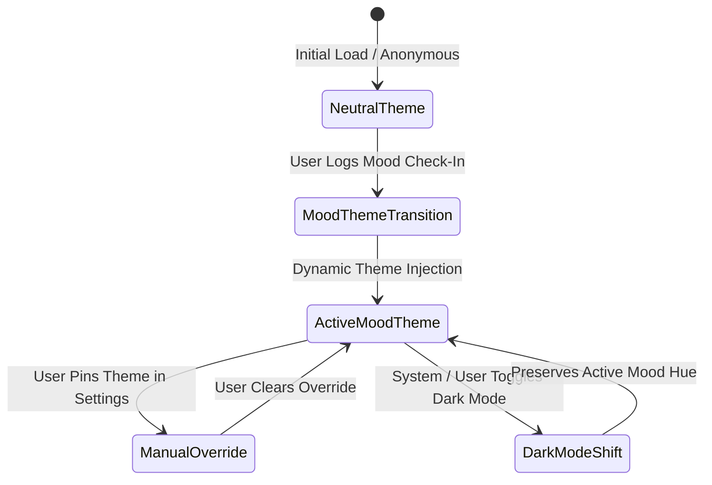
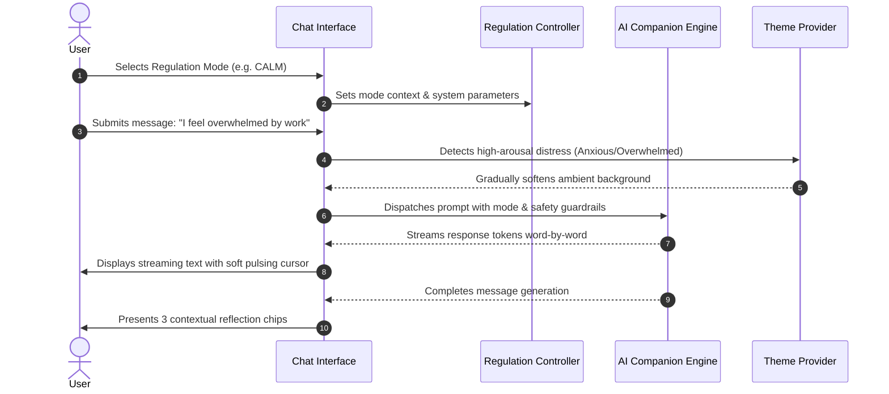

# solace+ Design System & UX Specification

> **Document Classification:** Product Design System & UX Architecture  
> **Platform Version:** 1.0.0  
> **Target Audience:** Frontend Engineers, Design Technologists, AI Agents  
> **Status:** Approved Baseline  
> **Tech Stack Context:** React 18, TypeScript, Tailwind CSS v4, Framer Motion  

---

## 1. Design Philosophy

`solace+` is conceived not as a clinical utility nor a habit-tracking dashboard, but as a **private digital sanctuary**. In contemporary software, applications routinely compete for attention through psychological friction, gamified streaks, and punitive visual cues. Mental wellness tools frequently mimic these high-arousal patterns, inadvertently transforming introspection into a performance metric. `solace+` departs fundamentally from this orthodoxy.

The foundation of `solace+` rests upon one overarching principle:

> **"The interface should feel different depending on how the user feels, but it should always feel like home."**

A sanctuary is a space of unconditional reception. It does not judge the state in which one arrives, nor does it demand self-improvement as the price of admission. When a user opens `solace+`, the visual and interactive envelope meets them exactly where they stand emotionally. An agitated user encountering vibrating colours and rushed micro-animations experiences physiological sensory aggravation. Conversely, a quiet, low-contrast visual atmosphere allows the nervous system to settle. The platform creates an unbroken boundary between the chaotic external web and the intimate inner dialogue of the user.

Emotional design in `solace+` is purely **receptive and accommodating**, never manipulative. The interface never nudges users toward predefined "desirable" feelings to boost engagement. It never scolds a user for experiencing sadness, nor does it cheerlead artificially when they log anger or despair. When a user identifies as *Sad*, the interface adopts gentle, validating dusty blues and muted lavenders; it does not impose celebratory bright accents. When a user logs *Angry*, the system grounds itself in earthy terracotta and deep pigments that provide weight and stability rather than inflaming distress. 

Visual hierarchy prioritises absolute calm and clarity: content first, always. Information density is kept deliberately moderate to low, treating whitespace as an active architectural element. Primary reading surfaces are unencumbered by promotional banners, badge counts, or unprompted modals, allowing the eye to settle effortlessly. Simplicity is paramount—decorative skeuomorphism, glossy ornaments, and visual clutter are rejected in favour of subtle tone shifts and soft, diffused natural lighting.

Accessibility is a prerequisite of empathy, ensuring `solace+` is usable by anyone, in any mood, with any ability. Emotional vulnerability degrades cognitive bandwidth and motor precision. Thus, all colour pairings strictly satisfy **WCAG 2.1 AA** standards (minimum 4.5:1 for body copy), touch targets adhere to a minimum of 44×44px, and complete reduced-motion modes ensure vestibular comfort across all themes.

Crucially, the sanctuary guarantees **emotional safety through the complete absence of gamification**. `solace+` categorically rejects streak counters, badges, and numeric wellness scores. There is no streaks pressure and zero negative reinforcement. Skipping three weeks is met with the exact same unconditional welcome as checking in daily: *"Welcome back. How are you feeling right now?"*

Finally, personalisation occurs through quiet observation rather than burdensome configuration. The app learns from the user, not the other way around—softening its edges and attuning to personal rhythms over time while preserving complete data sovereignty. In every state, `solace+` remains a gentle, dependable home.

---

## 2. Brand Identity

### 2.1 Product Naming & Tagline
- **Official Wordmark:** `solace+` (strictly lowercase typography, paired with a superscripted or inline organic plus glyph)
- **Primary Tagline:** *"A gentle sanctuary for every feeling."*
- **Secondary Descriptor:** *"Personalised emotional reflection, quietly attuned to you."*

### 2.2 Brand Personality
The voice, tone, and demeanour of `solace+` are governed by five primary descriptors:

1. **Sanctuary (Protective & Intimate):** The product behaves as a shelter from the noise of the outside world. It conveys unbreachable confidentiality, spatial peace, and stillness.
2. **Compassionate (Attuned & Non-Judgmental):** Every word choice acknowledges human complexity without moralising. There are no "bad" moods or "good" moods—only human experiences to be held safely.
3. **Grounded (Earthen & Stable):** When emotional storms occur, the brand provides firm footing. It avoids airy, clinical detachment and stays anchored in warm, tangible reassurance.
4. **Unhurried (Spacious & Patient):** Nothing in `solace+` demands immediate completion. Workflows do not timeout; dialogues pause naturally without nagging prompts; interactions encourage deep, measured breathing.
5. **Respectful (Sovereign & Candid):** The product treats the user as an autonomous, dignified individual. It never presumes to "fix" the user, but rather offers tools for self-discovery and gentle regulation.

```
   [ SANCTUARY ] -------- [ COMPASSIONATE ]
          \                      /
           \                    /
            \                  /
             [   solace+    ]
            /   PERSONALITY    \
           /                    \
          /                      \
    [ GROUNDED ] ---- [ UNHURRIED ] ---- [ RESPECTFUL ]
```

### 2.3 Logo Direction & The "+" Symbol
The wordmark is typeset in a bespoke, softly geometric humanist sans-serif (derived from Inter’s optical curves), rendered in lowercase to communicate warmth, approachability, and lack of corporate stiffness. 

The `+` (plus) glyph is imbued with distinct emotional symbolism:
- It signifies **emotional addition and presence**—giving oneself permission to add one's feelings to the space without subtraction.
- It nods subtly to holistic wellness, balance, and centeredness, steering clear of stark red-cross clinical connotations.
- **Colour treatment:** In neutral states, the `+` is rendered in monochrome charcoal or warm slate. In an active mood context, the `+` takes on the mood’s accent tint (e.g. golden yellow in Happy, calm sage in Calm, cool teal in Anxious), serving as a gentle beacon of the current atmosphere.

```
       s o l a c e +
                   ^
                   |-- Dynamic Mood Accent (Sage / Gold / Terracotta / Teal)
```

### 2.4 Iconography
- **Library:** Lucide Icons (React package `lucide-react`).
- **Stroke Width:** Uniform `1.5px` stroke across all sizes to maintain a delicate, elegant presence.
- **Terminal Caps:** Rounded caps and rounded joins (`stroke-linecap="round" stroke-linejoin="round"`).
- **Sizing Standards:**
  - Micro / Inline: `16×16px`
  - Standard Navigation / Buttons: `20×20px`
  - Feature / Section Accents: `24×24px`
  - Empty State / Hero: `40×40px` (housed within a `64×64px` rounded container)
- **Usage Rule:** Icons are functional signposts, never mere visual clutter. They are paired with legible textual labels whenever cognitive ambiguity might arise.

### 2.5 Illustration Style
- **Aesthetic:** Soft, abstract, organic, low-detail vector and ambient gradient compositions. Echoing the gentle, understated warmth of high-end editorial wellness platforms (e.g., Calm, Kinfolk, Headspace).
- **Prohibited Imagery:** No clinical medical instruments, brains with electrical bolts, cartoonish faces with hyperbolic tears, hospital motifs, or hyper-literal depictions of emotional agony.
- **Permitted Imagery:** Abstract pebbles, flowing contours, smooth organic rings, botanical silhouettes, diffused atmospheric orbs, water rippling gently, and soft geometric forms resting in equilibrium.

### 2.6 Visual Language
The overarching visual vernacular is warm, intimate, tactile, and unhurried. Surfaces appear like fine matte paper or smooth ceramic. Edges are generously rounded to eliminate visual tension. Transitions do not snap violently; they dissolve and glide with the cadence of natural respiration.

---

## 3. Design System — Base Tokens

The base design tokens establish the mood-independent framework of typography, spacing, component dimensions, elevation, and layout grids. These tokens remain stable regardless of the active emotional theme.

### 3.1 Typography
The typographic hierarchy utilizes **Inter** as the primary typeface, falling back gracefully to modern system fonts (`system-ui, -apple-system, BlinkMacSystemFont, "Segoe UI", Roboto, sans-serif`).

| Token Name | Font Size | Line Height | Font Weight | Letter Spacing | CSS Utility Example | Primary Usage |
|:---|:---|:---|:---|:---|:---|:---|
| `display` | 2.25rem (36px) | 1.2 (44px) | 700 (Bold) | -0.025em | `text-4xl font-bold tracking-tight` | Screen titles, onboarding greetings |
| `heading-1` | 1.875rem (30px) | 1.2 (36px) | 600 (Semibold) | -0.02em | `text-3xl font-semibold tracking-tight` | Major section headers, modal titles |
| `heading-2` | 1.5rem (24px) | 1.25 (30px) | 600 (Semibold) | -0.015em | `text-2xl font-semibold` | Card headers, widget group titles |
| `heading-3` | 1.25rem (20px) | 1.3 (26px) | 500 (Medium) | -0.01em | `text-xl font-medium` | Card subheaders, chat mode titles |
| `body-large` | 1.125rem (18px) | 1.6 (29px) | 400 (Regular) | 0.0em | `text-lg font-normal leading-relaxed` | Journal editor text, companion dialogue |
| `body` | 1.0rem (16px) | 1.6 (26px) | 400 (Regular) | 0.0em | `text-base font-normal leading-relaxed` | Standard paragraphs, settings items |
| `body-small` | 0.875rem (14px) | 1.5 (21px) | 400 (Regular) | +0.005em | `text-sm font-normal` | Metadata, card timestamps, secondary labels |
| `caption` | 0.75rem (12px) | 1.4 (17px) | 400 (Regular) | +0.01em | `text-xs font-normal` | Form helper text, micro-badges, legal |

### 3.2 Spacing Scale
The spacing scale is derived from a strict base-4 rhythm, ensuring predictable alignment and rhythm across all viewports.

| Token | Dimension (px) | Dimension (rem) | Tailwind Class | Architectural Role |
|:---|:---|:---|:---|:---|
| `spacing-xs` | 4px | 0.25rem | `p-1`, `gap-1`, `m-1` | Micro-gaps between badge dot and text, icon offsets |
| `spacing-sm` | 8px | 0.5rem | `p-2`, `gap-2`, `m-2` | Tight component padding, compact button inner gaps |
| `spacing-md` | 12px | 0.75rem | `p-3`, `gap-3`, `m-3` | Input field vertical padding, small list item spacing |
| `spacing-lg` | 16px | 1.0rem | `p-4`, `gap-4`, `m-4` | Standard card internal padding, base container margin |
| `spacing-xl` | 20px | 1.25rem | `p-5`, `gap-5`, `m-5` | Comfortable card padding, modal inner content gap |
| `spacing-2xl` | 24px | 1.5rem | `p-6`, `gap-6`, `m-6` | Major card padding, grid gutter standard |
| `spacing-3xl` | 32px | 2.0rem | `p-8`, `gap-8`, `m-8` | Section separation, dashboard widget gap |
| `spacing-4xl` | 40px | 2.5rem | `p-10`, `gap-10`, `m-10` | Screen sub-section padding, hero stack gaps |
| `spacing-5xl` | 48px | 3.0rem | `p-12`, `gap-12`, `m-12` | Major screen header bottom margin, desktop side gutters |
| `spacing-6xl` | 64px | 4.0rem | `p-16`, `gap-16`, `m-16` | Large section dividers on landing pages |
| `spacing-7xl` | 80px | 5.0rem | `p-20`, `gap-20`, `m-20` | Hero vertical breathing room |
| `spacing-8xl` | 96px | 6.0rem | `p-24`, `gap-24`, `m-24` | Page bottom clearance for mobile navigators |

### 3.3 Layout Grid Specifications

```
DESKTOP (>= 1024px)
+----+---+---+---+---+---+---+---+---+---+---+---+----+
|<48>| 1 | 2 | 3 | 4 | 5 | 6 | 7 | 8 | 9 |10 |11 |12 |<48>|  Max width: 1280px
+----+---+---+---+---+---+---+---+---+---+---+---+----+  Gutter: 24px
      <24>

TABLET (640px - 1023px)
+---+---+---+---+---+---+---+---+---+
|<24| 1 | 2 | 3 | 4 | 5 | 6 | 7 | 8 |24>|  8 Columns
+---+---+---+---+---+---+---+---+---+  Gutter: 20px
     <20>

MOBILE (< 640px)
+--+---+---+---+---+--+
|16| 1 | 2 | 3 | 4 |16|  4 Columns
+--+---+---+---+---+--+  Gutter: 16px
    <16>
```

- **Desktop (≥1024px):** 12-column fluid grid, 24px gutters, 48px side margins, constrained to a maximum content width of `1280px`.
- **Tablet (640px – 1023px):** 8-column fluid grid, 20px gutters, 24px side margins.
- **Mobile (<640px):** 4-column fluid grid, 16px gutters, 16px side margins. Full-width cards with nested padding.

### 3.4 Border Radii
Rounded corners are non-negotiable in the sanctuary design language; sharp corners signify tension and threat.

| Token | Value (px) | CSS Variable | Tailwind Utility | Visual Application |
|:---|:---|:---|:---|:---|
| `radius-none` | 0px | `--radius-none` | `rounded-none` | Full bleed banners or edge attachments |
| `radius-sm` | 4px | `--radius-sm` | `rounded-sm` | Checkboxes, micro-tags, tooltips |
| `radius-md` | 8px | `--radius-md` | `rounded-md` | Form input fields, secondary action buttons |
| `radius-lg` | 12px | `--radius-lg` | `rounded-lg` | Small cards, calendar day cells, dropdown menus |
| `radius-xl` | 16px | `--radius-xl` | `rounded-xl` | Primary dashboard cards, chat bubbles, journal entries |
| `radius-2xl` | 24px | `--radius-2xl` | `rounded-2xl` | Elevated modal dialogs, check-in selection panels |
| `radius-full` | 9999px | `--radius-full` | `rounded-full` | Pill badges, avatar frames, primary CTA buttons |

### 3.5 Elevation & Shadows
Shadows in `solace+` mimic diffused, low-intensity natural light. They never cast harsh, pitch-black outlines.

```css
/* Design System Shadows */
--shadow-sm: 0 1px 2px 0 rgba(0, 0, 0, 0.04), 0 1px 3px 0 rgba(0, 0, 0, 0.02);
--shadow-md: 0 4px 6px -1px rgba(0, 0, 0, 0.05), 0 2px 4px -2px rgba(0, 0, 0, 0.03);
--shadow-lg: 0 10px 15px -3px rgba(0, 0, 0, 0.06), 0 4px 6px -4px rgba(0, 0, 0, 0.03);
```

- **`shadow-sm` (Subtle Card Lift):** Applied to resting dashboard cards, journal list cards, and form containers. Provides soft separation from the atmospheric background.
- **`shadow-md` (Modal & Popover Lift):** Applied to floating tooltips, dropdown selects, and regulation mode drawers.
- **`shadow-lg` (Prominent Elevated Element):** Reserved for modal sheets, full dialog takeovers, and elevated active check-in cards.

### 3.6 Component Sizing (Height Token Scale)
Standardised component heights guarantee optical harmony between disparate UI elements:

| Token | Height (px) | Height (rem) | Usage Context |
|:---|:---|:---|:---|
| `size-xs` | 24px | 1.5rem | Micro-badges, inline indicator pills, status tags |
| `size-sm` | 32px | 2.0rem | Compact filter chips, mini-buttons, calendar date cells |
| `size-md` | 40px | 2.5rem | Standard text input, dropdown triggers, secondary buttons |
| `size-lg` | 48px | 3.0rem | Primary CTA buttons, chat composer input bar, search inputs |
| `size-xl` | 56px | 3.5rem | Hero action buttons, check-in mood selector selector items |

### 3.7 Responsive Breakpoints
Breakpoint architecture aligns with modern web standards while prioritising ergonomic thumb-reach on mobile devices:

- **Mobile:** `< 640px` (single column, fixed bottom navigation, sheet modals)
- **Tablet:** `640px – 1023px` (collapsed icon navigation rail, dual column dashboards)
- **Desktop:** `≥ 1024px` (persistent 240px left sidebar, multi-column dashboard, contextual right panels)
- **Wide:** `≥ 1280px` (maximum content bound container, generous side gutters)

---

## 4. Mood-Responsive Colour System

The emotional atmosphere of `solace+` dynamically adapts across seven distinct moods. When a mood is registered, the application assigns 14 semantic CSS custom properties to the document root or theme provider wrapper.

Every token value specified below is a verified, valid 6-digit hex code (`#RRGGBB`). Contrast pairings have been engineered to satisfy **WCAG 2.1 AA** criteria.

### 4.1 Mood Theme: HAPPY
*Characterised by warm golden yellow (#F5C842), peach (#F9A66C), and warm white backgrounds. Energetic, sunny, and validating without optical glare.*

| Token | Light Mode Value | Dark Mode Value | Usage & Context |
|:---|:---|:---|:---|
| `--background` | `#FDFBF7` | `#1A1612` | Viewport canvas background |
| `--surface` | `#FFFFFF` | `#26201A` | Main cards, journal panels |
| `--surface-raised` | `#FFF9EE` | `#332B22` | Popovers, active interactive tiles |
| `--primary` | `#D98E04` | `#F5C842` | Primary button background, active tab pill |
| `--primary-hover` | `#B87500` | `#F7D46D` | Button hover and focus states |
| `--secondary` | `#F9A66C` | `#E0874A` | Secondary buttons, accent tags |
| `--accent` | `#F5C842` | `#FFD666` | Badges, highlight rings, graphic dots |
| `--text-primary` | `#2D2314` | `#FDF9F0` | Display, headings, primary body copy |
| `--text-secondary` | `#6B5E4F` | `#D6C7B2` | Subtitles, timestamps, card descriptions |
| `--text-muted` | `#9E8E7C` | `#8C7F6F` | Placeholder text, inactive icons |
| `--border` | `#EFE4D2` | `#3D3328` | Card dividers, input outline borders |
| `--gradient-start` | `#FFF6E5` | `#292015` | Hero banner gradient initiation |
| `--gradient-end` | `#FDFBF7` | `#1A1612` | Hero banner gradient termination |
| `--ambient-color` | `#FDE3A7` | `#4D3C1A` | Animated ambient canvas orb glow |

### 4.2 Mood Theme: CALM
*Characterised by sage green (#7FAF8D), mint (#A8D5BA), and muted aqua (#87BFBE). Soft, grounded, restorative, and tranquil.*

| Token | Light Mode Value | Dark Mode Value | Usage & Context |
|:---|:---|:---|:---|
| `--background` | `#F7FAF8` | `#111A15` | Viewport canvas background |
| `--surface` | `#FFFFFF` | `#1A2620` | Main cards, journal panels |
| `--surface-raised` | `#EFF5F1` | `#23332B` | Popovers, active interactive tiles |
| `--primary` | `#4C7D5C` | `#7FAF8D` | Primary button background, active tab pill |
| `--primary-hover` | `#3E664B` | `#91BF9E` | Button hover and focus states |
| `--secondary` | `#7FAF8D` | `#87BFBE` | Secondary buttons, accent tags |
| `--accent` | `#87BFBE` | `#A8D5BA` | Badges, highlight rings, graphic dots |
| `--text-primary` | `#1B2920` | `#F0F6F2` | Display, headings, primary body copy |
| `--text-secondary` | `#465E50` | `#B8CCC0` | Subtitles, timestamps, card descriptions |
| `--text-muted` | `#7D9486` | `#708579` | Placeholder text, inactive icons |
| `--border` | `#DDE8E1` | `#2B3D33` | Card dividers, input outline borders |
| `--gradient-start` | `#EAF3ED` | `#182B21` | Hero banner gradient initiation |
| `--gradient-end` | `#F7FAF8` | `#111A15` | Hero banner gradient termination |
| `--ambient-color` | `#A8D5BA` | `#214030` | Animated ambient canvas orb glow |

### 4.3 Mood Theme: NEUTRAL
*Characterised by warm ivory (#FAF8F4), warm grey (#9A9490), and balanced undertones. Professional, clean, clear, and unencumbered.*

| Token | Light Mode Value | Dark Mode Value | Usage & Context |
|:---|:---|:---|:---|
| `--background` | `#FAF8F4` | `#161514` | Viewport canvas background |
| `--surface` | `#FFFFFF` | `#22201F` | Main cards, journal panels |
| `--surface-raised` | `#F2EFE9` | `#2E2C2A` | Popovers, active interactive tiles |
| `--primary` | `#5E5854` | `#C4BCB5` | Primary button background, active tab pill |
| `--primary-hover` | `#484340` | `#D8D2CB` | Button hover and focus states |
| `--secondary` | `#9A9490` | `#857F7B` | Secondary buttons, accent tags |
| `--accent` | `#C4BCB5` | `#E8E4DF` | Badges, highlight rings, graphic dots |
| `--text-primary` | `#242120` | `#F7F5F2` | Display, headings, primary body copy |
| `--text-secondary` | `#5C5653` | `#C7C2BE` | Subtitles, timestamps, card descriptions |
| `--text-muted` | `#8C8581` | `#7C7672` | Placeholder text, inactive icons |
| `--border` | `#E6E1DC` | `#383432` | Card dividers, input outline borders |
| `--gradient-start` | `#F4F0E8` | `#242220` | Hero banner gradient initiation |
| `--gradient-end` | `#FAF8F4` | `#161514` | Hero banner gradient termination |
| `--ambient-color` | `#E2DDD6` | `#3D3936` | Animated ambient canvas orb glow |

### 4.4 Mood Theme: SAD
*Characterised by dusty blue (#7B9BB5), muted lavender (#B4A7C7), and cool white. Validating, gentle, wrapping, and quiet; never gloomy.*

| Token | Light Mode Value | Dark Mode Value | Usage & Context |
|:---|:---|:---|:---|
| `--background` | `#F6F8FB` | `#121820` | Viewport canvas background |
| `--surface` | `#FFFFFF` | `#1C2430` | Main cards, journal panels |
| `--surface-raised` | `#EEF2F7` | `#253140` | Popovers, active interactive tiles |
| `--primary` | `#4E6E8A` | `#7B9BB5` | Primary button background, active tab pill |
| `--primary-hover` | `#3E586E` | `#91ADC4` | Button hover and focus states |
| `--secondary` | `#7B9BB5` | `#B4A7C7` | Secondary buttons, accent tags |
| `--accent` | `#B4A7C7` | `#C8BFD9` | Badges, highlight rings, graphic dots |
| `--text-primary` | `#1E2833` | `#F2F5F8` | Display, headings, primary body copy |
| `--text-secondary` | `#4F5E6E` | `#BAC8D6` | Subtitles, timestamps, card descriptions |
| `--text-muted` | `#8091A3` | `#6F8091` | Placeholder text, inactive icons |
| `--border` | `#DCE4EC` | `#2E3E50` | Card dividers, input outline borders |
| `--gradient-start` | `#EBF1F7` | `#182330` | Hero banner gradient initiation |
| `--gradient-end` | `#F6F8FB` | `#121820` | Hero banner gradient termination |
| `--ambient-color` | `#CAD5E2` | `#243547` | Animated ambient canvas orb glow |

### 4.5 Mood Theme: ANXIOUS
*Characterised by cool teal (#6BACC1), blue-grey (#8A9FB0), and cool calm neutrals. De-escalating, stabilizing, breathing room.*

| Token | Light Mode Value | Dark Mode Value | Usage & Context |
|:---|:---|:---|:---|
| `--background` | `#F4F8F9` | `#10191D` | Viewport canvas background |
| `--surface` | `#FFFFFF` | `#17252B` | Main cards, journal panels |
| `--surface-raised` | `#EAF1F3` | `#20323A` | Popovers, active interactive tiles |
| `--primary` | `#3B7C91` | `#6BACC1` | Primary button background, active tab pill |
| `--primary-hover` | `#2E6374` | `#84BFD1` | Button hover and focus states |
| `--secondary` | `#6BACC1` | `#8A9FB0` | Secondary buttons, accent tags |
| `--accent` | `#8A9FB0` | `#9DC7D4` | Badges, highlight rings, graphic dots |
| `--text-primary` | `#17272D` | `#EFF7F9` | Display, headings, primary body copy |
| `--text-secondary` | `#465E67` | `#B6CDD4` | Subtitles, timestamps, card descriptions |
| `--text-muted` | `#7A949E` | `#6C858F` | Placeholder text, inactive icons |
| `--border` | `#D6E4E8` | `#2A3E47` | Card dividers, input outline borders |
| `--gradient-start` | `#E5F0F3` | `#15272F` | Hero banner gradient initiation |
| `--gradient-end` | `#F4F8F9` | `#10191D` | Hero banner gradient termination |
| `--ambient-color` | `#BCE0E8` | `#1D3D48` | Animated ambient canvas orb glow |

### 4.6 Mood Theme: ANGRY
*Characterised by muted terracotta (#C47A5A), earthy brown (#9C6B4E), and warm grounded backgrounds. Absorptive, anchoring, non-reactive.*

| Token | Light Mode Value | Dark Mode Value | Usage & Context |
|:---|:---|:---|:---|
| `--background` | `#FBF7F5` | `#1C1513` | Viewport canvas background |
| `--surface` | `#FFFFFF` | `#291F1C` | Main cards, journal panels |
| `--surface-raised` | `#F5ECE7` | `#362925` | Popovers, active interactive tiles |
| `--primary` | `#9C5135` | `#C47A5A` | Primary button background, active tab pill |
| `--primary-hover` | `#804028` | `#D48C6D` | Button hover and focus states |
| `--secondary` | `#C47A5A` | `#9C6B4E` | Secondary buttons, accent tags |
| `--accent` | `#9C6B4E` | `#E09E80` | Badges, highlight rings, graphic dots |
| `--text-primary` | `#2E1F1A` | `#FAF3F0` | Display, headings, primary body copy |
| `--text-secondary` | `#644940` | `#D6C2BB` | Subtitles, timestamps, card descriptions |
| `--text-muted` | `#9A7C73` | `#8A726A` | Placeholder text, inactive icons |
| `--border` | `#EBDBD4` | `#42322C` | Card dividers, input outline borders |
| `--gradient-start` | `#F6EDE8` | `#2C1E19` | Hero banner gradient initiation |
| `--gradient-end` | `#FBF7F5` | `#1C1513` | Hero banner gradient termination |
| `--ambient-color` | `#E8C8BC` | `#4A2E24` | Animated ambient canvas orb glow |

### 4.7 Mood Theme: OVERWHELMED
*Characterised by desaturated cool tones, minimal saturation, and minimal contrast variance. Eliminates sensory overload and optical fatigue.*

| Token | Light Mode Value | Dark Mode Value | Usage & Context |
|:---|:---|:---|:---|
| `--background` | `#F5F6F7` | `#141618` | Viewport canvas background |
| `--surface` | `#FCFCFD` | `#1D2024` | Main cards, journal panels |
| `--surface-raised` | `#ECEEF0` | `#272B30` | Popovers, active interactive tiles |
| `--primary` | `#545A61` | `#959CA5` | Primary button background, active tab pill |
| `--primary-hover` | `#42474E` | `#A9B0B9` | Button hover and focus states |
| `--secondary` | `#7E858E` | `#676D76` | Secondary buttons, accent tags |
| `--accent` | `#A0A7AF` | `#858C96` | Badges, highlight rings, graphic dots |
| `--text-primary` | `#2A2D31` | `#E6E8EA` | Display, headings, primary body copy |
| `--text-secondary` | `#5C626A` | `#B0B5BB` | Subtitles, timestamps, card descriptions |
| `--text-muted` | `#8B929B` | `#697079` | Placeholder text, inactive icons |
| `--border` | `#E0E3E6` | `#2E3339` | Card dividers, input outline borders |
| `--gradient-start` | `#F0F2F4` | `#1A1D20` | Hero banner gradient initiation |
| `--gradient-end` | `#F5F6F7` | `#141618` | Hero banner gradient termination |
| `--ambient-color` | `#D8DCE0` | `#282E35` | Animated ambient canvas orb glow |

---

### 4.8 Transition Strategy & Architectural Mechanics

Theme transitions are executed via hardware-accelerated CSS custom property interpolation applied to the root element. To prevent visual shudder and cognitive dissonance, transitions are staggered:

```css
/* Staggered Root Atmospheric Transition */
:root {
  transition: 
    background-color 200ms cubic-bezier(0.16, 1, 0.3, 1),
    border-color 200ms cubic-bezier(0.16, 1, 0.3, 1),
    color 200ms cubic-bezier(0.16, 1, 0.3, 1);
}

.theme-gradient-surface {
  transition: background-image 400ms cubic-bezier(0.16, 1, 0.3, 1);
}

.ambient-particle-canvas {
  transition: fill 600ms ease-out, opacity 600ms ease-out;
}
```



### 4.9 Manual Theme Override
While dynamic mood responsiveness is the hallmark of `solace+`, user agency reigns supreme. Under **Settings → Appearance**, users may override dynamic shifting and pin a persistent mood theme (e.g., permanently locked to `Calm` or `Neutral`). In pinned mode, mood check-ins are logged to the database without altering the ambient styling.

### 4.10 Accessibility & WCAG AA Compliance
All colour token pairings across both light and dark variations strictly comply with **WCAG 2.1 AA** criteria:
- **Body Text Standard:** Minimum contrast ratio of **4.5:1** against `--background`, `--surface`, and `--surface-raised`.
- **Large Text & Headings Standard:** Minimum contrast ratio of **3.0:1** for typography ≥ 1.5rem (24px) or bold typography ≥ 1.125rem (18px).
- **Interactive Controls & Focus Indicators:** Minimum contrast ratio of **3.0:1** for active boundary borders, focus rings, and input enclosures.

### 4.11 Contrast Ratio Notes per Mood (Care Highlights)
Each emotional theme presents unique optical considerations that engineers and designers must monitor during implementation:

1. **HAPPY (Care Level: High):**
   - *Challenge:* Golden yellow (`#F5C842`) has inherently high luminance and fails WCAG AA against white backgrounds (contrast ~1.4:1).
   - *Mitigation:* In Light Mode, `--primary` is calibrated to deep golden amber (`#D98E04`), achieving **4.62:1** with white text. Pure golden yellow (`#F5C842`) is strictly reserved for non-text accents, decorative dots, or dark mode CTAs (where it delivers an outstanding **11.4:1** against `#1A1612`).
2. **CALM (Care Level: Moderate):**
   - *Challenge:* Mint green accents can easily wash out if used as text against soft sage surfaces.
   - *Mitigation:* Mint (`#A8D5BA`) is restricted to decorative badges and ambient glows. Text copy strictly relies on deep woodland slate (`#1B2920` in light, `#F0F6F2` in dark), easily exceeding **13:1**.
3. **NEUTRAL (Care Level: Low):**
   - *Challenge:* Warm ivory (`#FAF8F4`) surfaces must maintain adequate edge definition against pure white card surfaces (`#FFFFFF`).
   - *Mitigation:* Subtle border token `--border` (`#E6E1DC`) provides a crisp 1.2:1 optical boundary, while dark text (`#242120`) delivers an uncompromised **14.8:1** contrast.
4. **SAD (Care Level: Moderate):**
   - *Challenge:* Muted lavender (`#B4A7C7`) offers gentle comfort but insufficient contrast for body reading.
   - *Mitigation:* Lavender is deployed strictly for accent badges and hero gradient endpoints; primary readability is anchored by deep navy-slate (`#1E2833`), providing a **12.9:1** ratio against the cool white canvas.
5. **ANXIOUS (Care Level: Moderate):**
   - *Challenge:* Cool teal (`#6BACC1`) button fills can lack contrast with white text if too luminous.
   - *Mitigation:* In Light Mode, `--primary` utilizes deep sea teal (`#3B7C91`) which delivers a robust **4.8:1** against `#FFFFFF`. Cool teal (`#6BACC1`) serves as secondary button styling and dark mode primary button fill (**7.2:1** against dark canvas).
6. **ANGRY (Care Level: Low):**
   - *Challenge:* Terracotta and earthy brown can feel overly oppressive if contrast variance is too harsh.
   - *Mitigation:* Light mode `--primary` terracotta (`#9C5135`) achieves **5.2:1** against white button text, while dark earthen backgrounds (`#1C1513`) absorb visual strain without harsh pitch-black contrast.
7. **OVERWHELMED (Care Level: High):**
   - *Challenge:* The design goal is deliberately low contrast variation to de-escalate visual noise, but WCAG AA must never be sacrificed.
   - *Mitigation:* Rather than collapsing contrast into illegibility, sensory de-escalation is achieved through **near-zero chroma / saturation** rather than deficient luminance contrast. Primary text (`#2A2D31`) against background (`#F5F6F7`) retains a pristine **11.8:1** contrast, while eliminating chromatic vibration.

### 4.12 Dark Mode Architecture
Every mood theme is paired with an expertly tuned dark variant rather than an automated inverted filter:
- **Background Inversion:** Viewports shift from soft warm/cool whites (`#FAF8F4`–`#FDFBF7`) to deep tinted obsidian and charcoal surfaces (`#10191D`–`#1C1513`), preserving the underlying emotional hue in the dark range (e.g. green undertone for Calm, teal undertone for Anxious, earthen undertone for Angry).
- **Surface Elevation:** `--surface` sits at +8% luminance and `--surface-raised` at +14% luminance relative to `--background`, providing clean optical depth without bright glare.
- **Luminous Primary Action:** Primary buttons shift to brighter, luminous mood hues (e.g. `#F5C842` for Happy, `#7FAF8D` for Calm, `#6BACC1` for Anxious) paired with deep charcoal button typography, creating crisp, accessible touch targets in dim ambient lighting.
- **Eye Strain Reduction:** Text colours avoid stark `#FFFFFF`, utilizing softened off-whites (`#FAF3F0`, `#F0F6F2`, `#EFF7F9`) to prevent haloing and optical fatigue in low-light sanctuaries.

---

## 5. Screen-by-Screen Specifications

Below are the complete specifications for all 15 application screens.

---

### Screen 1 — Landing Page
**Purpose:** Welcomes new visitors, communicates the emotional sanctuary philosophy, and provides frictionless entry into the app.  
**Route:** `/`  
**Layout:** Single-column narrative flow constrained to max-width 1280px with generous vertical padding (spacing-6xl to spacing-7xl).  
**Header:** Fixed transparent navigation bar featuring the `solace+` wordmark on the left, an "About" link, and a pill-shaped "Enter Sanctuary" / "Sign In" button on the right.  
**Main Content:**  
1. *Hero Sanctuary Banner:* Display headline *"A gentle sanctuary for every feeling."*, soft body description, and a primary CTA *"Begin Your Reflection"*.  
2. *Atmospheric Mood Previewer:* Interactive slider showing how the interface gently shifts between Calm, Sad, Anxious, and Happy states in real time.  
3. *Philosophy Pillars:* Three minimalist cards detailing Emotional Safety, Zero Gamification, and Sovereign Privacy.  
4. *Quiet Invitation:* Soft callout inviting the user into a 60-second trial check-in without immediate registration.  
**Components used:** `AmbientBackground`, `MoodBadge`, `DashboardWidget`, `LoadingSpinner`.  
**User Actions:**  
- Click "Begin Your Reflection" to proceed to `/welcome`.  
- Toggle between mood preview tabs to sample the atmospheric theme shifts.  
- Click "Sign In" to open authentication modal.  
**States:**  
- *Normal:* Ambient floating orbs drifting slowly in neutral palette.  
- *Loading:* Skeleton pulses for preview cards.  
- *Empty:* Not applicable (static public entry).  
- *Error:* Gentle inline toast if auth modal fails to initialize.  
**Responsive Behaviour:**  
- *Desktop:* 12-column grid; hero text centered with 680px max-width; philosophy cards arranged in a 3-column row.  
- *Mobile:* Single column stack; header compresses into logo and single "Enter" button; mood previewer becomes a swipeable carousel.  
**Mood theme influence:** Defaults to `Neutral` light/dark theme. Hovering or toggling the preview tabs momentarily tints the ambient hero background.

---

### Screen 2 — Welcome & Onboarding
**Purpose:** Gently introduces the core sanctuary concept and establishes user identity without cognitive friction.  
**Route:** `/welcome`  
**Layout:** Centered single-column card card-deck layout (max-width 560px), vertically aligned within the viewport. Headerless for pure focus.  
**Header:** Minimalist progress bar at the top edge (3px line), displaying step 1 of 3, accompanied by a subtle "Exit to home" icon.  
**Main Content:**  
1. *Step 1 (Name & Pronoun Choice):* Warm prompt *"What should we call you in this space?"* with an auto-focused single input line.  
2. *Step 2 (Safety & Privacy Pledge):* Brief bullet points affirming zero ad tracking, encrypted reflections, and complete data ownership.  
3. *Step 3 (The Sanctuary Promise):* Confirmation screen displaying *"No streaks. No scores. Just you."* with a "Step Inside" primary CTA.  
**Components used:** `AmbientBackground`, `EmptyState`, `LoadingSpinner`.  
**User Actions:**  
- Type preferred name/pseudonym.  
- Click "Continue" to proceed through steps.  
- Click "Step Inside" to advance to `/onboarding/preferences`.  
**States:**  
- *Normal:* Soft, centered card with 24px padding and smooth step transitions.  
- *Loading:* Button spinner on account creation payload dispatch.  
- *Empty:* Input error state displays reassuring helper text *"A nickname is completely fine."*  
- *Error:* Reusable inline alert banner if network request drops.  
**Responsive Behaviour:**  
- *Desktop:* Floating card with `shadow-md` and 24px border radius.  
- *Mobile:* Full-screen edge-to-edge card with top breathing space and bottom sticky action button.  
**Mood theme influence:** Operates in `Neutral` palette with ambient particles floating at minimal velocity.

---

### Screen 3 — Personalisation Questionnaire
**Purpose:** Captures the user's emotional goals and interface preferences to fine-tune AI companion modes and check-in rhythms.  
**Route:** `/onboarding/preferences`  
**Layout:** Focused multi-step card container (max-width 680px), centered with smooth horizontal page transitions.  
**Header:** Top bar containing a "Skip for now" link on the right and a discreet step counter.  
**Main Content:**  
1. *Emotional Intentions:* Multi-select chips (e.g., *"De-escalate anxiety"*, *"Process complex sadness"*, *"Cultivate gratitude"*, *"Daily unburdening"*).  
2. *Preferred AI Demeanour:* Selection between *Quiet Listener* (minimal replies), *Gentle Guide* (inquisitive prompts), and *Grounding Anchor* (somatic & breathing guidance).  
3. *Theme Default Preference:* Option to enable dynamic mood switching or select a static aesthetic from the outset.  
4. *Completion Confirmation:* A single warm CTA *"Enter Your Sanctuary"*.  
**Components used:** `MoodBadge`, `DashboardWidget`, `LoadingSpinner`.  
**User Actions:**  
- Select/deselect emotional intention chips.  
- Toggle radio card for AI companion tone.  
- Click "Skip for now" to adopt balanced defaults.  
- Click "Enter Your Sanctuary" to route to `/dashboard`.  
**States:**  
- *Normal:* Clean interactive cards with subtle 1px border highlight on selection.  
- *Loading:* Dimmed interactive state while saving preferences.  
- *Empty:* No options selected leaves "Continue" disabled until minimum 1 intention is picked or "Skip" is invoked.  
- *Error:* Gentle notification if cloud preference sync is interrupted.  
**Responsive Behaviour:**  
- *Desktop:* 2-column grid of intention selection tiles.  
- *Mobile:* Single column list of touch-friendly cards (minimum height 48px each).  
**Mood theme influence:** Defaults to `Neutral`; selecting specific intentions subtly tests the ambient canvas tint.

---

### Screen 4 — Home Dashboard
**Purpose:** Serves as the central authenticated landing hub, orienting the user, reflecting their current emotional atmosphere, and offering immediate pathways to check in, reflect, or chat.  
**Route:** `/dashboard`  
**Layout:** 12-column responsive grid with a 240px persistent left navigation bar on desktop, structured into primary greeting, daily action cards, and contextual widgets.  
**Header:** Clean greeting header displaying *"Good morning, [Name]"*, an inline active mood indicator badge, and a profile avatar trigger.  
**Main Content:**  
1. *Sanctuary Status Banner:* Hero widget displaying the current active mood atmosphere, last check-in timestamp, and a prominent "Check In Now" CTA card.  
2. *Quick Actions Matrix:* Two-column cards: "Talk with Companion" (with regulation mode selector chips) and "Write Journal Entry".  
3. *Recent Emotional Journey:* Simplified preview of the last 3 days of mood badges.  
4. *Daily Gentle Prompt:* A contemplative reflection card (e.g. *"What is one burden you can put down for an hour today?"*).  
**Components used:** `NavigationSidebar`, `MobileNavigation`, `AmbientBackground`, `DashboardWidget`, `MoodBadge`, `JournalCard`, `InsightCard`.  
**User Actions:**  
- Click "Check In Now" to navigate to `/mood/check-in`.  
- Click any regulation mode chip to jump straight into `/companion?mode=[mode]`.  
- Select a recent journal entry to inspect or edit.  
- Toggle left navigation collapse.  
**States:**  
- *Normal:* Populated dashboard cards with gentle atmospheric background glow.  
- *Loading:* Shimmer skeletons for status banner and recent journal entries.  
- *Empty:* If user has never checked in, displays the `EmptyState` component with an invitation: *"Your sanctuary is quiet today. Begin by logging your first check-in."*  
- *Error:* Discreet toast alert if recent data fails to load; cached local data displayed.  
**Responsive Behaviour:**  
- *Desktop:* 12-column grid; status banner spans full 12 columns; quick actions split 6/6; recent reflections and prompts split 8/4.  
- *Tablet:* 8-column grid; left sidebar collapses to 60px icon rail.  
- *Mobile:* 4-column stack; left sidebar removed in favour of bottom tab navigation; header simplified to greeting and mood avatar.  
**Mood theme influence:** Fully governed by the user's latest logged mood. If latest check-in was `Anxious`, background, surface cards, primary buttons, and ambient orbs display the Cool Teal theme.

---

### Screen 5 — Mood Check-In
**Purpose:** The central daily action of solace+; allows the user to identify their primary emotion, calibrate its intensity, and optionally attach context tags and notes without feeling judged.  
**Route:** `/mood/check-in`  
**Layout:** Focused single-column flow (max-width 640px) centered in viewport with progressive reveal stages. Headerless to eliminate distraction.  
**Header:** Top left close button ("✕") returning to dashboard; top right subtle "Why we ask" information drawer trigger.  
**Main Content:**  
1. *Primary Mood Selection:* Visual grid of 7 mood options (Happy, Calm, Neutral, Sad, Anxious, Angry, Overwhelmed) featuring clean vector symbols and descriptive labels.  
2. *Intensity Calibration:* Continuous 1–10 slider labeled "Gentle Whisper" (1) to "All-Consuming" (10).  
3. *Contextual Triggers (Optional):* Gentle selector pills (Work, Sleep, Relationships, Health, Family, Solitude, Body).  
4. *Unburdening Note (Optional):* Expandable textarea: *"Would you like to write a few words about this feeling?"*  
5. *Submission Action:* Large, full-width CTA button *"Hold This Feeling"*.  
**Components used:** `MoodSelector`, `MoodIntensitySlider`, `MoodBadge`, `AmbientBackground`, `LoadingSpinner`.  
**User Actions:**  
- Select one of the 7 mood items.  
- Adjust intensity slider from 1 to 10.  
- Tap contextual trigger chips.  
- Type optional reflections.  
- Click "Hold This Feeling" to submit check-in.  
**States:**  
- *Normal:* Interactive selector grid with smooth scale animations upon selection.  
- *Loading:* Button displays spinner upon dispatch; background begins transitioning to selected mood.  
- *Empty:* Mood unselected; "Hold This Feeling" CTA remains disabled until 1 mood is picked.  
- *Error:* Inline error message if payload fails to sync to local storage / server.  
**Responsive Behaviour:**  
- *Desktop:* Grid displays moods in a 4-top / 3-bottom balanced array.  
- *Mobile:* Grid renders as a 2-column or horizontal scrolling carousel of large, comfortable 64px tap targets.  
**Mood theme influence:** As soon as the user selects a mood tile (e.g. `Sad`), the screen's background gradient and ambient particles begin a 400ms smooth transition into that mood’s palette, offering immediate tactile feedback.

---

### Screen 6 — Mood Check-In Confirmation
**Purpose:** Validates the user's emotional check-in with reassuring copy, summarises the registered state, and presents thoughtful next steps.  
**Route:** `/mood/confirmed`  
**Layout:** Centered single-column card layout (max-width 520px) with breathing space and calming micro-animations.  
**Header:** Headerless.  
**Main Content:**  
1. *Affirmation Emblem:* Dynamic circular badge rendered in the logged mood's accent colour, pulsing softly once.  
2. *Validating Message:* Bespoke affirming message corresponding to the emotion (e.g., for Angry: *"Your anger is valid. It is held safely here. Breathe."*).  
3. *Check-In Summary Tile:* Compact card showing Mood, Intensity (e.g., 7/10), and selected context tags.  
4. *Next Step Choices:* Three equal-weight action buttons: *"Unpack in Journal"*, *"Speak with Companion"*, or *"Return to Dashboard"*.  
**Components used:** `AmbientBackground`, `MoodBadge`, `DashboardWidget`.  
**User Actions:**  
- Click "Unpack in Journal" to open `/journal/new?prefill=mood`.  
- Click "Speak with Companion" to open `/companion?mode=[recommended]`.  
- Click "Return to Dashboard" to go to `/dashboard`.  
**States:**  
- *Normal:* Soft, tranquil presentation with subtle floating ambient glow.  
- *Loading:* Not applicable.  
- *Empty:* Not applicable.  
- *Error:* Fallback redirect link if query parameters are missing.  
**Responsive Behaviour:**  
- *Desktop:* Centered card with 32px padding and stacked action buttons.  
- *Mobile:* Full-viewport presentation with actions fixed to the lower screen edge.  
**Mood theme influence:** Fully drenched in the newly confirmed mood theme.

---

### Screen 7 — AI Companion
**Purpose:** Provides an intimate, non-judgmental conversational space where users can unburden thoughts, explore feelings, and receive empathetic reflection.  
**Route:** `/companion`  
**Layout:** Two-panel split on desktop (280px left chat history drawer + full-height central chat canvas). Mobile renders as a dedicated full-screen view.  
**Header:** Top status bar featuring companion identity (*solace+ companion*), current active regulation mode pill selector, and a privacy indicator lock icon.  
**Main Content:**  
1. *Regulation Mode Ribbon:* Horizontal pill selector (LISTEN, UNDERSTAND, CALM, REFLECT, REFOCUS, GRATITUDE).  
2. *Conversation Stream:* Vertically scrolling message feed containing timestamped user and AI bubbles.  
3. *Suggested Prompts:* Contextual chip buttons positioned above the composer for quick starting points.  
4. *Chat Composer:* Auto-resizing textarea with character count, send button, and privacy disclaimer (*"Conversations are private & never shared"*).  
**Components used:** `ChatMessage`, `ChatComposer`, `RegulationModeSelector`, `AmbientBackground`, `EmptyState`, `LoadingSpinner`.  
**User Actions:**  
- Select or switch between regulation modes.  
- Type message and send via Enter key or button click.  
- Click suggested prompt chips.  
- Select previous conversations from history sidebar.  
- Clear or archive active chat.  
**States:**  
- *Normal:* Active message feed with typing indicator during generation.  
- *Loading:* Skeleton pulse for message history sidebar on initial mount.  
- *Empty:* Empty state featuring an ambient icon, welcoming greeting, and 3 starter chips.  
- *Error:* Gentle inline retry banner if streaming token stream is disconnected.  
**Responsive Behaviour:**  
- *Desktop:* Chat history sidebar permanently visible or collapsible via icon; composer width max 768px.  
- *Mobile:* History sidebar converted to a slide-over drawer triggered by header menu icon; composer pinned directly above mobile keyboard.  
**Mood theme influence:** Chat bubble fills, suggested chip borders, and background ambient orbs inherit current mood theme custom properties.

---

### Screen 8 — AI Companion — Regulation Mode
**Purpose:** Provides a dedicated, distraction-free conversational experience tailored specifically to one of the 6 emotional regulation modes (e.g. CALM mode with integrated somatic breathing guidance).  
**Route:** `/companion?mode=calm` (or `listen`, `understand`, `reflect`, `refocus`, `gratitude`)  
**Layout:** Centered single-column layout (max-width 720px) with intensified ambient focus and a prominent mode banner.  
**Header:** Displays active mode name, mode description, and a "Change Mode" pill button.  
**Main Content:**  
1. *Mode Intent Banner:* Explanation card stating the goal of this session (e.g., *"CALM Mode: De-escalating physical tension and racing thoughts through gentle pacing."*).  
2. *Interactive Mode Anchor (Contextual):* For `CALM`, an interactive breathing guide pacer (inhale 4s, hold 4s, exhale 6s); for `GRATITUDE`, a 3-point reflection scaffold.  
3. *Specialised Conversation Stream:* Chat messages styled with specialized mode accents.  
4. *Focused Composer:* Text input with mode-specific placeholder copy (e.g. *"Speak whatever feels heavy right now..."*).  
**Components used:** `ChatMessage`, `ChatComposer`, `RegulationModeSelector`, `AmbientBackground`.  
**User Actions:**  
- Interact with mode tools (e.g. tap breathing circle to sync breath).  
- Chat with AI companion operating under strict mode behavioural constraints.  
- Switch to standard companion mode or alternative regulation mode.  
**States:**  
- *Normal:* Smooth conversation flow with mode banner anchored at top.  
- *Loading:* Soft typing indicator with mode-specific pulsing colour.  
- *Empty:* Mode banner with tailored starter prompts.  
- *Error:* Reconnection banner preserving message draft in composer.  
**Responsive Behaviour:**  
- *Desktop:* Mode anchor tool sits in a floating right-hand contextual panel (320px).  
- *Mobile:* Mode anchor tool sits collapsible above the chat stream.  
**Mood theme influence:** Inherits the active mood theme, but subtly harmonises with the mode's bespoke accent line.

---

### Screen 9 — Emotional Journal
**Purpose:** Displays the user's chronological archive of journal reflections, mood attachments, and personal writings in a calm, non-intimidating list.  
**Route:** `/journal`  
**Layout:** 12-column responsive layout with left navigation sidebar and a 2-column card stream (desktop) or single-column feed (mobile).  
**Header:** Section title *"Your Journal"*, search bar with filter trigger, and a "+ New Entry" primary CTA button.  
**Main Content:**  
1. *Filter & Search Bar:* Search input field paired with filter chips (All, Mood Check-Ins, Freeform, Bookmarked).  
2. *Journal Entry Stream:* Chronological feed of cards featuring date, attached mood badge, entry title, snippet text, and tags.  
3. *Pagination / Infinite Scroll Sentinel:* Discreet "End of reflections" marker.  
**Components used:** `NavigationSidebar`, `MobileNavigation`, `JournalCard`, `MoodBadge`, `EmptyState`, `LoadingSpinner`.  
**User Actions:**  
- Click "+ New Entry" to route to `/journal/new`.  
- Search entries by keyword.  
- Filter entries by associated mood.  
- Click any journal card to edit or read full reflection.  
**States:**  
- *Normal:* Staggered cards with clean 16px padding.  
- *Loading:* Shimmer skeletons of journal cards.  
- *Empty:* `EmptyState` displaying a quiet notebook graphic and message: *"Your journal is waiting. Unpack your first thought today."*  
- *Error:* Card error fallback with local offline cache notice.  
**Responsive Behaviour:**  
- *Desktop:* Dual-column masonry or 2-column grid.  
- *Mobile:* Single column card feed with swipe-to-delete/archive gestures.  
**Mood theme influence:** Card accents, mood badges, and search highlight rings reflect current mood theme.

---

### Screen 10 — Journal Editor
**Purpose:** An uncluttered, distraction-free writing environment for deep emotional processing, unburdening, and free writing.  
**Route:** `/journal/new` or `/journal/:id/edit`  
**Layout:** Focused single-column reading column (max-width 720px), centered with generous vertical padding (spacing-4xl).  
**Header:** Top navigation containing a back arrow, auto-save status indicator (*"Saved to device"*), word count, and an "Attachment" button for attaching mood or tags.  
**Main Content:**  
1. *Title Field:* Large borderless input field (`heading-1` typography, placeholder: *"Give this feeling a name..."*).  
2. *Metadata Bar:* Attached mood badge chip and date/time timestamp.  
3. *Body Editor:* Expansive, borderless auto-expanding textarea (`body-large` typography, line-height 1.6, placeholder: *"This space is completely yours. Write without editing yourself..."*).  
4. *Gentle Formatting Dock:* Bottom floating toolbar containing bold, italic, bullet list, quote block, and an "AI Reflect" prompt button.  
**Components used:** `MoodBadge`, `LoadingSpinner`, `AmbientBackground`.  
**User Actions:**  
- Write title and markdown body text.  
- Attach or change associated mood tag.  
- Trigger "AI Reflect" to generate a gentle companion insight based on the written text.  
- Manual "Done" / Save action (though content auto-saves continuously).  
**States:**  
- *Normal:* Clean typography with no extraneous borders or distraction icons.  
- *Loading:* Initial fetch state for existing entry edit.  
- *Empty:* Pristine blank canvas with gentle placeholder hints.  
- *Error:* Offline indicator banner reassuring user: *"Changes saved locally. Syncing when connection returns."*  
**Responsive Behaviour:**  
- *Desktop:* Centered document column with generous 80px side margins; toolbar docks comfortably at screen bottom.  
- *Mobile:* Full-bleed writing surface; formatting toolbar locks directly above system virtual keyboard.  
**Mood theme influence:** The editor surface adopts the active mood’s subtle `--surface` tone, ensuring eye comfort during long writing sessions.

---

### Screen 11 — Insights Dashboard
**Purpose:** Visualises emotional trends, patterns, and correlations over weekly and monthly horizons without punitive scoring or clinical jargon.  
**Route:** `/insights`  
**Layout:** 12-column layout with left navigation sidebar and a grid of reflective analytical cards.  
**Header:** Section header *"Emotional Insights"*, date horizon selector (Last 7 Days, Last 30 Days, Last 90 Days), and export summary button.  
**Main Content:**  
1. *Mood Distribution Bar:* Visual percentage breakdown of time spent in each mood category using official mood palette tokens.  
2. *Emotional Flow Chart:* `MoodTrendChart` (Recharts line chart) displaying intensity trends over time with smoothed curves.  
3. *Contextual Patterns:* 2-column matrix displaying observed correlations (e.g. *"You tend to feel Calmer on evenings after Solitude"*, *"Anxiety is most frequent on Tuesday mornings"*).  
4. *Reflection Summary:* An AI-synthesised gentle narrative summarizing the period's emotional arc.  
**Components used:** `NavigationSidebar`, `MobileNavigation`, `MoodTrendChart`, `InsightCard`, `MoodBadge`, `DashboardWidget`.  
**User Actions:**  
- Switch between 7-day, 30-day, and 90-day time horizons.  
- Hover over chart data points to view detailed tooltips with associated journal entries.  
- Click an insight card to view filtered journal entries related to that pattern.  
**States:**  
- *Normal:* Polished charts with responsive SVG curves.  
- *Loading:* Chart shimmer placeholders and metric skeletons.  
- *Empty:* If user has fewer than 3 check-ins: *"We need a few more reflections to observe your rhythms. Check in today to begin."*  
- *Error:* Chart render error boundary fallback with tabular data list.  
**Responsive Behaviour:**  
- *Desktop:* 12-column grid; trend chart spans 8 columns, distribution card spans 4 columns; pattern cards span 6 columns each.  
- *Mobile:* Single-column stacked widgets; line chart transforms into horizontally scrollable SVG view.  
**Mood theme influence:** Chart line strokes and container backgrounds dynamically harmonize with current mood tokens.

---

### Screen 12 — Emotional Calendar
**Purpose:** Provides a macroscopic monthly overview of emotional check-ins, allowing users to see the tapestry of their emotional life over time.  
**Route:** `/insights/calendar`  
**Layout:** 12-column grid featuring a large monthly calendar grid (8 columns) paired with a day-inspection detail drawer (4 columns).  
**Header:** Month/year selector with previous/next month chevrons and a "Today" quick jump button.  
**Main Content:**  
1. *Calendar Day Grid:* Standard 7-day week calendar table (`MoodCalendar`); each date cell displays day number and a rounded pill or orb filled with that day’s dominant mood colour.  
2. *Day Detail Drawer:* Selecting a date expands the right panel displaying all check-ins, intensity ratings, journal snippets, and companion chats recorded on that calendar date.  
3. *Monthly Hue Legend:* Bottom horizontal strip showing the 7 mood swatches.  
**Components used:** `NavigationSidebar`, `MobileNavigation`, `MoodCalendar`, `MoodBadge`, `JournalCard`.  
**User Actions:**  
- Navigate between past and present months.  
- Click on any calendar day cell to inspect detailed reflections in the side panel.  
- Click "+ Add Check-In" on an unlogged past date to backfill historical reflections.  
**States:**  
- *Normal:* Vibrant yet gentle grid with coloured date orbs.  
- *Loading:* Month grid skeleton.  
- *Empty:* Dates without check-ins show empty dashed rings; clicking shows: *"No check-in recorded for this day."*  
- *Error:* Calendar error toast on network failure.  
**Responsive Behaviour:**  
- *Desktop:* 8-column calendar grid paired with 4-column persistent right inspector.  
- *Mobile:* Full-width calendar grid; tapping a date opens a slide-up bottom modal sheet containing the day's check-in details.  
**Mood theme influence:** Each individual day cell wears its historical mood colour, creating an emotional mosaic; the surrounding chrome wears the active theme.

---

### Screen 13 — Profile
**Purpose:** Displays the user's sanctuary account details, emotional milestones, and personal reflection statistics.  
**Route:** `/profile`  
**Layout:** Single-column container (max-width 768px) with left navigation on desktop.  
**Header:** Page title *"Sanctuary Profile"* with quick link to Settings.  
**Main Content:**  
1. *Profile Hero:* User avatar, preferred display name, member since date, and current active mood status badge.  
2. *Sanctuary Journey Metrics:* Non-gamified metrics: Total Days Reflected, Journal Entries Written, Moments of Regulation Completed (strictly numeric, zero streak counters).  
3. *Preferred Regulation Modes:* Summary of user's most frequented AI companion modes.  
4. *Data Export Link:* Direct link to privacy data management.  
**Components used:** `NavigationSidebar`, `MobileNavigation`, `MoodBadge`, `DashboardWidget`.  
**User Actions:**  
- Edit display name and avatar icon.  
- View non-judgmental reflection totals.  
- Click through to settings or data export.  
**States:**  
- *Normal:* Clean profile card with muted secondary metrics.  
- *Loading:* Profile information skeleton.  
- *Empty:* Initial zero counts for new users with encouraging copy.  
- *Error:* Error notice if profile update fails.  
**Responsive Behaviour:**  
- *Desktop:* Centered profile layout with 2-column metrics cards.  
- *Mobile:* Single column stacked cards.  
**Mood theme influence:** Profile hero backdrop is tinted with the active mood's gradient tokens.

---

### Screen 14 — Settings
**Purpose:** Empowers users to customize app behaviour, notifications, theme overrides, and AI companion dynamics.  
**Route:** `/settings`  
**Layout:** Split layout on desktop (3-column tab category menu + 9-column settings panel) or unified scrollable list on mobile.  
**Header:** Page title *"Sanctuary Settings"*.  
**Main Content:**  
1. *Appearance & Themes:* Toggle between "Dynamic Mood Response" (automatic) and "Pinned Theme" (choose a fixed mood); Light/Dark mode selector (System, Light, Dark).  
2. *Gentle Reminders:* Notification preferences for daily check-ins (custom time, non-urgent notification copy, zero guilt phrasing).  
3. *AI Companion Tuning:* Select default regulation mode, response verbosity (Concise vs Expansive), and toggle AI reflection in journal.  
4. *Sound & Haptics:* Toggle ambient audio chimes and subtle haptic feedback for slider movements.  
**Components used:** `NavigationSidebar`, `MobileNavigation`, `DashboardWidget`.  
**User Actions:**  
- Toggle dynamic theme vs pinned mood theme.  
- Set daily reflection reminder time.  
- Adjust AI response length preferences.  
- Toggle sound and haptics.  
**States:**  
- *Normal:* Categorised list of settings cards with toggles and select dropdowns.  
- *Loading:* Settings load spinner.  
- *Empty:* Not applicable.  
- *Error:* Notification if setting change fails to persist.  
**Responsive Behaviour:**  
- *Desktop:* Left-aligned sub-navigation categories with right-aligned settings panels.  
- *Mobile:* Single grouped list with accordion headers.  
**Mood theme influence:** Responds immediately if user changes pinned theme or toggles dynamic mode.

---

### Screen 15 — Privacy & Data Management
**Purpose:** Guarantees absolute sovereign user control over personal data, encryption, export formats, and account deletion.  
**Route:** `/settings/privacy`  
**Layout:** Focused single-column card layout (max-width 768px).  
**Header:** Top title *"Privacy & Sovereignty"* with a prominent badge: *"End-to-End Private"*.  
**Main Content:**  
1. *Data Sovereignty Pledge:* Clear, transparent legal summary: reflections are encrypted, AI models are never trained on user conversations, and zero third-party trackers are utilized.  
2. *Export Your Sanctuary Data:* One-click download button generating a complete JSON and Markdown archive of all journal entries, check-ins, and chat transcripts.  
3. *AI Interaction History:* Toggle to clear all AI companion memory and reset conversational context.  
4. *Danger Zone (Permanent Erasure):* Red-tinted section allowing complete, irrevocable deletion of the entire account and all associated database records.  
**Components used:** `NavigationSidebar`, `MobileNavigation`, `DashboardWidget`, `LoadingSpinner`.  
**User Actions:**  
- Click "Export All Data" to trigger secure zip download.  
- Click "Clear AI Memory" with confirmation modal.  
- Click "Delete Sanctuary Account" triggering double-confirmation modal.  
**States:**  
- *Normal:* Clear, reassuring card layout with high-contrast text.  
- *Loading:* Progress bar during zip archive generation.  
- *Empty:* Not applicable.  
- *Error:* Detailed error dialog if export process times out.  
**Responsive Behaviour:**  
- *Desktop:* Spacious card layout with inline buttons.  
- *Mobile:* Stacked layout with full-width action buttons.  
**Mood theme influence:** Chrome adheres to active mood theme, while the Danger Zone card uses a controlled muted terra-cotta border to signal caution without screaming red.

---

## 6. AI Chat Experience

The AI Companion in `solace+` is an empathetic sounding board designed for reflective pacing, emotional co-regulation, and non-judgmental presence.



### 6.1 Conversation Layout
- **Desktop Architecture (≥1024px):** Full-height, 2-panel layout. The left panel is a dedicated chat history sidebar (280px wide) housing chronological conversation threads. The right panel is the primary conversational viewport, with the message feed centered at an optimal reading width of 768px and the composer anchored at the bottom.
- **Mobile Architecture (<640px):** Dedicated full-screen modal/page layout. The chat history sidebar is accessible via a top navigation drawer icon, sliding in as a focused overlay. The chat stream fills the viewport, and the composer locks immediately above the software virtual keyboard with safe-area padding.

### 6.2 Message Bubbles
- **User Message Bubbles:** Right-aligned within the stream; styled with `--primary` fill, white high-contrast text (`#FFFFFF`), and rounded corners with an asymmetrical anchor (`16px 16px 4px 16px`). Maximum width: 75% of chat container.
- **AI Companion Bubbles:** Left-aligned within the stream; styled with `--surface` background, `--text-primary` typography, and a delicate 1px `--border` outline. Rounded corners with an asymmetrical companion anchor (`16px 16px 16px 4px`). Paired with a 24×24px companion circular avatar glyph on the left.
- **Timestamps:** Discretely placed beneath each bubble in `caption` typography (`--text-muted`), fading in upon message focus, hover, or tap.
- **Avatar & Presence:** The AI avatar features a soft pulsing concentric ring in the active mode's accent colour, signaling calm receptivity.

### 6.3 Typing Indicator
- When the companion is processing or generating an initial response, a dedicated AI message bubble displays an animated **3-dot pulse** (`1.2s` infinite bounce loop with 150ms stagger between dots).
- Rendered in `--primary` colour at 40% opacity, providing subtle visual reassurance that the system is present and listening without visual urgency.

### 6.4 Streaming Response
- Responses appear via progressive token streaming: partial text emerges smoothly word-by-word to mirror thoughtful, measured speech cadence.
- A soft vertical bar cursor indicator (`1.5px` width, styled in `--primary` with a 800ms pulse) marks the active token frontier during generation.
- Token rendering does not cause cumulative layout shifts; the conversation container automatically autoscrolls smoothly only when the user is already anchored at the bottom.

### 6.5 Suggested Prompts
- Contextual suggestion chips appear in a horizontal scroll row directly above the composer:
  - Displayed when a conversation is initiated (empty state), or immediately following an AI response completion.
  - Presents 3–4 thoughtful, context-aware prompts relevant to the current regulation mode and emotional state.
  - Styled as pill-shaped chips with `--surface-raised` fill, 1px `--border` stroke, and `body-small` typography. Tapping a chip immediately sends the prompt or populates the input field.

### 6.6 Chat History Sidebar
- Situated in the left panel on desktop and accessible via a slide-out drawer on mobile:
  - Lists historical conversation sessions grouped chronologically: *Today*, *Yesterday*, *Previous 7 Days*, and *Earlier*.
  - Each session displays a truncated summary title (derived from the opening reflection or auto-generated by the companion), timestamp, and a miniature mood indicator pill.
  - Active conversation is highlighted with a `--surface-raised` background and a 2px left border accent.
  - Includes a "+ New Conversation" pill button at the top of the sidebar.

### 6.7 Composer
- **Input Surface:** Ergonomic auto-resizing textarea that expands vertically from a single line (`48px`) up to 4 lines (`140px`) before initiating internal scrolling.
- **Send Action:** Circular 36px action button styled in `--primary` with a Lucide upward arrow icon. Disabled with reduced opacity when input contains only whitespace or while streaming.
- **Character Count:** Subtle counter in `caption` size (`--text-muted`) positioned in the bottom right corner of the input shell.
- **Voice Input (Future Architecture):** Microphone icon integrated into the input right rail for upcoming whisper-mode audio reflection.

### 6.8 Regulation Mode Selector
- Positioned as a prominent horizontal pill tab group at the very top of the chat canvas:
  - Features 6 distinct modes: **LISTEN**, **UNDERSTAND**, **CALM**, **REFLECT**, **REFOCUS**, **GRATITUDE**.
  - Active mode pill is highlighted with `--primary` background fill and white text; inactive pills use `--surface` fill with subtle border.
  - Switching modes immediately recalibrates the companion's prompting engine, response length, and conversational demeanor.

### 6.9 Mood-Aware Background
- The background of the entire chat canvas features an animated, subtle ambient gradient reflecting the user's current emotional state.
- Utilizes the active theme's `--gradient-start`, `--gradient-end`, and `--ambient-color` custom properties.
- When high emotional arousal is detected (e.g. during acute anxiety or overwhelm), the ambient background imperceptibly deepens and desaturates to foster somatic grounding.

### 6.10 Privacy Indicator
- An explicit privacy assurance lock icon is permanently visible directly below the composer:
  - Rendered with a Lucide `Lock` icon (14×14px) and copy: *"Your conversations are private, encrypted, and never shared or used for model training."*
  - Reassures vulnerable users of complete confidentiality at the exact moment of typing.

### 6.11 The 6 Regulation Modes

```
+---------------------------------------------------------------------------------+
|                            REGULATION MODE SELECTOR                             |
|  [ LISTEN ]  [ UNDERSTAND ]  [ CALM ]  [ REFLECT ]  [ REFOCUS ]  [ GRATITUDE ]  |
+---------------------------------------------------------------------------------+
```

#### 1. Mode: LISTEN
- **Intent:** Pure cathartic release. The companion serves as an unconditional, quiet sounding board without offering advice, reframing, or questions.
- **Tone Description:** Soft, brief, validating, silent presence.
- **Suggested Prompts:**
  1. *"I just need to vent without anyone fixing it."*
  2. *"Everything went wrong today and I am exhausted."*
  3. *"Can I just say what is on my mind?"*
- **Visual Indicator:** Soft grey-blue accent badge; minimal punctuation styling.

#### 2. Mode: UNDERSTAND
- **Intent:** Unraveling complex, tangled, or contradictory feelings to achieve emotional clarity.
- **Tone Description:** Socratic, curious, gentle, non-directive.
- **Suggested Prompts:**
  1. *"I feel both relieved and guilty at the same time."*
  2. *"Why did that comment bother me so much?"*
  3. *"Help me figure out why I am feeling this knot in my stomach."*
- **Visual Indicator:** Lavender accent badge; lightbulb/spark icon.

#### 3. Mode: CALM
- **Intent:** De-escalating acute anxiety, sensory overload, panic, or racing thoughts through somatic grounding.
- **Tone Description:** Slow-paced, rhythmic, reassuring, somatic.
- **Suggested Prompts:**
  1. *"My heart is racing and I feel anxious."*
  2. *"Lead me through a quick grounding exercise."*
  3. *"I have too many thoughts in my head right now."*
- **Visual Indicator:** Sage green accent badge; breathing circle indicator icon.

#### 4. Mode: REFLECT
- **Intent:** Examining behavioral patterns, identifying triggers, and extracting personal wisdom from past experiences.
- **Tone Description:** Deep, analytical yet compassionate, philosophical.
- **Suggested Prompts:**
  1. *"I notice I always feel sad on Sunday evenings."*
  2. *"How does this reaction relate to my boundary struggles?"*
  3. *"What can this difficult encounter teach me about my values?"*
- **Visual Indicator:** Warm amber accent badge; mirror/water ripple icon.

#### 5. Mode: REFOCUS
- **Intent:** Breaking out of negative rumination loops or paralysis, gently identifying the next small tangible step.
- **Tone Description:** Grounded, practical, micro-action oriented, gentle encouragement.
- **Suggested Prompts:**
  1. *"I am overwhelmed and do not know where to start."*
  2. *"Help me pick just one small thing to do right now."*
  3. *"How can I break this massive task into gentle pieces?"*
- **Visual Indicator:** Mint teal accent badge; compass needle icon.

#### 6. Mode: GRATITUDE
- **Intent:** Cultivating appreciation, recognizing small moments of warmth, and shifting attention toward abundance.
- **Tone Description:** Warm, uplifting, appreciative, heartfelt.
- **Suggested Prompts:**
  1. *"Three small things that made me smile today."*
  2. *"I want to appreciate someone who supported me."*
  3. *"Find a moment of quiet peace from my morning."*
- **Visual Indicator:** Golden peach accent badge; morning sun icon.

---

## 7. Responsive Design

`solace+` offers an uncompromising experience across handheld phones, tablets, laptops, and ultra-wide desktop monitors.

```
+-----------------------------------------------------------------------------------------+
|                               RESPONSIVE SHELL ARCHITECTURE                             |
|                                                                                         |
|   DESKTOP (>= 1024px)              TABLET (640px - 1023px)         MOBILE (< 640px)     |
|   +-----+-------------------+     +---+---------------------+     +-------------------+ |
|   | S   | Main Content      |     | S | Main Content        |     | Main Content Area | |
|   | I   |                   |     | I |                     |     |                   | |
|   | D   |                   |     | D |                     |     |                   | |
|   | E   |                   |     | E |                     |     |                   | |
|   | B   |                   |     |   |                     |     +-------------------+ |
|   | A   |                   |     | R |                     |     | Bottom Tab Nav    | |
|   | R   |                   |     | A |                     |     | [H] [M] [C] [J] [I]| |
|   |240px|                   |     |60p|                     |     +-------------------+ |
|   +-----+-------------------+     +---+---------------------+                           |
+-----------------------------------------------------------------------------------------+
```

### 7.1 Desktop Specification (≥1024px)
- **Persistent Left Navigation Sidebar:** Fixed width of `240px`. Features product wordmark, main navigation list, active mood badge indicator, and profile switcher at bottom.
- **Main Canvas:** Centered content container with a maximum width of `1280px` and fluid horizontal padding (`48px`).
- **Contextual Right Panel (Contextual):** On chat, insights, and calendar views, a secondary `320px` right-hand inspector renders contextual metadata, day details, or breathing tools.

### 7.2 Tablet Specification (640px – 1023px)
- **Collapsed Sidebar Navigation Rail:** Sidebar shrinks to a `60px` icon-only rail with centered Lucide icons (`20px`). Tooltips appear on hover.
- **Grid Realignment:** 12-column layouts compress to an 8-column layout. Dual-column cards stack when cards fall below `320px` minimum width.

### 7.3 Mobile Specification (<640px)
- **Bottom Tab Navigation Bar:** Persistent fixed bar at the bottom of the viewport with a height of `64px` (plus safe-area inset padding).
- **Navigation Items (5 Tabs):**
  1. **Home** (`/dashboard`)
  2. **Mood** (`/mood/check-in`)
  3. **Companion** (`/companion`)
  4. **Journal** (`/journal`)
  5. **Insights** (`/insights`)
- **Ergonomics & Thumb Zones:** All primary CTA buttons (e.g. "Check In", "Send", "Save") are positioned in the lower 40% of the viewport.

### 7.4 Touch Ergonomics & Mobile Gestures
- **Minimum Target Size:** All buttons, chips, tabs, and interactive targets adhere strictly to a minimum bounding box of `44×44px`.
- **Swipe Gestures:**
  - *Journal Cards:* Swipe left to reveal subtle "Archive" action.
  - *Mood Cards:* Swipe horizontally to page through past check-in summaries.
  - *Mobile Sheets:* Swipe down on sheet drag handle to dismiss modals smoothly.
- **Modal vs Page Transitions:** On mobile, sub-flows (e.g. Check-In, Journal Editor) transition as full-screen modal sheets sliding upwards from the bottom (`translateY(100%) -> translateY(0)`), providing a clear spatial sense of focused entry and exit.

---

## 8. Component Inventory

Below is the formal engineering catalogue for the 19 core design system components.

---

### 1. `MoodSelector`
- **Purpose:** Primary grid allowing the user to select one of the 7 core emotions during check-in.
- **Key Props:**
  - `selectedMood?: MoodType` (`'happy' | 'calm' | 'neutral' | 'sad' | 'anxious' | 'angry' | 'overwhelmed'`)
  - `onSelectMood: (mood: MoodType) => void`
  - `variant?: 'grid' | 'carousel' | 'compact'`
- **States:** Default, Hover, Active/Selected, Disabled.
- **Visual Description:** 7 rounded ceramic-style cards containing an organic mood vector glyph, mood name, and brief poetic descriptor. Selection triggers a subtle spring scale (`1.04`) and a 2px mood accent border ring.
- **Accessibility:** Implemented as a semantic radiogroup (`role="radiogroup"`). Supports arrow-key navigation between mood tiles with aria-checked states.

---

### 2. `MoodIntensitySlider`
- **Purpose:** Precision slider allowing calibration of emotional intensity on a 1–10 scale.
- **Key Props:**
  - `value: number` (1 to 10)
  - `onChange: (value: number) => void`
  - `activeMood: MoodType`
- **States:** Resting, Dragging, Focused, Disabled.
- **Visual Description:** Custom track (8px height) styled with a subtle gradient matching the active mood. The thumb is an enlarged 28px circular orb with an inner intensity counter number.
- **Accessibility:** `role="slider"`, `aria-valuemin={1}`, `aria-valuemax={10}`, `aria-valuenow={value}`, `aria-valuetext="Intensity {value} of 10"`. Accessible via keyboard Left/Right arrows.

---

### 3. `MoodCard`
- **Purpose:** Displays a historical mood check-in record in feeds and calendars.
- **Key Props:**
  - `checkIn: CheckInRecord` (id, mood, intensity, tags, note, timestamp)
  - `onExpand?: (id: string) => void`
- **States:** Default, Hover, Expanded.
- **Visual Description:** Clean card with 16px radius, subtle border, featuring a left-edge 4px mood accent bar, mood badge, time label, and preview of attached reflection notes.
- **Accessibility:** Focusable card container with `aria-label="Check-in from [Date], Mood: [Mood], Intensity: [N]"`.

---

### 4. `MoodCalendar`
- **Purpose:** Interactive monthly grid displaying emotional check-ins across dates.
- **Key Props:**
  - `month: Date`
  - `records: CheckInRecord[]`
  - `onSelectDate: (date: Date) => void`
  - `selectedDate?: Date`
- **States:** Normal, Day Hover, Day Selected, Empty Day.
- **Visual Description:** 7-column grid of rounded squares. Dates with entries contain a soft tinted pill in that day's dominant mood hue. Selected day outlined with a 2px primary ring.
- **Accessibility:** Standard table grid semantics (`role="grid"`). Keyboard navigation across calendar cells via standard arrow keys.

---

### 5. `MoodTrendChart`
- **Purpose:** Visualises emotional intensity and mood trajectory over time using Recharts.
- **Key Props:**
  - `data: MoodTrendPoint[]` (date, intensity, moodType, label)
  - `timeRange: '7d' | '30d' | '90d'`
- **States:** Normal, Point Hover (Tooltip), Loading.
- **Visual Description:** Clean, unbordered line chart with smoothed curves (`type="monotone"`), gradient area fill below the curve, and responsive data points.
- **Accessibility:** Includes an off-screen accessible data table alternative for screen readers (`sr-only`), detailing each plotted date, mood, and intensity score.

---

### 6. `ThemeProvider`
- **Purpose:** React context provider managing dynamic mood tokens, dark mode status, and theme overrides.
- **Key Props:**
  - `children: React.ReactNode`
  - `initialMood?: MoodType`
  - `pinnedMood?: MoodType | null`
  - `colorMode?: 'light' | 'dark' | 'system'`
- **States:** Dynamic Mode, Pinned Mode.
- **Visual Description:** Headless provider component injecting CSS custom properties onto the `:root` document element.
- **Accessibility:** Detects system `prefers-color-scheme` and `prefers-reduced-motion` media queries and synchronises state automatically.

---

### 7. `MoodContextProvider`
- **Purpose:** State manager maintaining the user's active emotional state, recent check-in cache, and intensity history.
- **Key Props:**
  - `children: React.ReactNode`
- **States:** Initializing, Ready, Mutating.
- **Visual Description:** Headless logic provider exposing hooks: `useMood()`, `useCheckIn()`.
- **Accessibility:** Not directly applicable (logic wrapper).

---

### 8. `ChatMessage`
- **Purpose:** Individual conversation bubble rendering either user or AI companion dialogue.
- **Key Props:**
  - `message: ChatMessageRecord` (id, sender: 'user' | 'assistant', text, timestamp, mode)
  - `isStreaming?: boolean`
- **States:** Normal, Streaming, Error.
- **Visual Description:** User bubbles are right-aligned in `--primary` fill with white text. AI bubbles are left-aligned in `--surface` fill with subtle border and avatar glyph.
- **Accessibility:** `role="article"`, with `aria-live="polite"` applied to streaming AI bubbles so updates are announced gracefully to assistive tech.

---

### 9. `ChatComposer`
- **Purpose:** Multi-line text input and send action for the AI companion.
- **Key Props:**
  - `onSendMessage: (text: string) => void`
  - `isGenerating: boolean`
  - `placeholder?: string`
- **States:** Idle, Focused, Typing, Disabled/Generating.
- **Visual Description:** Pill-shaped or rounded 24px input enclosure with expanding textarea, send button, and privacy lock text.
- **Accessibility:** `aria-label="Message your solace companion"`, form submits on Enter (Shift+Enter for newline).

---

### 10. `RegulationModeSelector`
- **Purpose:** Pill tab bar allowing instant switching between the 6 companion regulation modes.
- **Key Props:**
  - `activeMode: RegulationMode` (`'listen' | 'understand' | 'calm' | 'reflect' | 'refocus' | 'gratitude'`)
  - `onSelectMode: (mode: RegulationMode) => void`
- **States:** Default, Hover, Active Tab.
- **Visual Description:** Horizontal scrolling strip of 6 rounded pill buttons. Active pill highlighted with `--primary` fill and subtle elevation.
- **Accessibility:** `role="tablist"`, each mode button acts as `role="tab"` with `aria-selected` attributes and arrow-key cycling.

---

### 11. `JournalCard`
- **Purpose:** Preview card for individual journal entries in the journal archive feed.
- **Key Props:**
  - `entry: JournalEntry` (id, title, excerpt, date, mood, wordCount)
  - `onClick: () => void`
- **States:** Default, Hover, Focused.
- **Visual Description:** Elevated ceramic card with 16px radius. Displays date, associated mood pill, entry headline, and 2-line truncated preview snippet.
- **Accessibility:** Fully keyboard-activatable (`tabIndex={0}`, responds to Enter and Space).

---

### 12. `InsightCard`
- **Purpose:** Displays an individual observed emotional correlation or trend summary.
- **Key Props:**
  - `title: string`
  - `description: string`
  - `tag?: string`
  - `iconName?: string`
- **States:** Normal, Interactive Hover.
- **Visual Description:** 16px radius card featuring an icon badge in the upper left, bold insight title, and descriptive narrative copy in `--text-secondary`.
- **Accessibility:** Semantic article structure with heading hierarchy.

---

### 13. `DashboardWidget`
- **Purpose:** Generic architectural container for dashboard cards, stats, and modules.
- **Key Props:**
  - `title?: string`
  - `headerAction?: React.ReactNode`
  - `children: React.ReactNode`
  - `className?: string`
- **States:** Normal, Loading (shimmer overlay).
- **Visual Description:** Uniform `--surface` background, 16px border radius, 1px `--border` outline, and standard `20px` internal padding.
- **Accessibility:** Encloses content within a semantic `<section>` element with `aria-labelledby` referencing its header.

---

### 14. `NavigationSidebar`
- **Purpose:** Desktop left-hand persistent navigation shell.
- **Key Props:**
  - `isCollapsed: boolean`
  - `onToggleCollapse: () => void`
  - `activeRoute: string`
- **States:** Expanded (240px), Collapsed (60px).
- **Visual Description:** Sleek vertical navigation bar containing the brand logo, navigation links with Lucide icons, active mood badge, and collapse trigger chevron.
- **Accessibility:** Semantic `<nav aria-label="Main Navigation">`, clear focus rings on all navigation anchors.

---

### 15. `MobileNavigation`
- **Purpose:** Ergonomic bottom tab navigation bar for mobile devices (<640px).
- **Key Props:**
  - `activeRoute: string`
  - `onRouteChange: (route: string) => void`
- **States:** Default, Active Tab.
- **Visual Description:** Fixed bottom bar (64px height) with frosted glass background (`backdrop-blur-md`), 5 evenly distributed tab icons with micro-labels. Active tab displays an accent indicator dot.
- **Accessibility:** `role="navigation"`, touch targets padded to minimum 48×48px.

---

### 16. `AmbientBackground`
- **Purpose:** Animated, fluid background canvas rendering soft mood-coloured floating orbs using Framer Motion.
- **Key Props:**
  - `mood: MoodType`
  - `intensity?: number`
- **States:** Ambient Drift, Theme Transitioning.
- **Visual Description:** Fullscreen fixed canvas behind all UI layers. Renders 2–3 blurred (blur-3xl) circular gradients drifting with organic sinusoidal motion.
- **Accessibility:** Completely disabled or frozen to a static linear gradient when `prefers-reduced-motion: reduce` is detected.

---

### 17. `EmptyState`
- **Purpose:** Calming illustration and explanatory copy when lists or feeds have no records.
- **Key Props:**
  - `icon: LucideIcon`
  - `title: string`
  - `description: string`
  - `actionLabel?: string`
  - `onAction?: () => void`
- **States:** Default.
- **Visual Description:** Centered vertical stack: a soft 64px rounded icon container in `--surface-raised`, `heading-2` title, gentle body description, and optional CTA button.
- **Accessibility:** Contains no empty links; CTA button clearly labeled.

---

### 18. `LoadingSpinner`
- **Purpose:** Non-distracting inline and full-page loading indicator.
- **Key Props:**
  - `size?: 'sm' | 'md' | 'lg'` (16px, 24px, 40px)
  - `fullPage?: boolean`
- **States:** Continuous gentle rotation.
- **Visual Description:** Minimalist circular arc spinner (`1.5px` stroke) rendered in `--primary` colour, rotating with ease-in-out cadence.
- **Accessibility:** `role="status"`, includes hidden `<span className="sr-only">Loading sanctuary content...</span>`.

---

### 19. `MoodBadge`
- **Purpose:** Compact pill chip displaying an emotion label, colour indicator dot, and optional intensity tag.
- **Key Props:**
  - `mood: MoodType`
  - `intensity?: number`
  - `size?: 'sm' | 'md'`
  - `showDot?: boolean`
- **States:** Default, Interactive/Hover.
- **Visual Description:** Rounded pill (full radius) filled with `--surface-raised`, featuring a 6px solid circular dot colored in the mood's primary hue and label in `caption` or `body-small`.
- **Accessibility:** Screen-reader accessible label: `"Mood: [Mood], Intensity [N] of 10"`.

---

## 9. Interaction and Motion Guidelines

Motion in `solace+` acts as an emotional regulator. It must never startle, agitate, or rush the user.

### 9.1 Timing, Easing & Duration Standards

| Interaction Type | Duration | Easing Curve | Motion Description |
|:---|:---|:---|:---|
| **Page Transitions** | 200ms | `cubic-bezier(0.16, 1, 0.3, 1)` | Opacity fade (0 to 1) accompanied by slight upward slide (`translateY(8px) -> translateY(0)`). |
| **Mood Theme Transition** | 200ms (colors), 400ms (gradients), 600ms (ambient orbs) | `ease-out` | Staggered cross-dissolve of root CSS custom properties. |
| **Button Hover** | 150ms | `ease-out` | Micro-scale (`scale(1.02)`) with subtle brightness lift. |
| **Card Hover** | 200ms | `cubic-bezier(0.16, 1, 0.3, 1)` | Subtle lift (`translateY(-2px)`) with elevation increase (`shadow-sm` to `shadow-md`). |
| **Modal Enter / Exit** | 200ms | `cubic-bezier(0.16, 1, 0.3, 1)` | Enter: `scale(0.96) -> scale(1.0)` + fade in. Exit: fade out. |
| **Sidebar Open / Close** | 240ms | `cubic-bezier(0.4, 0, 0.2, 1)` | Smooth horizontal slide on width and translation. |
| **Chart Animations** | 800ms | `ease-out` | Recharts built-in path draw animation on mount. |
| **Loading Skeleton** | 1.5s loop | `linear` | Soft continuous shimmer gradient across surface. |
| **Typing Indicator** | 1.2s loop | `easeInOut` | 3 dots bouncing rhythmically with 150ms stagger. |

### 9.2 Motion Intensity Calibrated by Mood
The motion system actively modulates animation parameters depending on the active emotional state:

- **Happy:** Moderate intensity. Responsive spring bounces on button taps, slightly faster micro-interactions (`150ms`), cheerful particle drift.
- **Calm:** Subtle intensity. Slow, generous fades (`300ms`), fluid easing, relaxed breathing cadence for ambient canvas.
- **Neutral:** Minimal intensity. Clean, standard, unobtrusive UI transitions.
- **Sad:** Subtle & slow. Gentle dissolves (`350ms`), zero sudden translations, comforting soft fades.
- **Anxious:** Minimal intensity. Rigidly eliminates unexpected movement, bouncing elements, or shaking animations to prevent sensory escalation.
- **Angry:** Minimal intensity. Direct, firm transitions without playful bounces; grounded, steady feedback.
- **Overwhelmed:** Zero extraneous motion. Completely still; particle animations freeze; all transitions collapse to instantaneous or direct opacity fades (`150ms`).

### 9.3 Reduced Motion Specification (`prefers-reduced-motion`)
Accessibility compliance mandates that when a user activates `prefers-reduced-motion: reduce` in their operating system:
- All spatial translations (`translateY`, `translateX`, `scale`) are disabled entirely.
- Transformations fall back to simple, instantaneous opacity cuts or gentle 100ms cross-fades.
- Animated background orbs freeze into a stationary, diffuse radial gradient.
- Continuous loops (such as loading spinners) are replaced with steady text progress or non-animated status indicators.

```css
@media (prefers-reduced-motion: reduce) {
  *, ::before, ::after {
    animation-duration: 0.01ms !important;
    animation-iteration-count: 1 !important;
    transition-duration: 0.01ms !important;
    scroll-behavior: auto !important;
  }
}
```

### 9.4 Focus States & Keyboard Navigation
Every interactive component (buttons, inputs, cards, calendar cells) features an unmistakable focus ring:
- **Style:** `2px` solid ring, colored with `--primary`, offset by `2px` (`outline: 2px solid var(--primary); outline-offset: 2px;`).
- **Contrast Guarantee:** The 2px offset ensures the ring is framed against a neutral border, maintaining optical clarity on any tinted background.

---

## 10. Design Acceptance Criteria

Reviewers, engineers, and automated auditing agents must evaluate every screen against this checklist prior to production deployment:

- [ ] **Visual Fidelity to Active Mood:** The screen correctly inherits and displays all 14 CSS custom properties corresponding to the active mood theme.
- [ ] **Typography Hierarchy:** Typography strictly employs the defined scale (Display down to Caption) with specified weights and line heights.
- [ ] **Spacing Scale Adherence:** All margins, paddings, and layout gaps utilize the base-4 token scale without arbitrary hardcoded pixel values.
- [ ] **WCAG AA Contrast Compliance:** All body copy satisfies minimum 4.5:1 contrast against its immediate surface; display text and focus rings satisfy 3:1.
- [ ] **Ergonomic Touch Targets:** Every touch target on mobile viewports meets or exceeds 44×44px.
- [ ] **Tri-Breakpoint Responsiveness:** Layout adapts seamlessly across Mobile (<640px), Tablet (640–1023px), and Desktop (≥1024px) without horizontal overflow.
- [ ] **Empty State Designed:** An empty state container with supportive copy and clear CTA is rendered when data collections are blank.
- [ ] **Error State Designed:** Graceful offline and network failure states are implemented with non-punitive, reassuring copy.
- [ ] **Loading Skeleton Implemented:** Shimmer skeleton states match the exact structural layout of incoming content.
- [ ] **Reduced-Motion Verified:** Layout complies fully with `prefers-reduced-motion`, disabling spatial motion and freezing canvas orbs.
- [ ] **Visible Focus Rings:** Keyboard navigation tab sequence is fully logical, with 2px offset focus rings visible on all elements.
- [ ] **Zero Gamification:** The screen contains no streak counters, competitive badges, numeric wellness scores, or punitive missed-day messages.
- [ ] **Smooth Theme Transitions:** Mood transitions execute smoothly within the 200ms–600ms staggered window without screen flash or layout shifts.
- [ ] **Inventory Reuse:** All UI components originate from the 19 registered design system components; zero one-off ad-hoc primitives.
- [ ] **Privacy Transparency:** Encrypted storage indicators and privacy assurances are clearly visible whenever AI conversation or personal reflection occurs.

---

*End of Design System & UX Specification for solace+*
