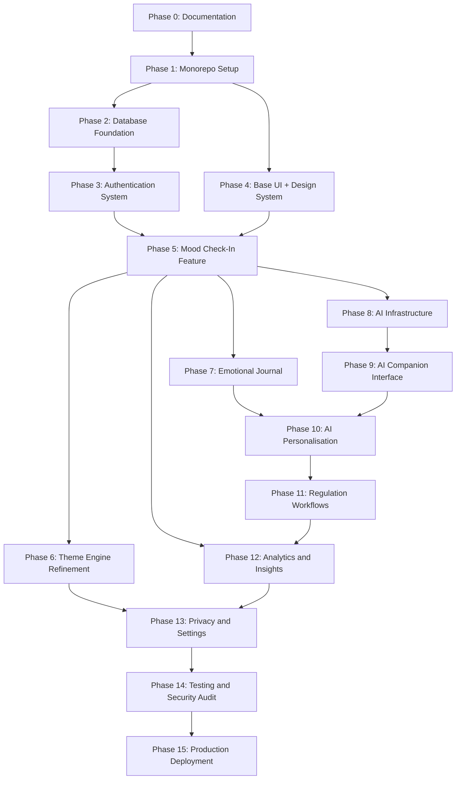

# Operational Execution Plan: solace+ (Phases 0–15)

**Platform Version:** 1.0.0  
**Status:** Approved for Implementation  
**Execution Target:** Antigravity Autonomous Coding Agent & Engineering Team  
**Workspace:** Monorepo (`apps/web`, `apps/api`, `packages/shared-types`)  
**Document Classification:** Authoritative Execution Master Specification  

---

> **PHASE EXECUTION PROTOCOL**
> Before starting any phase, Antigravity MUST:
> 1. Read all five planning documents (Architecture.md, Design.md, Implementation.md, Roadmap.md, Phases.md)
> 2. Inspect the current repository state
> 3. Verify that all prerequisites for the current phase are satisfied
> 4. Read the scope and acceptance criteria of the current phase
> 5. Prepare and state a concise execution plan
> 6. Implement ONLY the approved phase scope — nothing beyond it
> 7. Run all relevant tests
> 8. Inspect the implementation output
> 9. Fix any discovered issues before marking complete
> 10. Update documentation where the implementation revealed a gap
> 11. Record all completed tasks with ✅ markers
> 12. Report actual verification results (not assumed results)
> 13. **STOP and wait for explicit user approval before starting the next phase**
>
> **NEVER:**
> - Silently proceed to the next phase
> - Mark a task complete without verifying it
> - Claim tests passed without running them
> - Implement features outside the current phase scope
> - Skip prerequisites

---

## Document Overview & Operating Model

This operational execution plan defines the sequential, dependency-gated roadmap for constructing **solace+** from a blank repository to a fully tested, production-hardened emotional wellness platform.

Every phase within this document is structured as an autonomous work package containing twelve mandatory sections:
1. **Phase Objective:** Single sentence encapsulating the target state.
2. **Scope:** Exhaustive specification of features, interfaces, and code in scope, paired with an explicit list of out-of-scope items.
3. **Prerequisites:** Mandatory ancestral phases and verifiable filesystem/runtime artefacts required before initiating work.
4. **Tasks:** Chronological, granular task breakdown (5–15 tasks) detailing exact technical actions and expected verifiable outcomes.
5. **Files Expected to Be Created or Modified:** Precise file manifest specifying directory paths and filenames.
6. **Expected Outputs:** Observable system behaviours, compiled artefacts, and runnable capabilities demonstrable upon completion.
7. **Dependencies:** Classification of blocking versus non-blocking tasks, highlighting parallelisation pathways.
8. **Testing Requirements:** Granular testing matrix covering unit, integration, component, and performance suites.
9. **Verification Procedure:** Step-by-step terminal and browser verification protocol executing real commands and evaluating outputs.
10. **Acceptance Criteria:** Markdown checklist representing non-negotiable exit criteria. All must be ticked (`[x]`) to conclude the phase.
11. **Potential Failure Points:** Architectural, configuration, or operational pitfalls with specific mitigation directives.
12. **Exit Conditions:** Formal exit gate statement defining "done" for the phase.

---

## PHASE 0 — Requirements and Documentation

### 1. Phase Objective
Author and cross-validate the five foundational technical specifications governing the architecture, user experience, engineering implementation, product roadmap, and operational phases of solace+.

### 2. Scope
*   **In Scope:**
    *   Synthesise product vision into five canonical documents in the repository root: `Architecture.md`, `Design.md`, `Implementation.md`, `Roadmap.md`, and `Phases.md`.
    *   Formulate 8 Architecture Decision Records (ADRs) addressing backend runtime, ORM, authentication strategy, state management, database engine, AI abstraction, animation library, and repository topology.
    *   Specify the complete 7-mood taxonomy (**Happy, Calm, Neutral, Sad, Anxious, Angry, Overwhelmed**) alongside design tokens, animation cadences, and tone profiles.
    *   Define the 12-table relational database schema, index strategies, and cascade deletion rules.
    *   Specify all 15 user screens, 19 shared UI components, and 6 conversational regulation modes (**LISTEN, UNDERSTAND, CALM, REFLECT, REFOCUS, GRATITUDE**).
    *   Conduct rigorous cross-document consistency auditing across all specifications.
*   **Out of Scope:**
    *   Writing application source code, configuration scripts, or test harnesses.
    *   Creating package manifests or installing node modules.

### 3. Prerequisites
*   Clean Git repository initialised at `/Users/jayeshyadav/Projects/Solace+`.
*   Authorisation to define architecture, data schema, and system boundaries.

### 4. Tasks
1. Inspect the empty repository structure, verify workspace permissions, and confirm Git initialisation.
2. Resolve and document all 8 fundamental architectural decisions (ADRs 001–008) covering Hono, Drizzle, self-hosted JWT, Zustand, Neon PostgreSQL, OpenAI abstraction, Framer Motion, and pnpm monorepo.
3. Author `Architecture.md` detailing high-level topology, data flow diagrams, ERD with 12 entities, security controls, API contract specifications, and deployment infrastructure.
4. Author `Design.md` detailing sanctuary design philosophy, base design tokens, mood-responsive color matrices (7 moods × light/dark), 15 screen specifications, 19 UI component inventory, and WCAG AA accessibility baselines.
5. Author `Implementation.md` detailing development principles, folder structures, coding guidelines, state management patterns, API client interceptors, test strategy, and environment variable specifications.
6. Author `Roadmap.md` detailing milestone planning, release tracks (MVP, v1.1, v1.2), risk matrices, and dependency graphs.
7. Author `Phases.md` (this document) defining the 16-phase operational execution plan with dependency analysis and execution protocols.
8. Execute automated and manual cross-referencing passes across all five documents to eliminate nomenclature discrepancies, payload mismatches, and route contradictions.
9. Verify mood taxonomy, entity definitions, and HTTP endpoint signatures are identical across `Architecture.md`, `Design.md`, and `Implementation.md`.

### 5. Files Expected to Be Created or Modified
```
/Users/jayeshyadav/Projects/Solace+/Architecture.md
/Users/jayeshyadav/Projects/Solace+/Design.md
/Users/jayeshyadav/Projects/Solace+/Implementation.md
/Users/jayeshyadav/Projects/Solace+/Roadmap.md
/Users/jayeshyadav/Projects/Solace+/Phases.md
```

### 6. Expected Outputs
*   Five comprehensive, publication-grade markdown specifications committed to the repository root.
*   Zero ambiguity regarding database schemas, API routes, UI tokens, or phase dependencies prior to initialising code.

### 7. Dependencies
*   **Blocking:** Must precede any source code creation or repository initialisation (Phase 1).
*   **Parallelisable:** Document sections can be cross-drafted, but final cross-validation requires all five to be assembled.

### 8. Testing Requirements
*   Markdown syntax validation and linting.
*   Mermaid diagram rendering validation across all embedded code blocks.
*   Cross-document hyperlink and token integrity checks.

### 9. Verification Procedure
1. Execute file existence checks for all five core specifications in repository root:
   `ls -la /Users/jayeshyadav/Projects/Solace+/*.md`
2. Verify Mermaid block integrity by inspecting rendered diagrams in an IDE or using `mermaid-cli`.
3. Verify that all 7 moods are referenced consistently across `Architecture.md`, `Design.md`, and `Implementation.md`.
4. Verify that all 12 database entities match across `Architecture.md` Section 6 and `Implementation.md`.
5. Verify that all 6 regulation modes match between `Architecture.md` Section 7.9 and `Design.md` Section 6.6.

### 10. Acceptance Criteria
- [ ] All 5 documents (`Architecture.md`, `Design.md`, `Implementation.md`, `Roadmap.md`, `Phases.md`) exist in project root
- [ ] All 7 moods documented consistently across `Architecture.md`, `Design.md`, and `Implementation.md`
- [ ] Database schema entities (12 tables) consistent between `Architecture.md` and `Implementation.md`
- [ ] API endpoints defined for all feature modules (Auth, Mood, Journal, Companion, Regulation, Insights, Users)
- [ ] ADRs written for all 8 major architectural decisions
- [ ] Mood-to-theme token tables complete for all 7 moods in light and dark variants
- [ ] Phase sequence is dependency-consistent with the Mermaid dependency graph
- [ ] No contradictory technology choices or library versions across documents

### 11. Potential Failure Points
*   *Drift between architecture and design:* Entity properties in `Architecture.md` not matching input fields defined in `Design.md` screen specs.
    *Mitigation:* Cross-map every screen form input directly to its corresponding Drizzle table column.
*   *Broken Mermaid syntax:* Unquoted parentheses or brackets in node labels causing parser crashes.
    *Mitigation:* Enforce strict quoting on all diagram node text.

### 12. Exit Conditions
Phase 0 is complete when all five planning documents exist in the repository root, pass cross-consistency checks without discrepancies, and receive explicit stakeholder sign-off.

---

## PHASE 1 — Repository and Monorepo Setup

### 1. Phase Objective
Initialise a pnpm workspace monorepo containing frontend (`apps/web`), backend (`apps/api`), and shared types (`packages/shared-types`), configured with TypeScript project references, Tailwind CSS v4, unified linting, and continuous integration.

### 2. Scope
*   **In Scope:**
    *   Root workspace configuration via `pnpm-workspace.yaml` and root `package.json`.
    *   Scaffolding `apps/web` using Vite 6, React 18, and TypeScript in strict mode.
    *   Scaffolding `apps/api` using Node.js, Hono v4, and TypeScript in strict mode.
    *   Scaffolding `packages/shared-types` as an internal workspace dependency.
    *   Configuring Tailwind CSS v4 with `@tailwindcss/vite` in `apps/web`.
    *   Shared developer tooling: Prettier, ESLint (flat config `eslint.config.js`), TypeScript configs.
    *   Path aliases (`@/` for `apps/web`, `@api/` for `apps/api`, `@shared/` for shared types).
    *   GitHub Actions CI workflow (`.github/workflows/ci.yml`).
    *   Environment variable templates (`.env.example`) and `.gitignore`.
*   **Out of Scope:**
    *   Database connection or ORM schemas (Phase 2).
    *   Business logic, authentication, or domain routing.
    *   Design token injection or production component builds.

### 3. Prerequisites
*   Phase 0 complete and verified.
*   Node.js runtime (v20+ LTS) and `pnpm` (v9+) installed in the local environment.

### 4. Tasks
1. Initialise pnpm workspace: author root `package.json` with private workspace marker, create `pnpm-workspace.yaml` declaring `apps/*` and `packages/*`.
2. Initialise `apps/web`: create Vite + React 18 + TypeScript project with strict compiler settings.
3. Initialise `apps/api`: create Node.js + Hono project, configure `@hono/node-server` and `tsx` for hot-reloading development.
4. Initialise `packages/shared-types`: configure `package.json` with entry point `src/index.ts`, define initial domain enum stubs (`Mood`, `RegulationMode`).
5. Configure root TypeScript architecture: root `tsconfig.json` using project references (`composite: true`), app-specific `tsconfig.json` files inheriting from strict base.
6. Configure path aliases: map `@/` to `apps/web/src/*`, `@api/` to `apps/api/src/*`, and `@shared/` to `packages/shared-types/src/*` in tsconfigs and `vite.config.ts`.
7. Configure Tailwind CSS v4 in `apps/web`: install `@tailwindcss/vite` and `tailwindcss`, configure Vite plugin pipeline, and author minimal `src/styles/globals.css` with `@import "tailwindcss";`.
8. Configure root Prettier: author `.prettierrc` with single quotes, trailing commas, and 2-space indentation.
9. Configure ESLint: author root `eslint.config.js` using flat configuration, enabling `@typescript-eslint` and `eslint-plugin-react-hooks`.
10. Implement basic health check endpoint in `apps/api/src/index.ts` returning `{ status: 'ok', timestamp: string }` on `GET /health`.
11. Implement placeholder React application in `apps/web/src/App.tsx` displaying "solace+ sanctuary initialised".
12. Configure `.github/workflows/ci.yml` running linting, typechecking, and tests across all workspace packages on push and pull request.
13. Author root `.gitignore` covering `node_modules`, `dist`, `.env`, coverage reports, and OS artefacts.
14. Author `.env.example` templates for root, `apps/web`, and `apps/api`.
15. Author root `README.md` containing repository map, prerequisite declarations, and local development start instructions.

### 5. Files Expected to Be Created or Modified
```
/Users/jayeshyadav/Projects/Solace+/pnpm-workspace.yaml
/Users/jayeshyadav/Projects/Solace+/package.json
/Users/jayeshyadav/Projects/Solace+/.gitignore
/Users/jayeshyadav/Projects/Solace+/.prettierrc
/Users/jayeshyadav/Projects/Solace+/eslint.config.js
/Users/jayeshyadav/Projects/Solace+/tsconfig.json
/Users/jayeshyadav/Projects/Solace+/README.md
/Users/jayeshyadav/Projects/Solace+/.github/workflows/ci.yml
/Users/jayeshyadav/Projects/Solace+/apps/web/package.json
/Users/jayeshyadav/Projects/Solace+/apps/web/vite.config.ts
/Users/jayeshyadav/Projects/Solace+/apps/web/tsconfig.json
/Users/jayeshyadav/Projects/Solace+/apps/web/index.html
/Users/jayeshyadav/Projects/Solace+/apps/web/src/main.tsx
/Users/jayeshyadav/Projects/Solace+/apps/web/src/App.tsx
/Users/jayeshyadav/Projects/Solace+/apps/web/src/styles/globals.css
/Users/jayeshyadav/Projects/Solace+/apps/web/.env.example
/Users/jayeshyadav/Projects/Solace+/apps/api/package.json
/Users/jayeshyadav/Projects/Solace+/apps/api/tsconfig.json
/Users/jayeshyadav/Projects/Solace+/apps/api/src/index.ts
/Users/jayeshyadav/Projects/Solace+/apps/api/.env.example
/Users/jayeshyadav/Projects/Solace+/packages/shared-types/package.json
/Users/jayeshyadav/Projects/Solace+/packages/shared-types/tsconfig.json
/Users/jayeshyadav/Projects/Solace+/packages/shared-types/src/index.ts
```

### 6. Expected Outputs
*   Clean monorepo workspace installing dependencies via `pnpm install` without hoisting conflicts.
*   Frontend development server booting on `http://localhost:5173` rendering Tailwind-styled React content.
*   Backend development server booting on `http://localhost:3001` responding with HTTP 200 on `GET /health`.
*   Zero TypeScript compiler errors across all packages when running `pnpm -r typecheck`.

### 7. Dependencies
*   **Blocking:** Must be fully completed before Phase 2 (Database) and Phase 4 (Base UI).
*   **Parallelisable:** Frontend (`apps/web`) and backend (`apps/api`) scaffolding can be created in parallel once root workspace files are established.

### 8. Testing Requirements
*   `pnpm install` completes with exit code 0.
*   `pnpm -r typecheck` executes `tsc --noEmit` across `web`, `api`, and `shared-types` with zero errors.
*   `pnpm -r lint` validates all files without syntax or style errors.
*   Unit test confirming `GET /health` returns HTTP 200 and expected payload structure.

### 9. Verification Procedure
1. Execute workspace installation:
   `pnpm install`
2. Run global typechecking:
   `pnpm -r typecheck`
3. Run global linter:
   `pnpm -r lint`
4. Start backend server in development mode:
   `pnpm --filter api dev &`
   Wait 3 seconds, then test health check:
   `curl -i http://localhost:3001/health`
   Verify response is HTTP 200 with JSON `{ "status": "ok" }`. Kill backend process.
5. Build frontend application:
   `pnpm --filter web build`
   Verify `apps/web/dist` exists and contains compiled bundle.

### 10. Acceptance Criteria
- [ ] `pnpm-workspace.yaml` resolves `apps/*` and `packages/*` without warning
- [ ] TypeScript compiles cleanly in strict mode across all three packages (`web`, `api`, `shared-types`)
- [ ] ESLint flat config passes on all code
- [ ] Vite dev server boots and renders placeholder React app
- [ ] Tailwind CSS v4 compiles utility classes without PostCSS errors
- [ ] Hono server starts and returns HTTP 200 on `GET /health`
- [ ] Path aliases (`@/`, `@api/`, `@shared/`) resolve seamlessly in both IDE and build output
- [ ] GitHub Actions CI workflow script syntax is valid
- [ ] No sensitive credentials present in `.env.example` templates

### 11. Potential Failure Points
*   *Tailwind CSS v4 Vite integration incompatibilities:* Tailwind v4 deprecates legacy `tailwind.config.js` in favour of CSS-first directives and `@tailwindcss/vite`.
    *Mitigation:* Avoid creating a `tailwind.config.js`; configure `@tailwindcss/vite` plugin directly in `vite.config.ts` and use `@import "tailwindcss";` in `globals.css`.
*   *Monorepo package linking failures:* `apps/web` or `apps/api` failing to resolve `packages/shared-types`.
    *Mitigation:* Use `"@shared/types": "workspace:*"` in consumer `package.json` files and specify path mapping in `tsconfig.json`.

### 12. Exit Conditions
Phase 1 is complete when `pnpm install`, `pnpm -r typecheck`, `pnpm -r lint`, and the frontend build execute with zero errors, and the Hono health check endpoint returns HTTP 200.

---

## PHASE 2 — Database Foundation

### 1. Phase Objective
Configure the PostgreSQL database connection using Drizzle ORM, declare all 12 relational entity schemas, execute initial migrations, verify foreign key cascades, and seed 20 regulation activities.

### 2. Scope
*   **In Scope:**
    *   Configuring Drizzle ORM and Drizzle Kit in `apps/api`.
    *   Establishing database connection client singleton (`@neondatabase/serverless` with connection pooling support, fallback to `pg` for local testing).
    *   Declaring complete Drizzle schemas for all 12 entities: `users`, `user_preferences`, `mood_entries`, `mood_tags`, `mood_entry_tags`, `journal_entries`, `ai_conversations`, `ai_messages`, `regulation_activities`, `regulation_sessions`, `personal_insights`, `user_goals`.
    *   Configuring database migrations via `drizzle-kit generate` and `drizzle-kit migrate`.
    *   Authoring idempotent database seed script (`apps/api/src/db/seed.ts`) populating 20 regulation activities across 5 categories.
    *   Writing automated database integration tests validating connection, insertion, constraints, and cascade deletion.
*   **Out of Scope:**
    *   HTTP endpoints for business entities (handled in Phase 3, 5, 7, 8, 11).
    *   User authentication or password hashing logic (Phase 3).

### 3. Prerequisites
*   Phase 1 complete and verified.
*   Access to a local or Neon PostgreSQL development instance with valid `DATABASE_URL`.

### 4. Tasks
1. Install runtime and build dependencies in `apps/api`: `drizzle-orm`, `drizzle-kit`, `@neondatabase/serverless`, `pg`, `@types/pg`, and `dotenv`.
2. Author `apps/api/src/db/client.ts`: initialise Drizzle client singleton reading `DATABASE_URL` from validated environment variables.
3. Author `apps/api/src/db/schema/users.ts`: define `users` table and `user_preferences` table with foreign key to `users.id` (`onDelete: cascade`).
4. Author `apps/api/src/db/schema/mood.ts`: define `mood_entries`, `mood_tags`, and `mood_entry_tags` tables with check constraint on intensity (1–10) and mood enum.
5. Author `apps/api/src/db/schema/journal.ts`: define `journal_entries` table with soft-delete `deleted_at` timestamp and foreign key to `users.id`.
6. Author `apps/api/src/db/schema/ai.ts`: define `ai_conversations` and `ai_messages` tables with mode enum and message role enum (`user`, `assistant`, `system`).
7. Author `apps/api/src/db/schema/regulation.ts`: define `regulation_activities` (name, slug, category, duration, instructions) and `regulation_sessions` (ratings 1–5).
8. Author `apps/api/src/db/schema/insights.ts`: define `personal_insights` and `user_goals` tables with status enums and target dates.
9. Author `apps/api/src/db/index.ts`: re-export all schema objects and relations for centralised imports.
10. Author `apps/api/drizzle.config.ts` targeting PostgreSQL schema files with migrations output to `apps/api/src/db/migrations`.
11. Generate initial migration using `pnpm --filter api db:generate`.
12. Apply migration to development database using `pnpm --filter api db:migrate`.
13. Author `apps/api/src/db/seed.ts` populating 20 default regulation activities across the 5 categories (Breathing, Grounding, Movement, Cognitive Reframing, Gratitude).
14. Execute seed script and verify idempotent re-run behaviour (no duplicate key errors).
15. Author automated DB integration test (`apps/api/src/db/__tests__/db.integration.test.ts`) validating user creation, cascaded deletion, and check constraints.

### 5. Files Expected to Be Created or Modified
```
/Users/jayeshyadav/Projects/Solace+/apps/api/drizzle.config.ts
/Users/jayeshyadav/Projects/Solace+/apps/api/src/db/client.ts
/Users/jayeshyadav/Projects/Solace+/apps/api/src/db/index.ts
/Users/jayeshyadav/Projects/Solace+/apps/api/src/db/schema/users.ts
/Users/jayeshyadav/Projects/Solace+/apps/api/src/db/schema/mood.ts
/Users/jayeshyadav/Projects/Solace+/apps/api/src/db/schema/journal.ts
/Users/jayeshyadav/Projects/Solace+/apps/api/src/db/schema/ai.ts
/Users/jayeshyadav/Projects/Solace+/apps/api/src/db/schema/regulation.ts
/Users/jayeshyadav/Projects/Solace+/apps/api/src/db/schema/insights.ts
/Users/jayeshyadav/Projects/Solace+/apps/api/src/db/seed.ts
/Users/jayeshyadav/Projects/Solace+/apps/api/src/db/migrations/
/Users/jayeshyadav/Projects/Solace+/apps/api/src/db/__tests__/db.integration.test.ts
```

### 6. Expected Outputs
*   PostgreSQL database provisioned with 12 structured relational tables matching `Architecture.md` Section 6.
*   Generated SQL migration files recorded under version control in `apps/api/src/db/migrations`.
*   20 seeded regulation activities available in `regulation_activities` table.
*   Passing integration test suite confirming cascade delete integrity and check constraints.

### 7. Dependencies
*   **Blocking:** Prerequisites Phase 1. Blocks Phase 3 (Authentication).
*   **Parallelisable:** Can be developed concurrently with Phase 4 (Base UI Foundation).

### 8. Testing Requirements
*   Database connection connectivity test against target database URL.
*   Schema check constraint test: attempting to insert intensity `0` or `11` into `mood_entries` must throw constraint violation.
*   Enum validation test: attempting to insert invalid mood string must fail.
*   Cascade delete test: deleting a user record must automatically remove corresponding records in `user_preferences`, `mood_entries`, `journal_entries`, and `ai_conversations`.
*   Idempotency test: executing `pnpm --filter api db:seed` consecutively must result in exactly 20 regulation activities without duplication or failure.

### 9. Verification Procedure
1. Run Drizzle migration generator:
   `pnpm --filter api db:generate`
   Verify migration SQL file created in `apps/api/src/db/migrations/`.
2. Apply migrations:
   `pnpm --filter api db:migrate`
3. Execute seed script:
   `pnpm --filter api db:seed`
4. Run integration test suite:
   `pnpm --filter api test apps/api/src/db/__tests__/db.integration.test.ts`
5. Inspect database tables via database CLI or query:
   `SELECT count(*) FROM regulation_activities;`
   Confirm output is exactly 20.

### 10. Acceptance Criteria
- [ ] All 12 entity tables exist in the database with correct foreign key relations
- [ ] Primary keys use UUIDv4 / nanoid strings with default generation
- [ ] Check constraint enforces `intensity >= 1 AND intensity <= 10` on `mood_entries`
- [ ] Foreign key cascade deletes remove all user records upon user deletion
- [ ] Exactly 20 regulation activities populated across all 5 categories
- [ ] Re-running seed script produces no errors and maintains 20 activities
- [ ] DB integration test suite passes with 100% success rate

### 11. Potential Failure Points
*   *Serverless connection exhaustion:* Neon connections dropping or exceeding limits when running tests in rapid succession.
    *Mitigation:* Use pooled connection string (`-pooler`) for transaction workloads or configure connection pool limits in `client.ts`.
*   *Migration drift:* Manual database edits causing `drizzle-kit migrate` to fail.
    *Mitigation:* Never edit database directly; execute all schema alterations strictly through Drizzle schema declarations and generated migration files.

### 12. Exit Conditions
Phase 2 is complete when all 12 tables exist in the target database, migrations run cleanly from scratch, seed data is populated idempotently, and automated DB integration tests pass.

---

## PHASE 3 — Authentication System

### 1. Phase Objective
Implement secure self-hosted JWT authentication with bcrypt password hashing, token rotation, authentication middleware, and frontend session management.

### 2. Scope
*   **In Scope:**
    *   Auth domain models and Drizzle queries (`UserRepository`).
    *   Bcrypt password hashing (12 rounds) and comparison logic.
    *   Dual-token JWT architecture: 15-minute access token and 7-day cryptographically secure refresh token with database storage and rotation.
    *   Hono HTTP endpoints: `POST /api/auth/register`, `POST /api/auth/login`, `POST /api/auth/refresh`, `POST /api/auth/logout`.
    *   Hono `verifyJWT` authentication middleware injecting `user` into context.
    *   Frontend auth state store (`useAuthStore`) using Zustand with persistent storage.
    *   Axios / Fetch API client with automatic token attachment and 401 refresh interception.
    *   Frontend authentication pages (`LoginPage`, `RegisterPage`) and protected route guards.
*   **Out of Scope:**
    *   Third-party OAuth providers (Google, GitHub) — deferred beyond MVP.
    *   Password reset email dispatch (MVP uses direct in-app settings reset).
    *   Multi-factor authentication (MFA).

### 3. Prerequisites
*   Phase 1 (Monorepo Setup) and Phase 2 (Database Foundation) complete.
*   `users` and `user_preferences` tables active in the database.

### 4. Tasks
1. Define shared auth contracts in `packages/shared-types/src/auth.ts`: `RegisterRequest`, `LoginRequest`, `AuthResponse`, `UserPayload`.
2. Define Zod validation schemas in `apps/api/src/modules/auth/validators.ts`: `RegisterSchema` (email format, password min 8 chars with complexity) and `LoginSchema`.
3. Implement `UserRepository` in `apps/api/src/modules/auth/user.repository.ts`: `create`, `findByEmail`, `findById`, `updateRefreshToken`, `clearRefreshToken`.
4. Implement `TokenService` in `apps/api/src/lib/token.service.ts`: sign and verify access tokens (15m expiry) using `jose` / `jsonwebtoken`, generate secure random 64-byte refresh tokens, hash refresh tokens for persistence.
5. Implement `AuthService` in `apps/api/src/modules/auth/auth.service.ts`: register with email deduplication, login with constant-time password comparison, token refresh rotation, and logout invalidation.
6. Implement `AuthController` in `apps/api/src/modules/auth/auth.controller.ts` mapping HTTP requests to `AuthService` methods with standardised status codes (200, 201, 400, 401, 409, 422).
7. Implement `verifyJWT` middleware in `apps/api/src/middleware/auth.middleware.ts` validating bearer token header and binding authenticated `userId` to Hono context.
8. Wire auth routes into `apps/api/src/modules/auth/auth.routes.ts` and register on main Hono application router under `/api/auth`.
9. Write integration tests in `apps/api/src/modules/auth/__tests__/auth.integration.test.ts` covering register, duplicate email (409), login, invalid credentials (401), refresh rotation, and logout.
10. Frontend: Implement `useAuthStore` in `apps/web/src/shared/stores/auth.store.ts` managing `token`, `user`, `isAuthenticated`, `login`, `register`, and `logout` actions.
11. Frontend: Implement API client in `apps/web/src/shared/lib/api-client.ts` with request interceptor attaching bearer token and response interceptor refreshing expired tokens on 401.
12. Frontend: Implement `AuthLayout` in `apps/web/src/layouts/AuthLayout.tsx` providing centered sanctuary card envelope.
13. Frontend: Implement `LoginPage` and `RegisterPage` components in `apps/web/src/features/auth/pages/` with client-side form validation.
14. Frontend: Implement `ProtectedRoute` guard in `apps/web/src/router/ProtectedRoute.tsx` redirecting unauthenticated users to `/login`.
15. Frontend: Wire auth routes and protected route wrappers into React Router tree.

### 5. Files Expected to Be Created or Modified
```
/Users/jayeshyadav/Projects/Solace+/packages/shared-types/src/auth.ts
/Users/jayeshyadav/Projects/Solace+/packages/shared-types/src/index.ts
/Users/jayeshyadav/Projects/Solace+/apps/api/src/lib/token.service.ts
/Users/jayeshyadav/Projects/Solace+/apps/api/src/middleware/auth.middleware.ts
/Users/jayeshyadav/Projects/Solace+/apps/api/src/modules/auth/validators.ts
/Users/jayeshyadav/Projects/Solace+/apps/api/src/modules/auth/user.repository.ts
/Users/jayeshyadav/Projects/Solace+/apps/api/src/modules/auth/auth.service.ts
/Users/jayeshyadav/Projects/Solace+/apps/api/src/modules/auth/auth.controller.ts
/Users/jayeshyadav/Projects/Solace+/apps/api/src/modules/auth/auth.routes.ts
/Users/jayeshyadav/Projects/Solace+/apps/api/src/modules/auth/__tests__/auth.integration.test.ts
/Users/jayeshyadav/Projects/Solace+/apps/web/src/shared/stores/auth.store.ts
/Users/jayeshyadav/Projects/Solace+/apps/web/src/shared/lib/api-client.ts
/Users/jayeshyadav/Projects/Solace+/apps/web/src/layouts/AuthLayout.tsx
/Users/jayeshyadav/Projects/Solace+/apps/web/src/router/ProtectedRoute.tsx
/Users/jayeshyadav/Projects/Solace+/apps/web/src/features/auth/pages/LoginPage.tsx
/Users/jayeshyadav/Projects/Solace+/apps/web/src/features/auth/pages/RegisterPage.tsx
/Users/jayeshyadav/Projects/Solace+/apps/web/src/router/index.tsx
```

### 6. Expected Outputs
*   Fully functional, stateless JWT authentication system on backend with automatic token rotation.
*   Secure client session management persisting auth state across page reloads.
*   Protected route system preventing unauthorised access to sanctuary views.
*   Complete automated test suite validating all auth failure modes and happy paths.

### 7. Dependencies
*   **Blocking:** Requires Phase 1 and Phase 2. Blocks Phase 5 (Mood Check-In).
*   **Parallelisable:** Frontend auth UI can be styled in parallel with Phase 4 (Base UI).

### 8. Testing Requirements
*   `POST /api/auth/register`: 201 Created on valid submission; 409 Conflict on existing email; 422 Unprocessable on weak password.
*   `POST /api/auth/login`: 200 OK with access + refresh token on correct credentials; 401 Unauthorized on invalid password or nonexistent email.
*   `POST /api/auth/refresh`: 200 OK with new token pair when valid; 401 Unauthorized when token reused or expired (reuse detection invalidates token family).
*   `POST /api/auth/logout`: 200 OK and nullifies refresh token in database.
*   Auth middleware: accessing protected route without bearer token yields HTTP 401.

### 9. Verification Procedure
1. Execute backend auth integration test suite:
   `pnpm --filter api test apps/api/src/modules/auth/__tests__/auth.integration.test.ts`
2. Test registration via HTTP request:
   `curl -i -X POST http://localhost:3001/api/auth/register -H "Content-Type: application/json" -d '{"email":"test@solace.app","password":"Password123!","name":"Alex"}'`
   Verify HTTP 201 and payload containing `accessToken` and `refreshToken`.
3. Test duplicate registration:
   Re-run previous command. Verify HTTP 409 Conflict.
4. Test login:
   `curl -i -X POST http://localhost:3001/api/auth/login -H "Content-Type: application/json" -d '{"email":"test@solace.app","password":"Password123!"}'`
   Verify HTTP 200 and valid tokens returned.
5. In browser: Navigate to `http://localhost:5173/mood/check-in` while unauthenticated; confirm immediate redirection to `/login`.

### 10. Acceptance Criteria
- [ ] User registration stores bcrypt-hashed password (cost factor 12)
- [ ] Duplicate email registration returns HTTP 409 Conflict with clear error message
- [ ] Password validation rejects strings shorter than 8 characters
- [ ] Access token signed with HS256 / RS256 and expires in 15 minutes
- [ ] Refresh token rotates on every refresh request; old token immediately invalidated
- [ ] Protected API endpoints return 401 if token is missing, invalid, or expired
- [ ] Frontend redirects unauthenticated users to `/login` with return URL query
- [ ] Auth integration test suite passes with 100% success rate

### 11. Potential Failure Points
*   *Refresh token race condition:* Multiple concurrent client requests hitting 401 simultaneously causing simultaneous refresh calls, where only the first succeeds and others trigger token reuse invalidation.
    *Mitigation:* Implement request queuing / mutex in frontend `api-client.ts` to execute a single refresh call and buffer concurrent requests until new access token is resolved.
*   *Token storage vulnerability:* Storing plain refresh tokens in database.
    *Mitigation:* Hash refresh tokens using SHA-256 before writing to `users.refreshToken` column.

### 12. Exit Conditions
Phase 3 is complete when registration, login, token rotation, logout, and protected route redirection operate reliably end-to-end and all automated auth tests pass.

---

## PHASE 4 — Base UI Foundation and Design System

### 1. Phase Objective
Construct the sanctuary design system in React with Tailwind CSS v4, dynamic CSS custom property tokens, the ThemeProvider engine, Framer Motion ambient background, responsive navigation, and core UI primitives.

### 2. Scope
*   **In Scope:**
    *   Tailwind CSS v4 custom property architecture and token map in `apps/web/src/styles/tokens.css`.
    *   TypeScript token dictionaries for all 7 mood themes (Happy, Calm, Neutral, Sad, Anxious, Angry, Overwhelmed) in `apps/web/src/theme/mood-tokens.ts`.
    *   `ThemeProvider` and `MoodContextProvider` applying dynamic CSS variables to `:root`.
    *   `useThemeStore` Zustand store managing active mood theme and transition states.
    *   `AmbientBackground` component rendering organic, floating Framer Motion gradient orbs.
    *   `NavigationSidebar` (desktop ≥1024px) and `MobileNavigation` (mobile bottom bar <640px).
    *   `AppLayout` wrapping content in responsive layout with sidebar and ambient background.
    *   Reusable UI primitives: `Button`, `Input`, `Textarea`, `Card`, `Badge`, `Spinner`, `EmptyState`.
    *   Route skeleton covering all 15 screens with placeholder views.
*   **Out of Scope:**
    *   Mood history data fetching or submission (Phase 5).
    *   AI companion or chat interface components (Phase 9).
    *   Analytics chart rendering (Phase 12).

### 3. Prerequisites
*   Phase 1 (Monorepo Setup) complete.
*   Tailwind CSS v4 and `@tailwindcss/vite` verified in `apps/web`.

### 4. Tasks
1. Author `apps/web/src/styles/tokens.css` declaring default Neutral theme CSS variables: background surfaces, text hierarchy, borders, atmospheric gradients, and animation speeds.
2. Author `apps/web/src/styles/globals.css` importing Tailwind CSS v4 and `tokens.css`, declaring Inter font typography rules and base resets.
3. Author `apps/web/src/theme/theme.types.ts` defining `MoodTheme`, `Mood`, and `ThemeTokens` contracts.
4. Author `apps/web/src/theme/mood-tokens.ts` mapping all 7 moods to their complete CSS custom property definitions matching `Design.md` Section 4.
5. Implement `useThemeStore` in `apps/web/src/shared/stores/theme.store.ts` tracking `currentMood`, `themeMode` (light/dark), and transition duration.
6. Implement `ThemeProvider` in `apps/web/src/shared/theme/ThemeProvider.tsx` dynamically writing custom properties to `document.documentElement.style` and applying CSS transition classes.
7. Implement `MoodContextProvider` in `apps/web/src/shared/theme/MoodContextProvider.tsx` bridging mood state to child components.
8. Implement `AmbientBackground` in `apps/web/src/shared/components/AmbientBackground.tsx` rendering animated Framer Motion gradient blurs with reduced-motion fallback.
9. Implement `NavigationSidebar` in `apps/web/src/shared/components/NavigationSidebar.tsx` with sanctuary branding, active route indicators, and collapsible state for desktop viewports (≥1024px).
10. Implement `MobileNavigation` in `apps/web/src/shared/components/MobileNavigation.tsx` rendering fixed bottom tab bar for mobile viewports (<640px).
11. Implement `AppLayout` in `apps/web/src/layouts/AppLayout.tsx` composing `AmbientBackground`, navigation components, and scrollable content area.
12. Implement UI primitive components in `apps/web/src/shared/components/ui/`: `Button.tsx` (primary, secondary, ghost, danger), `Input.tsx`, `Textarea.tsx`, `Card.tsx`, `Badge.tsx`, `Spinner.tsx`, and `EmptyState.tsx`.
13. Configure complete React Router configuration in `apps/web/src/router/index.tsx` mapping all 15 screens to placeholder components enclosed in `AppLayout`.
14. Mount `ThemeProvider` at application root in `apps/web/src/App.tsx`.
15. Author unit and component tests for UI primitives and `ThemeProvider` custom property injection.

### 5. Files Expected to Be Created or Modified
```
/Users/jayeshyadav/Projects/Solace+/apps/web/src/styles/tokens.css
/Users/jayeshyadav/Projects/Solace+/apps/web/src/styles/globals.css
/Users/jayeshyadav/Projects/Solace+/apps/web/src/theme/theme.types.ts
/Users/jayeshyadav/Projects/Solace+/apps/web/src/theme/mood-tokens.ts
/Users/jayeshyadav/Projects/Solace+/apps/web/src/shared/stores/theme.store.ts
/Users/jayeshyadav/Projects/Solace+/apps/web/src/shared/theme/ThemeProvider.tsx
/Users/jayeshyadav/Projects/Solace+/apps/web/src/shared/theme/MoodContextProvider.tsx
/Users/jayeshyadav/Projects/Solace+/apps/web/src/shared/components/AmbientBackground.tsx
/Users/jayeshyadav/Projects/Solace+/apps/web/src/shared/components/NavigationSidebar.tsx
/Users/jayeshyadav/Projects/Solace+/apps/web/src/shared/components/MobileNavigation.tsx
/Users/jayeshyadav/Projects/Solace+/apps/web/src/layouts/AppLayout.tsx
/Users/jayeshyadav/Projects/Solace+/apps/web/src/shared/components/ui/Button.tsx
/Users/jayeshyadav/Projects/Solace+/apps/web/src/shared/components/ui/Input.tsx
/Users/jayeshyadav/Projects/Solace+/apps/web/src/shared/components/ui/Textarea.tsx
/Users/jayeshyadav/Projects/Solace+/apps/web/src/shared/components/ui/Card.tsx
/Users/jayeshyadav/Projects/Solace+/apps/web/src/shared/components/ui/Badge.tsx
/Users/jayeshyadav/Projects/Solace+/apps/web/src/shared/components/ui/Spinner.tsx
/Users/jayeshyadav/Projects/Solace+/apps/web/src/shared/components/ui/EmptyState.tsx
/Users/jayeshyadav/Projects/Solace+/apps/web/src/router/index.tsx
/Users/jayeshyadav/Projects/Solace+/apps/web/src/App.tsx
```

### 6. Expected Outputs
*   Cohesive sanctuary visual theme running in the browser with responsive layouts across desktop, tablet, and mobile.
*   Theme switching capability demonstrating smooth colour transitions when changing active mood state.
*   Library of accessible, token-aware UI primitives ready for domain feature screens.

### 7. Dependencies
*   **Blocking:** Requires Phase 1. Blocks Phase 5 (Mood Check-In).
*   **Parallelisable:** Can be developed concurrently with Phase 2 (Database) and Phase 3 (Authentication).

### 8. Testing Requirements
*   Component unit test: `Button` renders all variants (primary, secondary, ghost, danger) and responds to click events.
*   Component unit test: `ThemeProvider` updates document custom properties when theme store mood changes.
*   Visual/layout test: `NavigationSidebar` renders at ≥1024px viewport; `MobileNavigation` renders at <640px viewport.
*   Accessibility test: UI primitives support keyboard focus navigation with visible focus rings.

### 9. Verification Procedure
1. Execute frontend test suite:
   `pnpm --filter web test`
2. Start Vite dev server:
   `pnpm --filter web dev`
3. Open `http://localhost:5173` in browser.
4. Manually cycle `useThemeStore.getState().setMood('Sad')` in dev console: verify background surface smoothly shifts to muted indigo-blue within 400ms.
5. Cycle to `Angry`: verify shift to terracotta-warm slate.
6. Cycle to `Calm`: verify shift to soft sea-foam sage.
7. Resize viewport to 375px: verify `NavigationSidebar` hides and bottom `MobileNavigation` bar docks to bottom.

### 10. Acceptance Criteria
- [ ] All 7 mood themes apply their specific CSS variables to `:root` without page reload
- [ ] CSS colour transitions execute smoothly (200ms colour, 400ms gradient) without flashing
- [ ] AmbientBackground renders animated orbs without causing layout shift or high CPU usage
- [ ] NavigationSidebar renders on desktop (≥1024px) and hides on mobile
- [ ] MobileNavigation renders on mobile (<640px) and hides on desktop
- [ ] UI primitives (`Button`, `Input`, `Card`, etc.) render correctly across all 7 themes
- [ ] Reduced-motion mode (`prefers-reduced-motion`) disables orb movement and reduces transition timings
- [ ] All UI primitive component tests pass

### 11. Potential Failure Points
*   *FOUC (Flash of Unstyled Content) or Theme Flash:* Initial page render defaulting to light theme before stored mood hydrates.
    *Mitigation:* Read initial theme synchronously from `localStorage` in an inline script or before React root mounts.
*   *Performance degradation from CSS filters:* Excessive `filter: blur()` on animated ambient background orbs causing frame drops.
    *Mitigation:* Use `will-change: transform` and limit blur radius to 60px–80px on hardware-accelerated layers.

### 12. Exit Conditions
Phase 4 is complete when the design system tokens, ThemeProvider, layout shell, responsive navigation, and all core UI primitives are fully functional, tested, and visually confirmed across all 7 moods.

---

## PHASE 5 — Mood Check-In Feature

### 1. Phase Objective
Implement the complete vertical mood check-in capability—from the interactive 7-mood selector and intensity slider UI to the backend storage API, mood history feed, calendar visualizer, and dynamic sanctuary theme adaptation.

### 2. Scope
*   **In Scope:**
    *   Shared contracts for mood check-in request and response payloads.
    *   Backend CRUD endpoints: `POST /api/moods`, `GET /api/moods`, `GET /api/moods/:id`, `DELETE /api/moods/:id`.
    *   Backend validation enforcing valid mood enums, intensity range (1–10), and situational tags.
    *   Frontend `MoodSelector` (7 moods with accessible icons and keyboard navigation).
    *   Frontend `MoodIntensitySlider` (1–10 slider with tactile feedback).
    *   Frontend `MoodCheckInForm` (React Hook Form + Zod schema validation).
    *   Frontend `MoodCheckInPage` (`/mood/check-in`) and `MoodCheckInConfirmationPage` (`/mood/confirmed`).
    *   Frontend `MoodCard` component and `MoodHistoryPage` (`/mood/history`) with pagination.
    *   Frontend `MoodCalendar` month view displaying mood-tinted days.
    *   Automatic triggering of `ThemeProvider` upon check-in submission to update the sanctuary atmosphere.
*   **Out of Scope:**
    *   Advanced analytics or trend correlation charts (Phase 12).
    *   AI reflection generation based on check-in note (Phase 8/10).

### 3. Prerequisites
*   Phase 3 (Authentication) and Phase 4 (Base UI Foundation) complete.
*   `mood_entries`, `mood_tags`, and `mood_entry_tags` tables active in the database.

### 4. Tasks
1. Author shared types in `packages/shared-types/src/mood.ts`: `MoodEntry`, `CreateMoodEntryRequest`, `MoodHistoryQuery`, `MoodHistoryResponse`.
2. Author Zod validation schemas in `apps/api/src/modules/mood/validators.ts`: `CreateMoodEntrySchema` (validating mood enum, intensity 1–10, optional note max 500 chars, optional tags array) and `MoodHistoryQuerySchema`.
3. Implement `MoodRepository` in `apps/api/src/modules/mood/mood.repository.ts`: `createEntry`, `findByUserPaginated`, `findById`, `deleteEntry`, `findByDateRange`.
4. Implement `MoodService` in `apps/api/src/modules/mood/mood.service.ts`: enforce tenant isolation, tag association transactions, and history pagination.
5. Implement `MoodController` and routes in `apps/api/src/modules/mood/mood.controller.ts` and `mood.routes.ts`, applying `verifyJWT` middleware.
6. Write API integration tests covering creation, validation rejections, pagination, and tenant isolation (user A cannot delete user B's entry).
7. Frontend: Implement `MoodSelector` in `apps/web/src/features/mood/components/MoodSelector.tsx` displaying the 7 moods in an accessible radio-group layout.
8. Frontend: Implement `MoodIntensitySlider` in `apps/web/src/features/mood/components/MoodIntensitySlider.tsx` with tick marks from 1 to 10 and semantic descriptors.
9. Frontend: Implement `MoodCheckInForm` using React Hook Form and Zod resolver.
10. Frontend: Implement `MoodCheckInPage` in `apps/web/src/features/mood/pages/MoodCheckInPage.tsx`.
11. Frontend: Implement `MoodCheckInConfirmationPage` (`/mood/confirmed`) displaying celebratory reassurance and summary badge.
12. Frontend: Wire check-in completion to update `useThemeStore.setMood(selectedMood)`, immediately shifting the application theme.
13. Frontend: Implement `MoodCard` in `apps/web/src/features/mood/components/MoodCard.tsx` showing mood badge, intensity bar, relative date, tags, and note.
14. Frontend: Implement `MoodHistoryPage` in `apps/web/src/features/mood/pages/MoodHistoryPage.tsx` with infinite scroll or pagination (20 per page).
15. Frontend: Implement `MoodCalendar` in `apps/web/src/features/mood/components/MoodCalendar.tsx` rendering days tinted with that day's dominant logged mood.

### 5. Files Expected to Be Created or Modified
```
/Users/jayeshyadav/Projects/Solace+/packages/shared-types/src/mood.ts
/Users/jayeshyadav/Projects/Solace+/packages/shared-types/src/index.ts
/Users/jayeshyadav/Projects/Solace+/apps/api/src/modules/mood/validators.ts
/Users/jayeshyadav/Projects/Solace+/apps/api/src/modules/mood/mood.repository.ts
/Users/jayeshyadav/Projects/Solace+/apps/api/src/modules/mood/mood.service.ts
/Users/jayeshyadav/Projects/Solace+/apps/api/src/modules/mood/mood.controller.ts
/Users/jayeshyadav/Projects/Solace+/apps/api/src/modules/mood/mood.routes.ts
/Users/jayeshyadav/Projects/Solace+/apps/api/src/modules/mood/__tests__/mood.integration.test.ts
/Users/jayeshyadav/Projects/Solace+/apps/web/src/features/mood/api/mood.api.ts
/Users/jayeshyadav/Projects/Solace+/apps/web/src/features/mood/components/MoodSelector.tsx
/Users/jayeshyadav/Projects/Solace+/apps/web/src/features/mood/components/MoodIntensitySlider.tsx
/Users/jayeshyadav/Projects/Solace+/apps/web/src/features/mood/components/MoodCheckInForm.tsx
/Users/jayeshyadav/Projects/Solace+/apps/web/src/features/mood/components/MoodCard.tsx
/Users/jayeshyadav/Projects/Solace+/apps/web/src/features/mood/components/MoodCalendar.tsx
/Users/jayeshyadav/Projects/Solace+/apps/web/src/features/mood/pages/MoodCheckInPage.tsx
/Users/jayeshyadav/Projects/Solace+/apps/web/src/features/mood/pages/MoodCheckInConfirmationPage.tsx
/Users/jayeshyadav/Projects/Solace+/apps/web/src/features/mood/pages/MoodHistoryPage.tsx
/Users/jayeshyadav/Projects/Solace+/apps/web/src/shared/stores/mood.store.ts
```

### 6. Expected Outputs
*   End-to-end mood logging capability accessible at `/mood/check-in`.
*   Immediate, organic sanctuary theme transition reflecting the logged mood upon submission.
*   Historical feed and calendar month grid displaying recorded mood entries.
*   Enforced data isolation across API endpoints.

### 7. Dependencies
*   **Blocking:** Requires Phase 3 and Phase 4. Blocks Phase 6 (Theme Refinement), Phase 7 (Journal), Phase 8 (AI Infrastructure), and Phase 12 (Analytics).
*   **Parallelisable:** Independent of Phase 7 (Journal) once completed.

### 8. Testing Requirements
*   `POST /api/moods`: 201 Created with valid payload; 422 Unprocessable when intensity is 0 or 11; 422 when mood enum is invalid.
*   `GET /api/moods`: returns paginated array containing only records belonging to the authenticated user.
*   `DELETE /api/moods/:id`: 200 OK when deleting own entry; 403 Forbidden or 404 Not Found when attempting to delete another user's entry.
*   Component test: `MoodSelector` selects item via keyboard arrow keys and Enter/Space.
*   Component test: `MoodIntensitySlider` clamps values between 1 and 10.

### 9. Verification Procedure
1. Execute backend mood integration tests:
   `pnpm --filter api test apps/api/src/modules/mood/__tests__/mood.integration.test.ts`
2. Start development servers (`web` and `api`).
3. Log in as a registered user in the browser.
4. Navigate to `/mood/check-in`.
5. Select "Anxious", set intensity slider to "8", add note "Impending project deadline", click "Save Check-In".
6. Verify redirect to `/mood/confirmed`, and observe the sanctuary ambient background transitioning to lavender-slate.
7. Navigate to `/mood/history`: verify the entry appears with correct intensity, timestamp, and note.
8. Delete entry: verify entry disappears from history.

### 10. Acceptance Criteria
- [ ] User can submit a check-in selecting any of the 7 valid moods and an intensity of 1–10
- [ ] Submission persists accurately to `mood_entries` and `mood_entry_tags` in database
- [ ] Submitting a check-in immediately morphs the active sanctuary UI theme
- [ ] Mood history page displays entries sorted chronologically (newest first)
- [ ] Mood calendar accurately colours days matching logged entries
- [ ] Cross-tenant access is impossible (tested and verified)
- [ ] Full keyboard navigation supported on mood selector and intensity slider
- [ ] All unit and integration tests pass

### 11. Potential Failure Points
*   *Timezone distortion in calendar:* Mood entries logged at 11:30 PM appearing on the following day in the calendar due to UTC conversion.
    *Mitigation:* Store timestamps in UTC ISO-8601; render calendar cells using client's local timezone.
*   *Tag duplication:* Multiple identical tags inserted for a single user check-in.
    *Mitigation:* Use database upsert on `mood_tags.slug` scoped to tenant or globally normalized tags.

### 12. Exit Conditions
Phase 5 is complete when a user can record a check-in, observe the atmosphere adapt, review entries in history and calendar views, and all automated tests pass.

---

## PHASE 6 — Mood-Responsive Theme Engine (Refinement)

### 1. Phase Objective
Refine the mood-responsive design engine to production standards: complete dark mode variants for all 7 moods, manual theme pinning, automated WCAG AA contrast compliance, reduced-motion fallbacks, and animation intensity scaling.

### 2. Scope
*   **In Scope:**
    *   Complete dark-mode CSS token dictionaries for all 7 moods in `mood-tokens.ts`.
    *   System `prefers-color-scheme: dark` listener integrated into `ThemeProvider`.
    *   Manual theme pinning capability in Settings (user can lock the theme to Calm, Happy, etc., ignoring check-ins).
    *   Zustand store persistence for theme settings.
    *   Automated contrast verification script ensuring WCAG 2.1 AA compliance (4.5:1 text, 3:1 UI elements) across all 14 theme permutations (7 moods × 2 modes).
    *   `useReducedMotion` hook replacing floating animations with static, non-kinetic cross-fades.
    *   Atmospheric intensity calibration scaling `--animation-intensity` token with Framer Motion duration variables.
*   **Out of Scope:**
    *   User-defined custom hex codes or arbitrary palette generation.
    *   Theme marketplace or external themes.

### 3. Prerequisites
*   Phase 4 (Base UI Foundation) and Phase 5 (Mood Check-In Feature) complete.

### 4. Tasks
1. Author complete dark-mode token definitions for all 7 moods in `apps/web/src/theme/mood-tokens.ts`, strictly referencing `Design.md` Section 4.
2. Update `ThemeProvider` in `apps/web/src/shared/theme/ThemeProvider.tsx` to detect and listen to `window.matchMedia('(prefers-color-scheme: dark)')`.
3. Implement theme pinning and dark mode preferences in `useThemeStore` using `zustand/middleware` (`persist` to localStorage).
4. Update `ThemeProvider` resolution priority: `pinnedTheme` > `currentMood` > `Neutral` default.
5. Author automated contrast calculation test script (`apps/web/src/theme/__tests__/contrast.test.ts`) evaluating relative luminance and contrast ratios between surface tokens and text tokens across all 14 permutations.
6. Remediate any tokens failing the 4.5:1 contrast ratio threshold.
7. Implement `useReducedMotion` custom hook in `apps/web/src/shared/hooks/useReducedMotion.ts`.
8. Refactor `AmbientBackground` to consume `useReducedMotion` and disable drift motion when true.
9. Map `--animation-intensity` CSS variable to Framer Motion transitions across modal, card, and page transitions.
10. Implement `AppearanceSettings` component in `apps/web/src/features/settings/pages/AppearanceSettings.tsx` exposing dark/light toggle and theme pinning selector.
11. Author visual regression documentation baseline detailing theme snapshot capture protocols.

### 5. Files Expected to Be Created or Modified
```
/Users/jayeshyadav/Projects/Solace+/apps/web/src/theme/mood-tokens.ts
/Users/jayeshyadav/Projects/Solace+/apps/web/src/theme/__tests__/contrast.test.ts
/Users/jayeshyadav/Projects/Solace+/apps/web/src/shared/hooks/useReducedMotion.ts
/Users/jayeshyadav/Projects/Solace+/apps/web/src/shared/theme/ThemeProvider.tsx
/Users/jayeshyadav/Projects/Solace+/apps/web/src/shared/stores/theme.store.ts
/Users/jayeshyadav/Projects/Solace+/apps/web/src/shared/components/AmbientBackground.tsx
/Users/jayeshyadav/Projects/Solace+/apps/web/src/features/settings/pages/AppearanceSettings.tsx
```

### 6. Expected Outputs
*   Fully validated 14-theme matrix (7 moods × light/dark) achieving 100% WCAG AA contrast compliance.
*   Persistent theme pinning allowing users to lock their aesthetic sanctuary environment.
*   Flawless reduced-motion support for neurodivergent and motion-sensitive users.

### 7. Dependencies
*   **Blocking:** Requires Phase 4 and Phase 5. Blocks Phase 13 (Settings).
*   **Parallelisable:** Can be developed concurrently with Phase 7 (Emotional Journal).

### 8. Testing Requirements
*   Contrast unit test: all 14 theme variations must exhibit contrast ratio ≥ 4.5:1 for body copy against primary background, and ≥ 3:1 for interactive borders and headings.
*   Theme pinning test: setting `pinnedMood: 'Calm'` prevents `currentMood: 'Angry'` from updating CSS variables.
*   Reduced motion test: `AmbientBackground` renders static gradient when `prefers-reduced-motion: reduce` is active.

### 9. Verification Procedure
1. Execute automated contrast compliance test:
   `pnpm --filter web test apps/web/src/theme/__tests__/contrast.test.ts`
   Confirm 0 failures across all 14 theme configurations.
2. In browser: open Appearance settings (`/settings/appearance`).
3. Toggle "Dark Mode": verify immediate transition to dark palette without page reload.
4. Select "Pin Theme: Calm": navigate to `/mood/check-in`, log an "Angry" mood.
5. Verify that the UI remains pinned to Calm theme tokens while the check-in is logged as Angry.
6. Enable "Reduce Motion" in browser/OS settings: verify ambient background orbs immediately cease motion.

### 10. Acceptance Criteria
- [ ] Dark mode tokens implemented for all 7 moods
- [ ] Manual dark/light mode toggle operates reliably and persists across browser restarts
- [ ] Pinned theme overrides logged mood and persists in `localStorage`
- [ ] 100% of text and background token pairings pass WCAG AA contrast audit (≥ 4.5:1)
- [ ] Reduced motion preference strictly eliminates kinetic animations
- [ ] Ambient background orb intensity and colour dynamically calibrate per mood

### 11. Potential Failure Points
*   *Inadequate dark mode contrast:* Overly dark muted text on deep dark backgrounds failing WCAG AA.
    *Mitigation:* Use the automated contrast script as a gatekeeper; never manually eyeball contrast ratios.
*   *Zustand hydration mismatch:* Server or initial client render encountering mismatched storage keys.
    *Mitigation:* Use `onRehydrateStorage` hook in Zustand store to safely trigger theme application post-mount.

### 12. Exit Conditions
Phase 6 is complete when all 14 mood-theme permutations achieve verified WCAG AA compliance, theme pinning and dark mode operate and persist reliably, and motion reduction functions flawlessly.

---

## PHASE 7 — Emotional Journal

### 1. Phase Objective
Construct the private emotional journal module featuring rich text reflection, mood-tag correlation, guided prompts with idle triggers, client-side auto-save drafts, and soft-delete capabilities.

### 2. Scope
*   **In Scope:**
    *   Shared contracts for journal entry CRUD.
    *   Backend CRUD endpoints: `GET /api/journal`, `POST /api/journal`, `GET /api/journal/:id`, `PUT /api/journal/:id`, `DELETE /api/journal/:id` (soft delete).
    *   Backend filtering by mood tag and date ranges with pagination.
    *   15 static guided reflection prompts configured in application constants.
    *   Frontend `JournalCard` with mood badge, preview text, and word count.
    *   Frontend `JournalListPage` (`/journal`) with search, filter, and empty states.
    *   Frontend `JournalEditorPage` (`/journal/new`, `/journal/:id/edit`) with title, textarea, and mood tag selector.
    *   Frontend `GuidedPrompt` component displaying prompts after 5 seconds of typing inactivity.
    *   Debounced local draft auto-saving to `localStorage`.
    *   Frontend `JournalViewPage` (`/journal/:id`) and delete confirmation modal.
*   **Out of Scope:**
    *   Collaborative journaling or public sharing (solace+ is strictly a private sanctuary).
    *   AI reflection generation or journal summaries (Phase 10).

### 3. Prerequisites
*   Phase 3 (Authentication) and Phase 4 (Base UI Foundation) complete.
*   `journal_entries` table active in the database.

### 4. Tasks
1. Author shared types in `packages/shared-types/src/journal.ts`: `JournalEntry`, `CreateJournalEntryRequest`, `UpdateJournalEntryRequest`, `JournalListQuery`.
2. Author Zod validation schemas in `apps/api/src/modules/journal/validators.ts`: validate title (max 100 chars), content (min 1 char, max 20,000 chars), optional `moodTag`.
3. Implement `JournalRepository` in `apps/api/src/modules/journal/journal.repository.ts`: `create`, `findById`, `findByUserPaginated`, `update`, `softDelete` (setting `deletedAt = now()`), filtering out soft-deleted entries.
4. Implement `JournalService` in `apps/api/src/modules/journal/journal.service.ts` enforcing user isolation and pagination limits.
5. Implement `JournalController` and routes in `apps/api/src/modules/journal/journal.controller.ts` and `journal.routes.ts`.
6. Author constants library of 15 guided reflection prompts in `apps/web/src/features/journal/constants/reflection-prompts.ts`.
7. Author API integration tests covering journal CRUD, soft-deletion semantics, and cross-tenant access denial.
8. Frontend: Implement `JournalCard` in `apps/web/src/features/journal/components/JournalCard.tsx`.
9. Frontend: Implement `JournalListPage` in `apps/web/src/features/journal/pages/JournalListPage.tsx` with mood tag filter buttons and empty state.
10. Frontend: Implement `JournalEditor` in `apps/web/src/features/journal/components/JournalEditor.tsx` with auto-resizing text area, character count, and mood selector.
11. Frontend: Implement `GuidedPrompt` in `apps/web/src/features/journal/components/GuidedPrompt.tsx` that appears subtly after 5 seconds of inactivity and is dismissible.
12. Frontend: Implement debounced auto-save hook writing in-progress drafts to `localStorage` under `solace_journal_draft`.
13. Frontend: Implement `JournalEditorPage` (`/journal/new`, `/journal/:id/edit`).
14. Frontend: Implement `JournalViewPage` (`/journal/:id`) with delete confirmation modal.

### 5. Files Expected to Be Created or Modified
```
/Users/jayeshyadav/Projects/Solace+/packages/shared-types/src/journal.ts
/Users/jayeshyadav/Projects/Solace+/packages/shared-types/src/index.ts
/Users/jayeshyadav/Projects/Solace+/apps/api/src/modules/journal/validators.ts
/Users/jayeshyadav/Projects/Solace+/apps/api/src/modules/journal/journal.repository.ts
/Users/jayeshyadav/Projects/Solace+/apps/api/src/modules/journal/journal.service.ts
/Users/jayeshyadav/Projects/Solace+/apps/api/src/modules/journal/journal.controller.ts
/Users/jayeshyadav/Projects/Solace+/apps/api/src/modules/journal/journal.routes.ts
/Users/jayeshyadav/Projects/Solace+/apps/api/src/modules/journal/__tests__/journal.integration.test.ts
/Users/jayeshyadav/Projects/Solace+/apps/web/src/features/journal/constants/reflection-prompts.ts
/Users/jayeshyadav/Projects/Solace+/apps/web/src/features/journal/api/journal.api.ts
/Users/jayeshyadav/Projects/Solace+/apps/web/src/features/journal/components/JournalCard.tsx
/Users/jayeshyadav/Projects/Solace+/apps/web/src/features/journal/components/JournalEditor.tsx
/Users/jayeshyadav/Projects/Solace+/apps/web/src/features/journal/components/GuidedPrompt.tsx
/Users/jayeshyadav/Projects/Solace+/apps/web/src/features/journal/pages/JournalListPage.tsx
/Users/jayeshyadav/Projects/Solace+/apps/web/src/features/journal/pages/JournalEditorPage.tsx
/Users/jayeshyadav/Projects/Solace+/apps/web/src/features/journal/pages/JournalViewPage.tsx
```

### 6. Expected Outputs
*   Fully functional, private journaling experience in the web application.
*   Data integrity guarantees ensuring soft-deleted journals are hidden from the user interface and queries.
*   Reliable draft preservation preventing accidental content loss via localStorage.

### 7. Dependencies
*   **Blocking:** Requires Phase 3 and Phase 4. Blocks Phase 10 (AI Personalisation).
*   **Parallelisable:** Can be developed concurrently with Phase 6 (Theme Refinement) and Phase 8 (AI Infrastructure).

### 8. Testing Requirements
*   `POST /api/journal`: creates entry and links mood tag; rejects content exceeding 20,000 characters.
*   `DELETE /api/journal/:id`: sets `deletedAt` timestamp; subsequent `GET /api/journal` excludes the entry.
*   Tenant security: requesting another user's journal entry by UUID returns HTTP 404 or 403.
*   Component test: `GuidedPrompt` does not display while user is actively typing, appears 5 seconds after keystrokes cease, and hides on dismissal.
*   Component test: `JournalEditor` restores draft from `localStorage` on initial mount if draft exists.

### 9. Verification Procedure
1. Run backend journal integration test suite:
   `pnpm --filter api test apps/api/src/modules/journal/__tests__/journal.integration.test.ts`
2. In browser: navigate to `/journal/new`.
3. Enter title "Evening Reflection", type content, select mood tag "Calm".
4. Stop typing: wait 5 seconds and observe gentle appearance of a guided prompt chip. Dismiss prompt.
5. Refresh the browser page without saving: verify draft text is restored from localStorage.
6. Click "Save Reflection": verify redirect to `/journal` and confirm the new card appears.
7. Click the entry, click "Delete", confirm deletion: verify card disappears from journal list.

### 10. Acceptance Criteria
- [ ] User can create, read, update, and soft-delete journal entries
- [ ] Soft-deleted entries are excluded from all active application queries
- [ ] Journal entries can be filtered by mood tag in the user interface
- [ ] Guided prompts appear following 5 seconds of typing cessation and can be dismissed
- [ ] Draft text is safely preserved in `localStorage` and purged upon successful publication
- [ ] No cross-tenant access to private reflections is possible
- [ ] All unit and integration tests pass

### 11. Potential Failure Points
*   *Loss of draft on accidental navigation:* User navigates away before debounced save commits to localStorage.
    *Mitigation:* Attach `beforeunload` window event listener when editor form is dirty.
*   *Large text payload performance:* Long reflections causing UI lag.
    *Mitigation:* Virtualise long journal lists and constrain single reflection body to 20,000 characters in Zod schema.

### 12. Exit Conditions
Phase 7 is complete when the journal module provides complete CRUD and filtering capabilities, soft deletion operates cleanly, local draft persistence is verified, and all automated tests pass.

---

## PHASE 8 — AI Infrastructure

### 1. Phase Objective
Construct the backend AI foundation: provider abstraction layer, prompt assembly pipeline, deterministic safety guardrails, token counting, conversation repositories, and rate limiting—without UI dependencies.

### 2. Scope
*   **In Scope:**
    *   `AIProvider` TypeScript interface for pluggable model orchestration.
    *   `OpenAIProvider` implementation utilising Vercel AI SDK and OpenAI-compatible client.
    *   `ProviderFactory` selecting provider implementation from environment variables.
    *   `SystemPromptBuilder` constructing multi-layered system prompts based on current mood and the 6 regulation modes (**LISTEN, UNDERSTAND, CALM, REFLECT, REFOCUS, GRATITUDE**).
    *   `SafetyService` executing deterministic crisis keyword detection and non-clinical boundary guardrails.
    *   `ContextAssemblyService` gathering user preferences, recent mood check-ins, and conversation context.
    *   `ConversationRepository` and `MessageRepository` handling persistence in `ai_conversations` and `ai_messages`.
    *   `TokenCounter` utility estimating token counts and enforcing context window budgets.
    *   `RateLimitService` enforcing 50 AI messages per user per day.
*   **Out of Scope:**
    *   Frontend chat interface or streaming SSE components (Phase 9).
    *   Automated journal semantic extraction (Phase 10).

### 3. Prerequisites
*   Phase 2 (Database Foundation) complete.
*   `ai_conversations` and `ai_messages` tables active in the database.
*   Valid `OPENAI_API_KEY` configured in `apps/api/.env`.

### 4. Tasks
1. Author `AIProvider` interface in `apps/api/src/ai/provider.interface.ts` defining `generateStream`, `generateText`, and `countTokens`.
2. Implement `OpenAIProvider` in `apps/api/src/ai/providers/openai.provider.ts` using Vercel AI SDK (`ai` package) with OpenAI GPT-4o adapter.
3. Implement `ProviderFactory` in `apps/api/src/ai/provider.factory.ts` instantiating provider based on `AI_PROVIDER` env var.
4. Implement `SafetyService` in `apps/api/src/ai/safety.service.ts` maintaining deterministic regex patterns for self-harm, suicide, and clinical crisis terms; returns emergency response message and crisis lifeline metadata when triggered.
5. Implement `SystemPromptBuilder` in `apps/api/src/ai/system-prompt.builder.ts` combining base sanctuary persona, strict non-clinical disclaimers, selected regulation mode directive, and user profile data.
6. Implement `ContextAssemblyService` in `apps/api/src/ai/context-assembly.service.ts` querying recent mood history and assembling chronologically ordered message histories within token limits.
7. Implement `ConversationRepository` in `apps/api/src/modules/companion/conversation.repository.ts`.
8. Implement `MessageRepository` in `apps/api/src/modules/companion/message.repository.ts`.
9. Implement `ConversationService` in `apps/api/src/modules/companion/conversation.service.ts` managing conversation lifecycle and message appending.
10. Implement `TokenCounter` in `apps/api/src/ai/token-counter.ts` implementing approximation algorithms (4 characters per token average or lightweight tiktoken).
11. Implement `RateLimitService` in `apps/api/src/ai/rate-limit.service.ts` enforcing a strict ceiling of 50 assistant responses per user per 24-hour rolling window.
12. Author unit tests for `SystemPromptBuilder` verifying prompt mutations across all 6 regulation modes.
13. Author unit tests for `SafetyService` verifying detection of 15 explicit crisis phrases and non-flagging of standard emotional terms (e.g., "I'm having a sad day").
14. Author unit tests for `ContextAssemblyService` using mock database repositories.
15. Author unit tests for `RateLimitService` validating 429 status trigger upon 51st message.

### 5. Files Expected to Be Created or Modified
```
/Users/jayeshyadav/Projects/Solace+/apps/api/src/ai/provider.interface.ts
/Users/jayeshyadav/Projects/Solace+/apps/api/src/ai/providers/openai.provider.ts
/Users/jayeshyadav/Projects/Solace+/apps/api/src/ai/provider.factory.ts
/Users/jayeshyadav/Projects/Solace+/apps/api/src/ai/safety.service.ts
/Users/jayeshyadav/Projects/Solace+/apps/api/src/ai/system-prompt.builder.ts
/Users/jayeshyadav/Projects/Solace+/apps/api/src/ai/context-assembly.service.ts
/Users/jayeshyadav/Projects/Solace+/apps/api/src/ai/token-counter.ts
/Users/jayeshyadav/Projects/Solace+/apps/api/src/ai/rate-limit.service.ts
/Users/jayeshyadav/Projects/Solace+/apps/api/src/modules/companion/conversation.repository.ts
/Users/jayeshyadav/Projects/Solace+/apps/api/src/modules/companion/message.repository.ts
/Users/jayeshyadav/Projects/Solace+/apps/api/src/modules/companion/conversation.service.ts
/Users/jayeshyadav/Projects/Solace+/apps/api/src/ai/__tests__/safety.test.ts
/Users/jayeshyadav/Projects/Solace+/apps/api/src/ai/__tests__/prompt-builder.test.ts
/Users/jayeshyadav/Projects/Solace+/apps/api/src/ai/__tests__/context-assembly.test.ts
/Users/jayeshyadav/Projects/Solace+/apps/api/src/ai/__tests__/rate-limit.test.ts
```

### 6. Expected Outputs
*   Hardened, non-clinical AI orchestration subsystem ready to produce streaming dialogue.
*   Deterministic safety filter that immediately intercepts crisis disclosures without communicating with external LLM APIs.
*   Tested system prompt pipeline tailoring AI posture to all 6 regulation modes.

### 7. Dependencies
*   **Blocking:** Requires Phase 2 and Phase 5. Blocks Phase 9 (AI Companion Interface).
*   **Parallelisable:** Can be developed concurrently with Phase 6 and Phase 7.

### 8. Testing Requirements
*   Safety unit test: crisis expressions ("want to end it all", "kill myself", "suicide") immediately return crisis payload without triggering OpenAI provider.
*   Safety negative test: normal emotional disclosures ("feeling overwhelmed", "heartbroken", "angry at work") must NOT trigger crisis intervention.
*   Prompt builder test: verify that switching mode to `CALM` injects somatic grounding rules; `LISTEN` prohibits unsolicited advice.
*   Rate limit test: 50 messages allowed; 51st message throws `RateLimitExceededException`.

### 9. Verification Procedure
1. Execute AI subsystem test suite:
   `pnpm --filter api test apps/api/src/ai/__tests__/`
   Verify all unit tests pass across safety, prompts, context assembly, and rate limiting.
2. Verify token counter bounds: execute test feeding 2,000 words; confirm calculated token estimation falls within ±10% of tiktoken canonical count.
3. Verify safety regex performance: ensure safety phrase evaluation executes in under 2 milliseconds.

### 10. Acceptance Criteria
- [ ] `AIProvider` interface abstracts model provider implementation
- [ ] `OpenAIProvider` conforms strictly to `AIProvider` contract
- [ ] `SystemPromptBuilder` generates distinct, tone-calibrated prompts for all 6 regulation modes
- [ ] Non-clinical safety rules are permanently anchored in system prompts regardless of mode
- [ ] Crisis phrases trigger immediate deterministic safety intervention without contacting LLM
- [ ] Context assembly limits message history to stay within token thresholds
- [ ] Rate limiting enforces 50 messages per user per day ceiling
- [ ] 100% of unit tests pass

### 11. Potential Failure Points
*   *Safety filter over-triggering:* Innocent user statements like "that movie was killer" triggering false-positive crisis alerts.
    *Mitigation:* Use word-boundary regular expressions and contextual phrase combinations rather than single isolated keywords.
*   *Token context overflow:* Conversations with long histories exceeding model context limits.
    *Mitigation:* Enforce sliding window pruning in `ContextAssemblyService` that preserves system prompt, oldest user goal, and last N messages within budget.

### 12. Exit Conditions
Phase 8 is complete when the AI provider, safety guardrails, prompt builder, context assembly, and rate limiter pass all unit test suites with 100% compliance.

---

## PHASE 9 — AI Companion Interface

### 1. Phase Objective
Construct the responsive AI companion chat experience: Server-Sent Events (SSE) streaming API, interactive chat UI, regulation mode switcher, auto-resizing composer, and streaming token rendering.

### 2. Scope
*   **In Scope:**
    *   Shared contracts for conversation and message entities.
    *   Backend routes: `GET /api/conversations`, `POST /api/conversations`, `GET /api/conversations/:id`, `DELETE /api/conversations/:id`, `GET /api/conversations/:id/messages`, `POST /api/conversations/:id/messages` (SSE streaming).
    *   Hono Server-Sent Events endpoint streaming tokens via Vercel AI SDK and persisting completed message records to `ai_messages`.
    *   Frontend `useCompanionStore` Zustand store managing conversation state and streaming buffers.
    *   Frontend `ChatMessage` supporting user bubbles, AI sanctuary bubbles, and streaming cursor.
    *   Frontend `ChatComposer` with auto-resizing textarea, character limits, and Enter-to-send shortcuts.
    *   Frontend `RegulationModeSelector` pill tabs switching between the 6 modes.
    *   Frontend `ConversationSidebar` showing past conversations and "New Reflection" trigger.
    *   Frontend `CompanionPage` (`/companion`) integrating sidebar, message stream, and composer.
    *   Contextual suggested starter prompts for empty conversations.
    *   Prominent non-clinical sanctuary disclaimer banner.
*   **Out of Scope:**
    *   Voice/audio recording and speech-to-text (deferred beyond MVP).
    *   Multi-modal image uploads.

### 3. Prerequisites
*   Phase 3 (Authentication), Phase 4 (Base UI), and Phase 8 (AI Infrastructure) complete.

### 4. Tasks
1. Author shared companion contracts in `packages/shared-types/src/companion.ts`: `Conversation`, `Message`, `RegulationMode`, `CreateMessageRequest`.
2. Author Zod validation schemas in `apps/api/src/modules/companion/validators.ts`: validate content length (1–2,000 chars), mode enum, conversation UUID.
3. Implement `CompanionController` in `apps/api/src/modules/companion/companion.controller.ts`.
4. Implement streaming message endpoint (`POST /api/conversations/:id/messages`) using Hono's `streamText` helper: execute safety check, assemble context, invoke AI provider, stream SSE chunks to client, and persist complete response upon stream completion.
5. Author backend integration tests validating conversation creation, message streaming headers (`text/event-stream`), rate limit interception, and crisis intercept bypass.
6. Frontend: Implement `useCompanionStore` in `apps/web/src/shared/stores/companion.store.ts` handling message streams, mode switches, and active conversation selection.
7. Frontend: Implement streaming API client in `apps/web/src/features/companion/api/companion.api.ts` using `ReadableStream` / `fetch-event-source` to consume SSE.
8. Frontend: Implement `RegulationModeSelector` in `apps/web/src/features/companion/components/RegulationModeSelector.tsx` displaying the 6 modes with mood-aware active states.
9. Frontend: Implement `ChatMessage` in `apps/web/src/features/companion/components/ChatMessage.tsx` rendering markdown formatting, timestamp, and pulsing streaming cursor.
10. Frontend: Implement `ChatComposer` in `apps/web/src/features/companion/components/ChatComposer.tsx` with dynamic height expansion, Shift+Enter newline support, and disabled state during streaming.
11. Frontend: Implement `ConversationSidebar` in `apps/web/src/features/companion/components/ConversationSidebar.tsx` listing conversation threads with delete actions.
12. Frontend: Implement `SuggestedPrompts` in `apps/web/src/features/companion/components/SuggestedPrompts.tsx` with contextual chips based on the user's active mood.
13. Frontend: Implement `CompanionPage` in `apps/web/src/features/companion/pages/CompanionPage.tsx` uniting all sub-components into an accessible chat layout.
14. Frontend: Add permanent non-clinical advisory notice at the header of the companion view.

### 5. Files Expected to Be Created or Modified
```
/Users/jayeshyadav/Projects/Solace+/packages/shared-types/src/companion.ts
/Users/jayeshyadav/Projects/Solace+/packages/shared-types/src/index.ts
/Users/jayeshyadav/Projects/Solace+/apps/api/src/modules/companion/validators.ts
/Users/jayeshyadav/Projects/Solace+/apps/api/src/modules/companion/companion.controller.ts
/Users/jayeshyadav/Projects/Solace+/apps/api/src/modules/companion/companion.routes.ts
/Users/jayeshyadav/Projects/Solace+/apps/api/src/modules/companion/__tests__/companion.integration.test.ts
/Users/jayeshyadav/Projects/Solace+/apps/web/src/features/companion/api/companion.api.ts
/Users/jayeshyadav/Projects/Solace+/apps/web/src/features/companion/components/RegulationModeSelector.tsx
/Users/jayeshyadav/Projects/Solace+/apps/web/src/features/companion/components/ChatMessage.tsx
/Users/jayeshyadav/Projects/Solace+/apps/web/src/features/companion/components/ChatComposer.tsx
/Users/jayeshyadav/Projects/Solace+/apps/web/src/features/companion/components/ConversationSidebar.tsx
/Users/jayeshyadav/Projects/Solace+/apps/web/src/features/companion/components/SuggestedPrompts.tsx
/Users/jayeshyadav/Projects/Solace+/apps/web/src/features/companion/pages/CompanionPage.tsx
/Users/jayeshyadav/Projects/Solace+/apps/web/src/shared/stores/companion.store.ts
```

### 6. Expected Outputs
*   Fully functional, streaming conversational companion ("solace AI") accessible at `/companion`.
*   Low-latency token rendering with sub-500ms time-to-first-token.
*   Seamless switching across all 6 regulation modes with observable changes in AI conversational style.
*   Safe interception and resource presentation when crisis keywords are transmitted.

### 7. Dependencies
*   **Blocking:** Requires Phase 3, Phase 4, and Phase 8. Blocks Phase 10 (AI Personalisation).
*   **Parallelisable:** Independent of Phase 7 (Journal) and Phase 11 (Regulation).

### 8. Testing Requirements
*   `POST /api/conversations`: 201 Created and returns new conversation record.
*   `POST /api/conversations/:id/messages`: returns `Content-Type: text/event-stream`; streams tokens progressively.
*   Safety trigger test: transmitting crisis text returns safety payload without contacting model; displays emergency hotline banner in UI.
*   Rate limit test: 51st message yields HTTP 429 and displays polite cooldown notification.
*   Component test: `ChatComposer` auto-resizes on multiline input and submits on Enter key (without Shift).

### 9. Verification Procedure
1. Execute companion integration tests:
   `pnpm --filter api test apps/api/src/modules/companion/__tests__/companion.integration.test.ts`
2. Start development servers.
3. In browser: navigate to `/companion`.
4. Click "New Conversation", select mode `CALM`.
5. Enter message "I'm feeling very tense and hurried today." Press Enter.
6. Observe:
   - User message bubble renders immediately.
   - Assistant message placeholder appears with blinking cursor.
   - Tokens stream in smoothly without layout jitter.
   - AI response adopts soothing, de-escalating tone consistent with `CALM` mode.
7. Switch mode to `REFLECT` and send follow-up: observe tone shift toward gentle cognitive inquiry.
8. Refresh browser: verify past conversation thread persists in sidebar and renders complete history.

### 10. Acceptance Criteria
- [ ] User can create, view, and delete conversations
- [ ] AI responses stream via Server-Sent Events with visible token-by-token progression
- [ ] All 6 regulation modes produce distinct conversational postures
- [ ] Crisis disclosures trigger instant non-clinical safety responses with emergency contacts
- [ ] Conversations and messages persist reliably in database upon stream conclusion
- [ ] Chat UI is fully keyboard accessible and scrolls to bottom on new tokens
- [ ] Non-clinical sanctuary advisory is clearly visible in the UI
- [ ] All unit and integration tests pass

### 11. Potential Failure Points
*   *Orphaned message records on client disconnect:* User closes browser mid-stream causing incomplete message records.
    *Mitigation:* Accumulate tokens on backend server and execute message database insert in a stream `finally` block regardless of client socket termination.
*   *Scroll bouncing during streaming:* Autoscroll fighting user manual scroll.
    *Mitigation:* Only auto-scroll to bottom if user is already within 50px of the bottom of the message viewport.

### 12. Exit Conditions
Phase 9 is complete when users can engage in low-latency streaming dialogue across all 6 regulation modes, past conversations persist, crisis guardrails operate flawlessly, and all automated tests pass.

---

## PHASE 10 — AI Personalisation and Context

### 1. Phase Objective
Integrate deep, privacy-preserving AI personalisation: inject user preferences, 7-day mood trajectories, opt-in journal insights, and automatic 30-message conversation summarisation into the AI context pipeline.

### 2. Scope
*   **In Scope:**
    *   Database migration: add `ai_personalisation_consent` to `user_preferences` and `summary` to `ai_conversations`.
    *   `UserPreferencesRepository` managing user consent, reminder times, and wellness goals.
    *   HTTP endpoints: `GET /api/preferences` and `PUT /api/preferences`.
    *   Enhancing `ContextAssemblyService` to assemble:
        *   User preferred name and core wellness goals.
        *   7-day mood history summary (valence, primary moods, intensity trend).
        *   Opt-in journal theme extraction (last 3 entries) strictly when consent is enabled.
        *   Historical conversation summary when thread exceeds 30 messages.
    *   `JournalSummaryService` generating non-literal, theme-only abstracts of recent reflections.
    *   `ConversationSummarisationJob` condensing long conversation threads into memory summaries.
    *   Frontend `PersonalisationQuestionnairePage` (`/welcome/preferences`) during onboarding.
    *   Frontend `PersonalisationSettings` allowing users to toggle AI personalisation on or off with transparent explanations.
*   **Out of Scope:**
    *   Vector database / RAG vector embeddings (MVP uses deterministic SQL context assembly).
    *   Selling or sharing user context with third-party advertising networks.

### 3. Prerequisites
*   Phase 7 (Journal), Phase 8 (AI Infrastructure), and Phase 9 (AI Companion) complete.

### 4. Tasks
1. Generate and apply Drizzle database migration adding `ai_personalisation_consent` (boolean, default false) to `user_preferences` and `summary` (text, nullable) to `ai_conversations`.
2. Implement `UserPreferencesRepository` in `apps/api/src/modules/users/preferences.repository.ts`.
3. Implement `GET /api/preferences` and `PUT /api/preferences` endpoints with Zod schema validation.
4. Implement `JournalSummaryService` in `apps/api/src/ai/journal-summary.service.ts` to extract high-level emotional themes from the last 3 journal entries without exposing raw sensitive sentences.
5. Implement `ConversationSummarisationJob` in `apps/api/src/ai/summarisation.job.ts`: when a conversation reaches 30 messages, trigger background summarisation saving condensed context to `ai_conversations.summary`.
6. Refactor `ContextAssemblyService` to incorporate user preferences, 7-day mood trajectory, and conversation summaries.
7. Integrate strict consent check in `ContextAssemblyService`: if `ai_personalisation_consent` is false, completely bypass journal queries and long-term memory.
8. Write integration tests verifying that journal data is included in AI context ONLY when consent is true, and omitted when false.
9. Write unit tests validating summarisation trigger at 30-message boundary.
10. Frontend: Implement `PersonalisationQuestionnairePage` in `apps/web/src/features/onboarding/pages/PersonalisationQuestionnairePage.tsx` collecting preferred name, goals, and explicit AI consent.
11. Frontend: Implement `PersonalisationSettings` in `apps/web/src/features/settings/pages/PersonalisationSettings.tsx` displaying consent toggle, explanation of data boundaries, and clear controls.
12. Author end-to-end integration test validating context injection during conversation stream.

### 5. Files Expected to Be Created or Modified
```
/Users/jayeshyadav/Projects/Solace+/apps/api/src/db/schema/users.ts
/Users/jayeshyadav/Projects/Solace+/apps/api/src/db/schema/ai.ts
/Users/jayeshyadav/Projects/Solace+/apps/api/src/db/migrations/
/Users/jayeshyadav/Projects/Solace+/apps/api/src/modules/users/preferences.repository.ts
/Users/jayeshyadav/Projects/Solace+/apps/api/src/modules/users/preferences.controller.ts
/Users/jayeshyadav/Projects/Solace+/apps/api/src/modules/users/preferences.routes.ts
/Users/jayeshyadav/Projects/Solace+/apps/api/src/ai/journal-summary.service.ts
/Users/jayeshyadav/Projects/Solace+/apps/api/src/ai/summarisation.job.ts
/Users/jayeshyadav/Projects/Solace+/apps/api/src/ai/context-assembly.service.ts
/Users/jayeshyadav/Projects/Solace+/apps/api/src/ai/__tests__/personalisation.test.ts
/Users/jayeshyadav/Projects/Solace+/apps/web/src/features/onboarding/pages/PersonalisationQuestionnairePage.tsx
/Users/jayeshyadav/Projects/Solace+/apps/web/src/features/settings/pages/PersonalisationSettings.tsx
```

### 6. Expected Outputs
*   Deeply empathetic AI responses acknowledging recent emotional patterns without violating privacy.
*   Strict opt-in consent mechanism guaranteeing zero journal context ingestion unless authorised.
*   Automated long-term memory condensation allowing rich continuity across lengthy conversation threads.

### 7. Dependencies
*   **Blocking:** Requires Phase 7, Phase 8, and Phase 9. Blocks Phase 11 (Regulation Workflows).
*   **Parallelisable:** Can be developed concurrently with Phase 12 (Analytics).

### 8. Testing Requirements
*   Context assembly test with consent disabled: generated context MUST NOT contain any journal entries, themes, or historical summaries.
*   Context assembly test with consent enabled: generated context includes recent mood trend and high-level journal themes.
*   Summarisation job test: adding 30th message triggers summarisation task; summary column is populated.
*   Preferences API test: `PUT /api/preferences` successfully toggles consent flag.

### 9. Verification Procedure
1. Execute personalisation integration tests:
   `pnpm --filter api test apps/api/src/ai/__tests__/personalisation.test.ts`
2. In browser: navigate to `/settings/privacy`.
3. Verify "AI Personalisation" toggle is OFF by default.
4. Log check-in: "Anxious" (intensity 9).
5. Open `/companion`, start chat: note that AI acknowledges anxiety (from active mood) but makes no mention of journal records.
6. Navigate to `/settings/privacy`, toggle "AI Personalisation" to ON.
7. Create journal entry: "Worried about my sister's medical test tomorrow." Tag: Anxious.
8. Open `/companion`, start chat in `UNDERSTAND` mode: send "I'm having trouble focusing."
9. Verify assistant gently acknowledges family and health worries with empathy while honouring sanctuary boundaries.

### 10. Acceptance Criteria
- [ ] AI personalisation is strictly opt-in and defaults to false
- [ ] With consent disabled, AI context contains zero journal information
- [ ] With consent enabled, AI context seamlessly reflects 7-day mood trend and journal themes
- [ ] Conversations exceeding 30 messages automatically generate condensed summary
- [ ] Preference changes immediately reflect in subsequent AI interactions
- [ ] Transparent privacy disclaimers accompany all personalisation toggles
- [ ] All unit and integration tests pass

### 11. Potential Failure Points
*   *Privacy leak via raw prompt logging:* Logging the assembled prompt to console or monitoring tools exposing sensitive journal entries.
    *Mitigation:* Redact all prompt context from application logs; only log token counts and latency metrics.
*   *Context hallucination:* Model claiming to know facts about the user that were never provided.
    *Mitigation:* Anchor prompt with negative constraints: "Never assume or extrapolate facts about the user beyond the provided context block."

### 12. Exit Conditions
Phase 10 is complete when opt-in AI personalisation functions end-to-end, consent boundaries are verified by automated tests, conversation summarisation operates reliably, and zero context leaks occur.

---

## PHASE 11 — Mood Regulation Workflows

### 1. Phase Objective
Implement the mood regulation subsystem: interactive activities library (20 activities across 5 categories), somatic exercise player, session completion tracking with effectiveness ratings, and proactive companion integration.

### 2. Scope
*   **In Scope:**
    *   Backend CRUD endpoints: `GET /api/regulation/activities`, `POST /api/regulation/sessions`, `PUT /api/regulation/sessions/:id/complete`.
    *   Backend filtering of activities by category: Breathing, Grounding, Movement, Cognitive Reframing, Gratitude.
    *   Frontend `RegulationActivityCard` displaying activity duration, category badge, and purpose.
    *   Frontend `RegulationActivityListPage` (`/regulation`) with category tabs.
    *   Frontend `RegulationSessionPage` (`/regulation/:id/session`) featuring interactive Framer Motion pacing:
        *   Box breathing visual pacer (4s inhale, 4s hold, 4s exhale, 4s hold).
        *   5-4-3-2-1 sensory grounding interactive checklist.
    *   Frontend `RegulationCompleteModal` collecting 1–5 star effectiveness rating and optional reflection note.
    *   AI companion integration: companion proactively suggests relevant regulation activity links when in `CALM` mode.
*   **Out of Scope:**
    *   Hardware biometric integration (Apple Watch / heart rate monitors).
    *   Custom user-authored regulation activity creation (MVP uses curated 20 activities).

### 3. Prerequisites
*   Phase 2 (Database Foundation — 20 seeded activities), Phase 4 (Base UI), and Phase 9 (AI Companion) complete.

### 4. Tasks
1. Author shared regulation types in `packages/shared-types/src/regulation.ts`: `RegulationActivity`, `RegulationSession`, `StartSessionRequest`, `CompleteSessionRequest`.
2. Author Zod validation schemas in `apps/api/src/modules/regulation/validators.ts`: validate session completion ratings (1–5 integer) and activity IDs.
3. Implement `RegulationActivityRepository` in `apps/api/src/modules/regulation/regulation-activity.repository.ts`: `findAll`, `findById`, `findByCategory`.
4. Implement `RegulationSessionRepository` in `apps/api/src/modules/regulation/regulation-session.repository.ts`: `create`, `findById`, `completeSession`, `findByUser`.
5. Implement `RegulationService` in `apps/api/src/modules/regulation/regulation.service.ts` managing session lifecycle and rating calculations.
6. Implement `RegulationController` and routes in `apps/api/src/modules/regulation/regulation.controller.ts` and `regulation.routes.ts`.
7. Author backend integration tests validating activity querying, session initiation, and rating submission.
8. Frontend: Implement `RegulationActivityCard` in `apps/web/src/features/regulation/components/RegulationActivityCard.tsx`.
9. Frontend: Implement `RegulationActivityListPage` in `apps/web/src/features/regulation/pages/RegulationActivityListPage.tsx`.
10. Frontend: Implement interactive pacing visualisers:
    - `BreathingPacer.tsx`: animated expanding/contracting circle timed to breathwork cadence using Framer Motion.
    - `GroundingChecklist.tsx`: step-by-step 5-4-3-2-1 sensory prompts.
11. Frontend: Implement `RegulationSessionPage` in `apps/web/src/features/regulation/pages/RegulationSessionPage.tsx` executing guided workflows.
12. Frontend: Implement `RegulationCompleteModal` collecting 1–5 star effectiveness ratings and saving results to backend.
13. Frontend: Connect AI Companion in `CALM` mode to recommend contextually appropriate regulation exercises.

### 5. Files Expected to Be Created or Modified
```
/Users/jayeshyadav/Projects/Solace+/packages/shared-types/src/regulation.ts
/Users/jayeshyadav/Projects/Solace+/packages/shared-types/src/index.ts
/Users/jayeshyadav/Projects/Solace+/apps/api/src/modules/regulation/validators.ts
/Users/jayeshyadav/Projects/Solace+/apps/api/src/modules/regulation/regulation-activity.repository.ts
/Users/jayeshyadav/Projects/Solace+/apps/api/src/modules/regulation/regulation-session.repository.ts
/Users/jayeshyadav/Projects/Solace+/apps/api/src/modules/regulation/regulation.service.ts
/Users/jayeshyadav/Projects/Solace+/apps/api/src/modules/regulation/regulation.controller.ts
/Users/jayeshyadav/Projects/Solace+/apps/api/src/modules/regulation/regulation.routes.ts
/Users/jayeshyadav/Projects/Solace+/apps/api/src/modules/regulation/__tests__/regulation.integration.test.ts
/Users/jayeshyadav/Projects/Solace+/apps/web/src/features/regulation/api/regulation.api.ts
/Users/jayeshyadav/Projects/Solace+/apps/web/src/features/regulation/components/RegulationActivityCard.tsx
/Users/jayeshyadav/Projects/Solace+/apps/web/src/features/regulation/components/BreathingPacer.tsx
/Users/jayeshyadav/Projects/Solace+/apps/web/src/features/regulation/components/GroundingChecklist.tsx
/Users/jayeshyadav/Projects/Solace+/apps/web/src/features/regulation/components/RegulationCompleteModal.tsx
/Users/jayeshyadav/Projects/Solace+/apps/web/src/features/regulation/pages/RegulationActivityListPage.tsx
/Users/jayeshyadav/Projects/Solace+/apps/web/src/features/regulation/pages/RegulationSessionPage.tsx
```

### 6. Expected Outputs
*   Curated catalog of 20 evidence-based regulation exercises accessible to users.
*   Fluid, soothing interactive somatic exercise player (breathing and grounding).
*   Session completion telemetry tracking user-reported effectiveness.
*   Companion recommendations bridging chat dialogue to active somatic exercises.

### 7. Dependencies
*   **Blocking:** Requires Phase 2, Phase 4, Phase 9, and Phase 10. Blocks Phase 12 (Analytics).
*   **Parallelisable:** Independent of Phase 7 (Journal).

### 8. Testing Requirements
*   `GET /api/regulation/activities`: returns 20 activities; category filter correctly subsets records.
*   `POST /api/regulation/sessions`: 201 Created and associates session with authenticated user.
*   `PUT /api/regulation/sessions/:id/complete`: updates completed status and stores 1–5 star rating; rejects ratings < 1 or > 5.
*   Component test: `BreathingPacer` animates smoothly through Inhale, Hold, Exhale phases.
*   Component test: `RegulationCompleteModal` submits rating and closes modal upon submission.

### 9. Verification Procedure
1. Execute regulation integration tests:
   `pnpm --filter api test apps/api/src/modules/regulation/__tests__/regulation.integration.test.ts`
2. In browser: navigate to `/regulation`.
3. Filter by "Breathing": select "Box Breathing (4-4-4-4)".
4. Click "Begin Practice": observe animated pacer expanding on inhale (4s), holding (4s), contracting on exhale (4s), and holding (4s).
5. Complete 2 cycles and click "Conclude Session".
6. In completion modal: award 5 stars, add note "Felt significantly more grounded", submit.
7. Verify session record is persisted with rating in database.

### 10. Acceptance Criteria
- [ ] All 20 regulation activities are browsable and filterable by category
- [ ] Somatic exercise player visualises breathing and grounding pacing accurately
- [ ] User can complete a session and record a 1–5 star effectiveness rating
- [ ] Ratings and completion duration persist in `regulation_sessions`
- [ ] AI companion in `CALM` mode provides contextual activity recommendations
- [ ] Reduced motion settings provide static text-based pacing cues
- [ ] All unit and integration tests pass

### 11. Potential Failure Points
*   *Animation timer drift:* Standard `setInterval` or CSS transitions drifting out of sync during long breathing sessions.
    *Mitigation:* Drive Framer Motion keyframe loops using deterministic duration transitions rather than chained interval callbacks.
*   *Premature exit:* User closes browser during session without recording completion.
    *Mitigation:* Create session record on start; if user closes window, record remains marked incomplete without corrupting analytics.

### 12. Exit Conditions
Phase 11 is complete when all 20 regulation activities are playable, somatic exercise visualisers execute with fluid pacing, session telemetry is captured reliably, and all automated tests pass.

---

## PHASE 12 — Analytics and Insights

### 1. Phase Objective
Construct the emotional analytics engine and dashboard: mood distribution charts, temporal intensity trends, trigger correlation analysis, activity effectiveness metrics, and rule-based personal insight cards.

### 2. Scope
*   **In Scope:**
    *   Backend analytics aggregation services:
        *   Mood distribution (% and counts per mood).
        *   Mood trends (daily average intensity over time).
        *   Calendar day aggregations.
        *   Trigger correlation (top tags associated with low-valence states).
        *   Activity effectiveness (ranked by average rating).
    *   Rule-based deterministic personal insights engine (e.g., "Mondays tend to carry higher anxiety").
    *   Backend routes: `GET /api/moods/analytics/distribution`, `GET /api/moods/analytics/trends`, `GET /api/moods/analytics/calendar`, `GET /api/insights/triggers`, `GET /api/insights/effectiveness`, `GET /api/insights/personal`.
    *   Frontend `MoodDistributionChart` (Recharts responsive BarChart).
    *   Frontend `MoodTrendChart` (Recharts responsive LineChart).
    *   Frontend `InsightCard` displaying pattern titles, descriptive findings, and supporting metrics.
    *   Frontend `InsightsDashboardPage` (`/insights`) with 7d, 30d, 90d, and all-time date range filters.
    *   Frontend `EmotionalCalendarPage` (`/insights/calendar`).
    *   Zero-data empty state prompting users to record check-ins when fewer than 7 entries exist.
    *   Accessible table alternatives for screen readers.
*   **Out of Scope:**
    *   Predictive machine-learning mental health diagnostic forecasting.
    *   Exporting analytics to external tracking platforms.

### 3. Prerequisites
*   Phase 5 (Mood Check-In), Phase 7 (Journal), and Phase 11 (Regulation Workflows) complete.

### 4. Tasks
1. Author shared analytics types in `packages/shared-types/src/insights.ts`: `MoodDistribution`, `MoodTrendPoint`, `TriggerAnalysis`, `ActivityEffectivenessMetric`, `PersonalInsight`.
2. Implement `AnalyticsService` in `apps/api/src/modules/insights/analytics.service.ts` authoring optimised SQL aggregation queries using Drizzle ORM.
3. Implement `InsightsService` in `apps/api/src/modules/insights/insights.service.ts` generating rule-based insights based on statistical deviations.
4. Implement `InsightsController` and routes in `apps/api/src/modules/insights/insights.controller.ts` and `insights.routes.ts`.
5. Author backend integration tests validating distribution percentages, trend averages, and date-range filtering.
6. Frontend: Implement `useInsightsStore` in `apps/web/src/shared/stores/insights.store.ts` managing active date ranges and cached metrics.
7. Frontend: Implement `MoodDistributionChart` in `apps/web/src/features/insights/components/MoodDistributionChart.tsx` using Recharts with sanctuary theme colours.
8. Frontend: Implement `MoodTrendChart` in `apps/web/src/features/insights/components/MoodTrendChart.tsx` with smoothed curves and tooltips.
9. Frontend: Implement `InsightCard` in `apps/web/src/features/insights/components/InsightCard.tsx`.
10. Frontend: Implement `InsightsDashboardPage` in `apps/web/src/features/insights/pages/InsightsDashboardPage.tsx` with date-range toggles (7D, 30D, 90D, ALL).
11. Frontend: Implement `EmotionalCalendarPage` in `apps/web/src/features/insights/pages/EmotionalCalendarPage.tsx`.
12. Implement accessible `DataTableAlternative` component exposing chart data in semantic HTML tables for screen reader users.
13. Implement insufficient data empty state when check-in count is below 7.

### 5. Files Expected to Be Created or Modified
```
/Users/jayeshyadav/Projects/Solace+/packages/shared-types/src/insights.ts
/Users/jayeshyadav/Projects/Solace+/packages/shared-types/src/index.ts
/Users/jayeshyadav/Projects/Solace+/apps/api/src/modules/insights/analytics.service.ts
/Users/jayeshyadav/Projects/Solace+/apps/api/src/modules/insights/insights.service.ts
/Users/jayeshyadav/Projects/Solace+/apps/api/src/modules/insights/insights.controller.ts
/Users/jayeshyadav/Projects/Solace+/apps/api/src/modules/insights/insights.routes.ts
/Users/jayeshyadav/Projects/Solace+/apps/api/src/modules/insights/__tests__/analytics.integration.test.ts
/Users/jayeshyadav/Projects/Solace+/apps/web/src/features/insights/api/insights.api.ts
/Users/jayeshyadav/Projects/Solace+/apps/web/src/features/insights/components/MoodDistributionChart.tsx
/Users/jayeshyadav/Projects/Solace+/apps/web/src/features/insights/components/MoodTrendChart.tsx
/Users/jayeshyadav/Projects/Solace+/apps/web/src/features/insights/components/InsightCard.tsx
/Users/jayeshyadav/Projects/Solace+/apps/web/src/features/insights/pages/InsightsDashboardPage.tsx
/Users/jayeshyadav/Projects/Solace+/apps/web/src/features/insights/pages/EmotionalCalendarPage.tsx
/Users/jayeshyadav/Projects/Solace+/apps/web/src/shared/stores/insights.store.ts
```

### 6. Expected Outputs
*   Rich, responsive emotional wellness analytics dashboard accessible at `/insights`.
*   Clear visual representations of mood distributions, temporal valence trends, and trigger patterns.
*   Accessible data tables fulfilling WCAG AA compliance for non-visual interaction.

### 7. Dependencies
*   **Blocking:** Requires Phase 5 and Phase 11. Blocks Phase 13 (Settings & Privacy).
*   **Parallelisable:** Independent of Phase 9 (AI Companion).

### 8. Testing Requirements
*   Analytics distribution test: percentages sum to 100% (within rounding tolerance).
*   Analytics trend test: returns chronological daily points matching database fixture entries.
*   Data isolation test: analytics queries strictly partition data by authenticated `userId`.
*   Empty state test: querying analytics for user with < 7 check-ins flags insufficient data status.
*   Component test: `MoodDistributionChart` renders bars corresponding to active logged moods.

### 9. Verification Procedure
1. Execute analytics integration tests:
   `pnpm --filter api test apps/api/src/modules/insights/__tests__/analytics.integration.test.ts`
2. Start development servers.
3. In browser: navigate to `/insights` with test user account containing 15 check-ins.
4. Verify:
   - Bar chart displays accurate percentages across logged moods.
   - Trend line plots daily intensity fluctuations.
   - Trigger analysis highlights top correlated tags (e.g., "Work", "Sleep").
5. Toggle date range selector to "30 Days": verify charts re-fetch and re-render without errors.
6. Verify screen reader access: inspect DOM to confirm semantic table with `sr-only` class reflects identical data points.

### 10. Acceptance Criteria
- [ ] All 5 analytics endpoints return mathematically accurate calculations
- [ ] Charts render responsively across mobile, tablet, and desktop viewports
- [ ] Date-range filters (7d, 30d, 90d, all) update chart data seamlessly
- [ ] Insufficient data threshold (< 7 entries) renders empathetic prompt to log more check-ins
- [ ] Screen reader accessible tables accompany all visual data representations
- [ ] Strict tenant data isolation verified across all aggregation queries
- [ ] All unit and integration tests pass

### 11. Potential Failure Points
*   *SQL aggregation performance bottlenecks:* Slow queries when user logs hundreds of entries.
    *Mitigation:* Create compound database index on `mood_entries(user_id, created_at)`.
*   *Recharts responsive container collapse:* Recharts failing to size correctly within animated tabs.
    *Mitigation:* Specify explicit aspect ratio or minimum height on chart container elements.

### 12. Exit Conditions
Phase 12 is complete when all analytics endpoints execute performantly, charts render responsively and accessibly, date filters operate reliably, and all automated tests pass.

---

## PHASE 13 — Privacy, Settings and Personalisation

### 1. Phase Objective
Complete the privacy, account management, and profile settings interfaces: GDPR-compliant data export, cascading account deletion, password modification, notification scheduling, and consent controls.

### 2. Scope
*   **In Scope:**
    *   Backend account management endpoints:
        *   `PUT /api/users/profile` (update display name, email).
        *   `PUT /api/users/password` (update password with current password verification).
        *   `GET /api/users/export` (generate comprehensive JSON export of all user data).
        *   `DELETE /api/users/account` (cascading deletion of all records and immediate token invalidation).
    *   Backend notification preference persistence in `user_preferences`.
    *   Frontend `SettingsPage` (`/settings`) with tabbed sub-navigation:
        *   Account tab (profile, email, password change).
        *   Appearance tab (dark mode, theme pinning).
        *   Notifications tab (browser check-in reminders).
        *   Privacy tab (AI personalisation consent, data export, account deletion).
    *   Frontend `ProfilePage` (`/profile`) displaying membership duration, check-in totals, and journal counts.
    *   Typed confirmation modal for irreversible account deletion ("delete my account").
    *   Client-side data export triggering immediate JSON file download.
    *   Browser Notification API integration for scheduled check-in reminders.
*   **Out of Scope:**
    *   SMS or phone-based text notifications.
    *   Email marketing preference management (solace+ sends zero marketing emails).

### 3. Prerequisites
*   Phase 3 (Authentication), Phase 6 (Theme Engine), and Phase 12 (Analytics) complete.

### 4. Tasks
1. Implement profile update and password change methods in `apps/api/src/modules/users/users.service.ts` enforcing bcrypt verification of existing password.
2. Implement data export query compiling user profile, preferences, mood check-ins, journal reflections, AI conversations, and regulation sessions into a single JSON payload.
3. Implement account deletion service executing cascading delete of all user records and revoking all active refresh tokens.
4. Wire routes into `apps/api/src/modules/users/users.routes.ts` and register under `/api/users`.
5. Author backend integration tests validating password changes, data export payloads, and cascading account deletion.
6. Frontend: Implement `SettingsPage` in `apps/web/src/features/settings/pages/SettingsPage.tsx` with sidebar navigation.
7. Frontend: Implement `AccountSettings` tab handling name updates and password changes with form validation.
8. Frontend: Implement `NotificationSettings` tab requesting browser Notification permissions and scheduling local check-in reminders.
9. Frontend: Implement `PrivacySettings` tab featuring AI personalisation consent toggles, data export button, and danger zone.
10. Frontend: Implement `DeleteAccountModal` requiring exact case-sensitive string confirmation before invoking delete API.
11. Frontend: Implement `ProfilePage` in `apps/web/src/features/profile/pages/ProfilePage.tsx`.
12. Author frontend component and journey tests covering data export and account deletion flows.

### 5. Files Expected to Be Created or Modified
```
/Users/jayeshyadav/Projects/Solace+/apps/api/src/modules/users/users.service.ts
/Users/jayeshyadav/Projects/Solace+/apps/api/src/modules/users/users.controller.ts
/Users/jayeshyadav/Projects/Solace+/apps/api/src/modules/users/users.routes.ts
/Users/jayeshyadav/Projects/Solace+/apps/api/src/modules/users/__tests__/users.integration.test.ts
/Users/jayeshyadav/Projects/Solace+/apps/web/src/features/settings/pages/SettingsPage.tsx
/Users/jayeshyadav/Projects/Solace+/apps/web/src/features/settings/pages/AccountSettings.tsx
/Users/jayeshyadav/Projects/Solace+/apps/web/src/features/settings/pages/NotificationSettings.tsx
/Users/jayeshyadav/Projects/Solace+/apps/web/src/features/settings/pages/PrivacySettings.tsx
/Users/jayeshyadav/Projects/Solace+/apps/web/src/features/settings/components/DeleteAccountModal.tsx
/Users/jayeshyadav/Projects/Solace+/apps/web/src/features/profile/pages/ProfilePage.tsx
```

### 6. Expected Outputs
*   Self-sovereign privacy controls empowering users to inspect, export, or permanently delete all personal emotional data.
*   Complete settings configuration suite managing user identity, appearance, notifications, and security.
*   Rigorous GDPR/CCPA data export and right-to-be-forgotten implementation.

### 7. Dependencies
*   **Blocking:** Requires Phase 3, Phase 6, and Phase 12. Blocks Phase 14 (Testing & Security Audit).
*   **Parallelisable:** Independent of Phase 11 (Regulation).

### 8. Testing Requirements
*   Password change test: 200 OK when old password matches; 403 Forbidden when old password incorrect.
*   Data export test: returns valid JSON object containing complete arrays of user records; excludes hashed passwords or other users' data.
*   Account deletion test: deletes user record; database query confirms 0 records remain in all associated tables.
*   Subsequent auth test: token from deleted user returns 401 Unauthorized immediately.
*   Component test: `DeleteAccountModal` keeps delete button disabled until user types "delete my account".

### 9. Verification Procedure
1. Execute users integration test suite:
   `pnpm --filter api test apps/api/src/modules/users/__tests__/users.integration.test.ts`
2. In browser: navigate to `/settings/privacy`.
3. Click "Export My Data": verify browser downloads `solace-data-export.json`. Open file and inspect JSON schema.
4. Click "Delete Account": modal appears. Attempt to submit with empty input (button disabled). Type "delete my account", click confirm.
5. Verify:
   - Application immediately clears local auth tokens.
   - Redirects to `/welcome`.
   - Attempting to log back in with old credentials returns HTTP 401.

### 10. Acceptance Criteria
- [ ] User can update display name and change password securely
- [ ] Data export generates complete, structured JSON file of all personal data
- [ ] Account deletion executes cascading deletion leaving zero residual data in database
- [ ] AI personalisation consent toggle operates reliably
- [ ] Browser notifications request permission cleanly and schedule reminders
- [ ] Danger zone actions require strict typed confirmation
- [ ] All unit and integration tests pass

### 11. Potential Failure Points
*   *Incomplete cascade deletion:* Orphaned records left in foreign tables violating GDPR compliance.
    *Mitigation:* Use database foreign key `ON DELETE CASCADE` constraints and execute deletion in an explicit database transaction.
*   *Data export payload timeout:* Large export files causing request timeout.
    *Mitigation:* Stream JSON generation or construct export using indexed batch queries.

### 12. Exit Conditions
Phase 13 is complete when all settings tabs operate reliably, data export produces valid JSON archives, cascading account deletion leaves zero residual data, and all automated tests pass.

---

## PHASE 14 — Integration Testing, Accessibility and Security Audit

### 1. Phase Objective
Execute comprehensive quality assurance across the entire platform: complete unit test suites (≥80% coverage), 19 component tests, 5 Playwright end-to-end user journeys, axe-core WCAG AA accessibility audit, and OWASP security vulnerability assessment.

### 2. Scope
*   **In Scope:**
    *   Unit test expansion targeting ≥80% coverage on all backend service and repository files.
    *   Component test suite validating all 19 shared UI components from `Design.md`.
    *   Playwright E2E automation for 5 critical sanctuary journeys:
        *   Journey 1: Register → Onboarding → Mood Check-in → Theme morph verification.
        *   Journey 2: Journal creation → Mood tagging → Journal feed verification.
        *   Journey 3: AI conversation → Mode switch → Token streaming → History persistence.
        *   Journey 4: Insights dashboard → Date range filtering → Chart verification.
        *   Journey 5: Data export → Account deletion → Auth rejection verification.
    *   Automated axe-core accessibility audit across all 15 screens.
    *   OWASP security checklist audit (JWT tampering, cross-tenant isolation, SQL injection parameters, XSS, rate limiting).
    *   Performance profiling: bundle size (<500KB gzipped), Core Web Vitals, and Lighthouse audit (score ≥80 mobile).
    *   Remediating all discovered defects and reconciling documentation.
*   **Out of Scope:**
    *   Manual external third-party penetration testing engagements.
    *   Physical device lab testing beyond Chrome and Firefox desktop/mobile emulation.

### 3. Prerequisites
*   All earlier development phases (Phase 1 through Phase 13) complete and integrated.

### 4. Tasks
1. Execute global test coverage audit using Vitest; identify gaps in service layers and write tests achieving ≥80% branch and line coverage.
2. Complete component test coverage for all 19 design system components in `apps/web/src/shared/components/__tests__/`.
3. Configure Playwright testing harness in `apps/web/e2e/playwright.config.ts`.
4. Author Playwright test for Journey 1 in `apps/web/e2e/journeys/01-register-checkin-theme.spec.ts`.
5. Author Playwright test for Journey 2 in `apps/web/e2e/journeys/02-journal-reflection.spec.ts`.
6. Author Playwright test for Journey 3 in `apps/web/e2e/journeys/03-companion-streaming.spec.ts`.
7. Author Playwright test for Journey 4 in `apps/web/e2e/journeys/04-insights-analytics.spec.ts`.
8. Author Playwright test for Journey 5 in `apps/web/e2e/journeys/05-export-delete-account.spec.ts`.
9. Integrate `@axe-core/playwright` and execute automated accessibility scans across all 15 application screens; fail build on any critical or serious violations.
10. Execute OWASP security test suite validating resistance against forged JWT signatures, parameter tampering, and cross-tenant data access attempts on 15+ endpoints.
11. Run bundle analyzer on frontend production build: verify initial gzipped JavaScript bundle is < 500KB.
12. Run Lighthouse CLI on production build: verify mobile performance score ≥ 80, accessibility score ≥ 95.
13. Fix all discovered code, style, accessibility, and security bugs.
14. Update documentation where implementation details evolved during the audit.

### 5. Files Expected to Be Created or Modified
```
/Users/jayeshyadav/Projects/Solace+/apps/web/e2e/playwright.config.ts
/Users/jayeshyadav/Projects/Solace+/apps/web/e2e/journeys/01-register-checkin-theme.spec.ts
/Users/jayeshyadav/Projects/Solace+/apps/web/e2e/journeys/02-journal-reflection.spec.ts
/Users/jayeshyadav/Projects/Solace+/apps/web/e2e/journeys/03-companion-streaming.spec.ts
/Users/jayeshyadav/Projects/Solace+/apps/web/e2e/journeys/04-insights-analytics.spec.ts
/Users/jayeshyadav/Projects/Solace+/apps/web/e2e/journeys/05-export-delete-account.spec.ts
/Users/jayeshyadav/Projects/Solace+/apps/web/e2e/accessibility/a11y.spec.ts
/Users/jayeshyadav/Projects/Solace+/apps/api/src/__tests__/security.audit.test.ts
/Users/jayeshyadav/Projects/Solace+/Architecture.md (updates if needed)
/Users/jayeshyadav/Projects/Solace+/Implementation.md (updates if needed)
```

### 6. Expected Outputs
*   Comprehensive, passing test report demonstrating ≥80% code coverage across backend services.
*   Passing Playwright E2E suite validating all 5 critical user journeys.
*   Axe-core report confirming zero critical/serious accessibility violations across all 15 screens.
*   Security audit report validating cross-tenant data isolation and protection against OWASP Top 10 vulnerabilities.

### 7. Dependencies
*   **Blocking:** Requires Phases 1–13. Blocks Phase 15 (Production Deployment).
*   **Parallelisable:** E2E test authoring and security audit runs can proceed in parallel.

### 8. Testing Requirements
*   Unit test coverage: backend services ≥ 80%; shared types 100%.
*   Component test coverage: all 19 inventory components have passing tests.
*   E2E test suite: 5/5 Playwright journey specs pass consistently on Chromium and Firefox.
*   Accessibility: 0 critical, 0 serious axe-core violations on all 15 screens.
*   Security: 15+ endpoints reject forged tokens, invalid user IDs, and malicious payloads.

### 9. Verification Procedure
1. Execute backend unit test coverage report:
   `pnpm --filter api test:coverage`
   Verify coverage table reports ≥80% lines and branches.
2. Execute Playwright E2E test suite:
   `pnpm --filter web test:e2e`
   Confirm 5 passed specs.
3. Execute automated accessibility audit:
   `pnpm --filter web test:a11y`
   Confirm 0 critical / serious violations.
4. Execute security audit tests:
   `pnpm --filter api test apps/api/src/__tests__/security.audit.test.ts`
5. Analyze frontend build bundle size:
   `pnpm --filter web build`
   Confirm total initial bundle size < 500KB gzipped.

### 10. Acceptance Criteria
- [ ] Backend service layer unit test coverage is ≥ 80%
- [ ] All 19 components from `Design.md` have passing component tests
- [ ] All 5 Playwright end-to-end journeys pass reliably on Chromium and Firefox
- [ ] Zero critical or serious axe-core accessibility violations across all 15 screens
- [ ] Security audit confirms zero high or critical OWASP findings
- [ ] Multi-tenant isolation verified across all API endpoints with zero cross-tenant leakage
- [ ] Production frontend bundle size is under 500KB gzipped
- [ ] Lighthouse mobile performance score is ≥ 80, accessibility score ≥ 95

### 11. Potential Failure Points
*   *Flaky E2E tests due to animations:* Framer Motion transitions causing Playwright assertions to fail intermittently.
    *Mitigation:* Enable reduced-motion flag or disable animations in Playwright browser context configuration.
*   *Axe-core false positives on ambient background:* Contrast checkers miscalculating contrast over moving gradient orbs.
    *Mitigation:* Test text contrast against defined solid surface tokens behind the text rather than dynamic composite canvases.

### 12. Exit Conditions
Phase 14 is complete when all unit, component, E2E, accessibility, and security suites pass with zero defects, performance budgets are respected, and coverage targets are achieved.

---

## PHASE 15 — Production Deployment

### 1. Phase Objective
Deploy the production-ready solace+ platform to cloud infrastructure: Neon Serverless PostgreSQL, Railway/Render API service, Netlify static hosting, Sentry telemetry, and automated GitHub Actions CD pipelines.

### 2. Scope
*   **In Scope:**
    *   Provisioning production Neon Serverless PostgreSQL database with connection pooling.
    *   Applying Drizzle database migrations and running production seed script (20 activities).
    *   Deploying `apps/api` to Railway (or Render) with health checking (`/health`) and production environment variables.
    *   Deploying `apps/web` to Netlify with single-page application redirect rules (`_redirects`) and custom headers.
    *   Configuring Sentry error monitoring across frontend and backend applications.
    *   Configuring automated GitHub Actions deployment workflow (`.github/workflows/deploy.yml`) triggered on push to `main`.
    *   Executing production smoke tests validating registration, mood check-in, AI streaming, and data export.
    *   Authoring `DEPLOYMENT.md` operational runbook.
*   **Out of Scope:**
    *   Multi-region distributed Kubernetes cluster management (unnecessary for MVP scale).
    *   Custom domain purchase and DNS registrar billing management.

### 3. Prerequisites
*   Phase 14 (Testing & Security Audit) complete and signed off.
*   Production accounts and API keys provisioned: Neon PostgreSQL, Railway/Render, Netlify, Sentry, OpenAI.

### 4. Tasks
1. Provision production Neon Serverless PostgreSQL project; obtain pooled connection string.
2. Run Drizzle migration against production database: `DATABASE_URL=<PROD_URL> pnpm --filter api db:migrate`.
3. Run Drizzle seed script against production database populating the 20 regulation activities.
4. Configure Railway project for `apps/api`:
   - Set build command: `pnpm --filter api build`.
   - Set start command: `node apps/api/dist/index.js`.
   - Set healthcheck path: `/health`.
   - Configure all environment variables matching `Implementation.md` Section 11.3.
5. Deploy `apps/api` to Railway; verify public HTTPS endpoint and health check response.
6. Configure Netlify project for `apps/web`:
   - Set build command: `pnpm --filter web build`.
   - Set publish directory: `apps/web/dist`.
   - Set `VITE_API_URL` to production Railway API endpoint.
   - Author `apps/web/public/_redirects` with `/* /index.html 200` to support React Router SPA routing.
7. Deploy `apps/web` to Netlify; verify public HTTPS site renders.
8. Install and configure `@sentry/react` in `apps/web` and `@sentry/node` in `apps/api` for production exception telemetry.
9. Author `.github/workflows/deploy.yml` configuring automated deployment pipeline on push to `main` branch.
10. Execute production smoke test:
    - Register new production user.
    - Submit mood check-in and verify theme adaptation.
    - Create journal entry.
    - Initiate AI companion streaming chat and verify token response.
    - View insights dashboard.
    - Export user data.
11. Author `DEPLOYMENT.md` runbook documenting infrastructure architecture, deployment steps, environment variables, and rollback procedures.

### 5. Files Expected to Be Created or Modified
```
/Users/jayeshyadav/Projects/Solace+/.github/workflows/deploy.yml
/Users/jayeshyadav/Projects/Solace+/apps/web/public/_redirects
/Users/jayeshyadav/Projects/Solace+/apps/web/src/lib/sentry.ts
/Users/jayeshyadav/Projects/Solace+/apps/api/src/lib/sentry.ts
/Users/jayeshyadav/Projects/Solace+/DEPLOYMENT.md
```

### 6. Expected Outputs
*   Live production deployment accessible on public HTTPS URLs.
*   Automated CI/CD pipeline deploying code to production on push to `main` following successful verification.
*   Operational runbook (`DEPLOYMENT.md`) enabling reproducible deployments and disaster recovery.

### 7. Dependencies
*   **Blocking:** Requires all prior phases (Phases 0–14) to be complete and approved.
*   **Parallelisable:** Infrastructure setup (Neon, Railway, Netlify) can be configured concurrently.

### 8. Testing Requirements
*   Health check endpoint returns HTTP 200 with `{ "status": "ok" }` on live production domain.
*   SSL/TLS certificate validation: HTTPS strictly enforced with HSTS headers.
*   End-to-end smoke test passes on production environment without runtime console errors.
*   Sentry test event captured and displayed in monitoring dashboard.

### 9. Verification Procedure
1. Verify production backend health:
   `curl -i https://api.solace.app/health` (substitute real production URL)
   Confirm HTTP 200 OK.
2. In browser: navigate to live production web URL.
3. Open Developer Tools Console: confirm zero errors.
4. Execute complete user journey:
   - Register account.
   - Check in mood: confirm immediate atmospheric shift.
   - Write journal reflection.
   - Send message to AI companion: confirm smooth streaming tokens.
   - Navigate to `/settings/privacy`, trigger data export: confirm JSON file downloads.
5. Trigger intentional test exception: verify event appears in Sentry error dashboard.

### 10. Acceptance Criteria
- [ ] Production database migrated and populated with 20 regulation activities
- [ ] Production API responds to health check with HTTP 200 on HTTPS
- [ ] Production web application loads without runtime errors on HTTPS
- [ ] React Router client-side routing works cleanly on page refreshes via `_redirects`
- [ ] AI companion streaming dialogue functions on live production URL
- [ ] Sentry error tracking active on both client and server
- [ ] GitHub Actions CD workflow successfully deploys commits on `main`
- [ ] `DEPLOYMENT.md` documentation complete with full runbook instructions

### 11. Potential Failure Points
*   *Netlify 404 on page refresh:* Navigating directly to `/companion` or `/journal` returning 404 Not Found.
    *Mitigation:* Ensure `apps/web/public/_redirects` contains `/* /index.html 200` and is copied into `dist/`.
*   *CORS rejection in production:* Frontend domain blocked by backend API CORS policy.
    *Mitigation:* Set `CORS_ORIGIN` environment variable on Railway to exact production Netlify domain.

### 12. Exit Conditions
Phase 15 is complete when the platform is live on production infrastructure, fully operational, monitored by Sentry, verified by smoke tests, and documented in `DEPLOYMENT.md`.

---

## Phase Dependency Diagram

The following directed graph defines the strict execution topology and dependency gates across all 16 phases. Arrows indicate hard blocking prerequisites.



### Parallelisation Analysis & Concurrency Opportunities
While the platform follows a strict vertical phase discipline, several phases can be executed concurrently by separate engineers or subagent streams once their common ancestors are satisfied:

1. **Phase 2 & Phase 4 Parallel Track:** Following the completion of Phase 1 (Monorepo Setup), backend database configuration (Phase 2) and frontend design token/UI primitive scaffolding (Phase 4) can proceed completely in parallel without blocking each other.
2. **Phase 6, 7 & 8 Parallel Track:** Following the completion of Phase 5 (Mood Check-In), three independent feature tracks unlock simultaneously:
   - *Design/UI Stream:* Phase 6 (Theme Engine Refinement — contrast audits, dark mode, theme pinning).
   - *Product Feature Stream:* Phase 7 (Emotional Journal — CRUD, guided prompts, auto-save drafts).
   - *AI Engineering Stream:* Phase 8 (AI Infrastructure — provider abstraction, prompt builder, safety filters).
3. **Phase 9 Execution Gate:** Phase 9 (AI Companion Interface) requires Phase 8 to be complete, but can proceed independently of Phase 6 or Phase 7.
4. **Phase 10 Synchronization Gate:** Phase 10 (AI Personalisation) unites the Journal stream (Phase 7) with the AI stream (Phase 9), requiring both to be complete before assembling holistic personal context.
5. **Phase 12 Synchronization Gate:** Phase 12 (Analytics & Insights) aggregates mood entries (Phase 5) and regulation telemetry (Phase 11), unlocking comprehensive dashboard visualization.

---

## Phase Summary Table

| Phase | Phase Name | Objective | Blocking Prerequisites | Parallelisable With | Approx Tasks |
| :--- | :--- | :--- | :--- | :--- | :---: |
| **0** | Requirements & Documentation | Create the five planning specifications governing the entire platform. | None | None | 9 |
| **1** | Repository & Monorepo Setup | Initialise pnpm monorepo with web, api, shared-types, and CI/CD tooling. | Phase 0 | None | 15 |
| **2** | Database Foundation | Configure PostgreSQL connection, 12 Drizzle schemas, migrations, and seed data. | Phase 1 | Phase 4 | 15 |
| **3** | Authentication System | Implement registration, login, JWT rotation, auth middleware, and session store. | Phase 1, Phase 2 | Phase 4 | 15 |
| **4** | Base UI & Design System | Construct design system tokens, ThemeProvider, layouts, and UI primitives. | Phase 1 | Phase 2, Phase 3 | 15 |
| **5** | Mood Check-In Feature | Implement vertical mood logging, 7-mood selector, history, calendar, and theme triggers. | Phase 3, Phase 4 | None | 15 |
| **6** | Theme Engine Refinement | Refine theme engine with dark modes, theme pinning, contrast compliance, and motion controls. | Phase 5 | Phase 7, Phase 8 | 14 |
| **7** | Emotional Journal | Construct private journal with reflections, mood tagging, guided prompts, and soft-delete. | Phase 5 | Phase 6, Phase 8 | 14 |
| **8** | AI Infrastructure | Build model abstraction, system prompt pipeline, safety guardrails, and rate limiting. | Phase 2, Phase 5 | Phase 6, Phase 7 | 15 |
| **9** | AI Companion Interface | Build chat UI, SSE streaming endpoint, 6 regulation modes, and composer. | Phase 4, Phase 8 | Phase 6, Phase 7 | 15 |
| **10** | AI Personalisation | Integrate preferences, 7-day mood history, opt-in journal themes, and summarisation. | Phase 7, Phase 9 | Phase 12 | 13 |
| **11** | Regulation Workflows | Implement 20 regulation exercises, somatic player, completion telemetry, and AI links. | Phase 10 | None | 13 |
| **12** | Analytics & Insights | Implement distribution charts, trend graphs, trigger analysis, and personal insights. | Phase 5, Phase 11 | Phase 10 | 13 |
| **13** | Privacy, Settings & Profile | Complete settings tabs, data export, account deletion, and notification scheduling. | Phase 6, Phase 12 | None | 14 |
| **14** | Testing & Security Audit | Execute test expansion (≥80%), 19 component tests, 5 E2E journeys, a11y, and security audit. | Phase 13 | None | 14 |
| **15** | Production Deployment | Deploy live platform to Neon, Railway, Netlify, configure Sentry, and document runbook. | Phase 14 | None | 11 |

---

*End of Operational Execution Plan — solace+*
