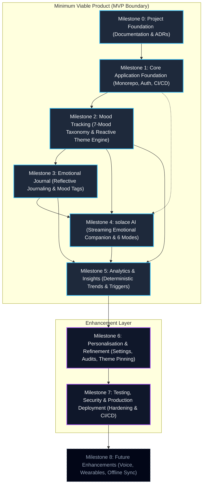
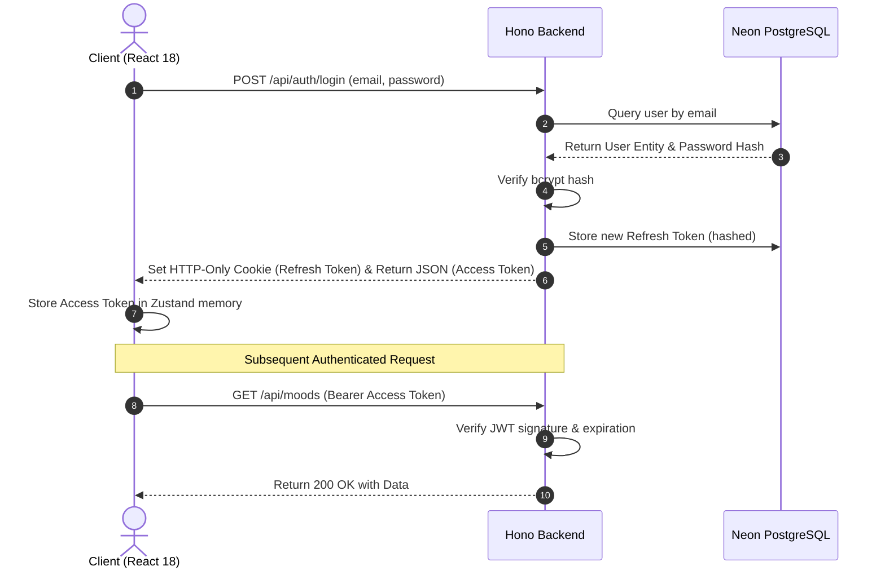
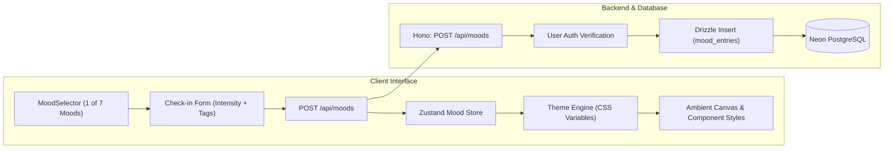
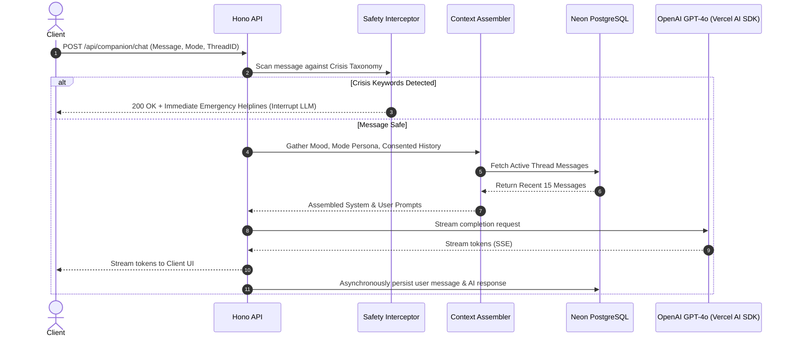
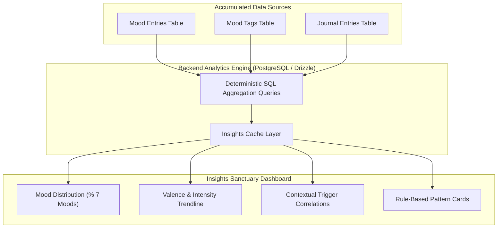
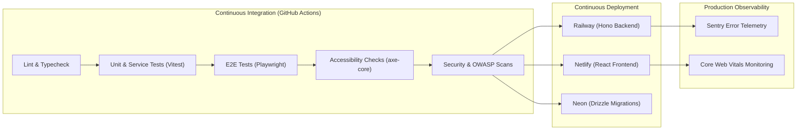

# Roadmap.md: Product Development Roadmap for solace+

> **Document Classification:** Product Delivery & Engineering Lifecycle Roadmap  
> **Platform Version:** 1.0.0  
> **Status:** Authoritative Baseline  
> **Author:** Principal Software Architect & Technical Lead  
> **Target Audience:** Engineering Leads, Product Managers, Frontend/Backend Developers, AI Implementation Agents  
> **Repository Target:** `/Users/jayeshyadav/Projects/Solace+`  

---

## Preamble

This roadmap defines the sequential, dependency-driven engineering plan for **solace+**, an AI-powered emotional wellness and mood tracking platform designed as a private digital sanctuary. The purpose of this document is to establish a rigorous, transparent progression of deliverables that guarantees technical integrity, psychological safety, and architectural stability across the development lifecycle.

The development lifecycle is divided into three distinct operational strata:

1. **The Minimum Viable Product (MVP — Milestones 0 to 5):** The MVP encompasses the irreducible functional core required to make solace+ genuinely useful, emotionally supportive, and demonstrably unique. This includes establishing the monorepo foundation, the full-stack authentication flow, the foundational seven-mood check-in mechanism coupled with the reactive design engine, private reflective journaling, the streaming solace AI companion operating across six distinct regulation modes, and deterministic emotional analytics.
2. **The Enhancement Layer (Milestones 6 to 7):** This phase transforms the functional skeleton into an enterprise-grade, accessible, and resilient production platform. It introduces granular user preferences, deep personalisation, theme pinning, cross-screen responsive audits, comprehensive test suites (unit, component, and end-to-end), OWASP-aligned security hardening, and production infrastructure deployment.
3. **The Future Vision (Milestone 8):** This strategic horizon explores capabilities that extend beyond the core platform—including voice interactions, wearable biometric telemetry, local-first offline synchronisation, and privacy-preserving clinical export conduits.

Crucially, this roadmap strictly rejects arbitrary calendar deadlines and artificial sprint targets. In complex wellness engineering involving non-clinical psychological guidance and generative artificial intelligence, temporal pressure introduces architectural shortcuts and safety compromises. Progression across milestones is governed exclusively by **dependency order** and strict **acceptance criteria**. A milestone is achieved if and only if all technical requirements pass continuous integration, all accessibility standards meet WCAG 2.1 AA thresholds, and the platform satisfies its empirical completion conditions.

---

## MILESTONE 0 — Project Foundation

### Objectives
Establish the complete architectural, design, relational, and procedural foundation of solace+ before authoring any application source code. Ensure that every structural decision, safety constraint, and design token hierarchy is documented, validated, and agreed upon to prevent compounding technical debt during active implementation.

### Deliverables
*   **System Architecture Specification:** Authoritative `Architecture.md` defining system topology, domain boundaries, security models, data lifecycles, and deployment topologies.
*   **Design System & UX Blueprint:** Authoritative `Design.md` establishing the dynamic mood-responsive token system, colour palettes, typography, kinetic motion specs, and screen archetypes.
*   **Technical Implementation Blueprint:** Authoritative `Implementation.md` specifying directory layouts, coding standards, error hierarchies, testing protocols, and dependency trees.
*   **Product Delivery Roadmap:** Authoritative `Roadmap.md` setting forth dependency-driven milestones, deliverables, criteria, and forward horizons.
*   **Development Phase Breakdown:** Authoritative `Phases.md` outlining granular vertical execution steps and task breakdowns.
*   **Technology Stack Finalisation:** Formal lock-in of React 18, Vite, Tailwind CSS v4, Zustand, React Router v6, Recharts, Framer Motion, Node.js, Hono, Neon PostgreSQL, Drizzle ORM, and Vercel AI SDK.
*   **Architectural Decision Records (ADRs):** Comprehensive records justifying technical selections (Hono vs Express, Drizzle vs Prisma, Tailwind v4 CSS variables vs CSS-in-JS).
*   **Mood Theme Token Architecture:** Complete design token matrix mapping all 7 moods (Happy, Calm, Neutral, Sad, Anxious, Angry, Overwhelmed) to surface, primary, border, and ambient variables.
*   **Relational Database Schema:** Complete Drizzle schema specification defining user, mood, journal, AI conversation, and preference entities with strict foreign keys and index strategies.
*   **REST and Streaming API Contracts:** Fully typed TypeScript and OpenAPI-aligned endpoint definitions governing all planned client-server interactions.

### Dependencies
None. This is the greenfield genesis point for the entire solace+ engineering lifecycle.

### Technical Requirements
*   All five core planning documents (`Architecture.md`, `Design.md`, `Implementation.md`, `Roadmap.md`, `Phases.md`) must be mutually consistent regarding entity names, route definitions, token names, and library choices.
*   All architectural decisions must be substantiated with documented trade-off analyses, specifically detailing performance, bundle size, and developer velocity implications.
*   No unresolved architectural questions may remain regarding authentication lifecycle, state management boundaries, AI context assembly, or CSS custom property injection.

### Acceptance Criteria
*   All five foundational planning documents exist in the repository root and are fully approved.
*   Domain terminology (such as the 7-mood taxonomy, the 6 regulation modes, and specific entity attributes) is identical across all documents.
*   The database entity-relationship model exhibits complete referential integrity, explicit cascade rules, and designated foreign key indices.
*   Every planned API route specifies request payloads, query parameters, response envelopes, and standard error formats using Zod schema conventions.
*   The mood token mapping assigns validated hex codes, contrast ratios, and gradient stops for all seven supported moods in light and dark modes, passing WCAG 2.1 AA requirements.

### Potential Risks
*   **Planning Scope Creep:** Over-specifying speculative future features rather than focusing on the MVP foundation.
*   **Underestimating Generative AI Latency:** Failing to architect for streaming Server-Sent Events (SSE) from the outset, risking conversational lag.
*   **Underspecifying Design Tokens:** Incomplete CSS custom property definitions leading to visual glitches or repainting overhead during runtime transitions.
*   **Premature Database Optimisation:** Introducing partitioning or read replicas before establishing core entity access patterns.

### Completion Conditions
The five architectural documents are reviewed and signed off by the lead architect and project owner. Autonomous coding agents or human engineering pairs can commence Milestone 1 without requiring additional architectural clarification.

---

## MILESTONE 1 — Core Application Foundation

### Objectives
Construct a working, testable, and deployable skeleton of the solace+ full-stack platform. Establish the monorepo workspace, spin up the HTTP backend with resilient database connectivity, implement complete end-to-end JWT authentication with token rotation, configure the frontend build pipeline, and establish continuous integration quality gates.

### Deliverables
*   **pnpm Workspaces Monorepo:** Initialised repository containing `apps/web`, `apps/api`, and `packages/shared` with unified dependency management and TypeScript project references.
*   **Frontend Application Skeleton:** Vite + React 18 + TypeScript application in `apps/web` with Tailwind CSS v4, dynamic CSS custom property infrastructure, and React Router v6.
*   **Backend HTTP Service:** Node.js + Hono server in `apps/api` featuring security headers, CORS origin controls, structured error handling middleware, and a `/health` endpoint.
*   **Database Infrastructure:** Serverless Neon PostgreSQL database instance provisioned, Drizzle ORM configured, connection pooling established, and initial migrations applied.
*   **Authentication Subsystem:** Complete authentication endpoints (`POST /api/auth/register`, `POST /api/auth/login`, `POST /api/auth/refresh`, `POST /api/auth/logout`, `GET /api/auth/me`).
*   **Cryptographic Security Layer:** Password hashing using bcrypt with work factor 12, short-lived signed JWT access tokens (15-minute lifespan), and cryptographically random refresh tokens (7-day lifespan).
*   **Token Rotation Mechanism:** Refresh token exchange with automatic token reuse detection and database invalidation.
*   **Frontend Routing & Layouts:** Route protection layer (`ProtectedRoute`, `PublicRoute`), base application layouts (`AppLayout`, `AuthLayout`), and top-level navigation shell.
*   **ThemeProvider Foundation:** Minimal Zustand-driven theme provider injecting default `neutral` theme CSS tokens into the document root.
*   **Continuous Integration Pipeline:** GitHub Actions workflow executing workspace linting (ESLint), type checking (`tsc --noEmit`), and automated integration tests on all pull requests.

### Dependencies
*   Milestone 0 complete (planning baseline, schema designs, and contracts approved).

### Technical Requirements
*   TypeScript strict mode enabled across all packages (`strict: true`, `noImplicitAny: true`, `noUncheckedIndexedAccess: true`).
*   `packages/shared` exports shared Zod validation schemas, TypeScript interfaces, and constant enumerations consumed by both frontend and backend.
*   Refresh tokens must be delivered exclusively via secure, `HttpOnly`, `SameSite=Lax` cookies, with `Secure` enabled in production.
*   Database connection pool configured to gracefully handle serverless sleep states without dropping pending client queries.
*   Integration test suite running against an ephemeral or test database validating registration, login, token expiry, and token rotation.

### Acceptance Criteria
*   A new user can successfully register with a valid email and strong password, receiving an encrypted record in Neon PostgreSQL.
*   An existing user can log in, receive a valid JWT in memory and an HTTP-only refresh cookie, and navigate to protected routes.
*   When an access token expires, the client transparently calls `/api/auth/refresh`, rotates the token pair, and resumes requests without user disruption.
*   Attempting to use an expired or invalidated refresh token revokes all active sessions for that user and redirects to `/login`.
*   Unauthenticated users attempting to access `/dashboard` or `/journal` are immediately redirected to `/login` with an intact return URL.
*   The `/health` endpoint returns `200 OK` with database ping latency and memory telemetry.
*   GitHub Actions CI executes on every push, reporting zero TypeScript errors, zero lint warnings, and passing tests.

### Potential Risks
*   **Serverless Cold Starts:** Neon PostgreSQL connection latency during cold starts causing initial auth request timeouts.
*   **Token Rotation Race Conditions:** Multiple concurrent frontend fetch calls triggering concurrent refresh requests, causing false positive reuse alerts.
*   **Tailwind CSS v4 Integration Breaking Changes:** Differences in the CSS-first `@theme` configuration syntax compared to legacy JavaScript configurations.

### Completion Conditions
The full authentication cycle (register, login, access protected resource, token refresh, logout) functions seamlessly in both local development and a staging preview deployment. CI pipeline is verified green.

---

## MILESTONE 2 — Mood Tracking

### Objectives
Implement the core emotional check-in experience, mood history tracking, and the dynamic mood-responsive visual theme engine. Ensure that logging an affective state immediately modulates the user interface atmosphere, reinforcing emotional presence through aesthetic synchronisation.

### Deliverables
*   **MoodSelector Component:** Accessible, interactive 7-mood selector component showcasing custom expressive SVG icons and semantic labels for Happy, Calm, Neutral, Sad, Anxious, Angry, and Overwhelmed.
*   **MoodIntensitySlider Component:** Smooth, tactile range input supporting granular emotional intensity selection (scaled 1 to 10) with contextual descriptive labels.
*   **Mood Check-in Modal & Form:** Streamlined submission interface allowing users to record primary mood, intensity, contextual trigger tags (e.g., Work, Sleep, Relationships), and an optional free-form note.
*   **Mood Persistence API:** Endpoints `POST /api/moods`, `GET /api/moods` (paginated history), `GET /api/moods/latest`, and `DELETE /api/moods/:id`.
*   **Mood History View:** Paginated timeline presenting historical entries as interactive `MoodCard` components with intensity indicators and contextual tags.
*   **Emotional Calendar Component:** Interactive monthly calendar view displaying daily dominant mood indicators, visual colour dots, and check-in frequency counters.
*   **Mood-Responsive Theme Engine:** Client-side CSS custom property injector translating the user's latest mood into semantic CSS tokens (`--color-surface-bg`, `--color-primary`, `--color-border-subtle`, `--ambient-gradient`).
*   **Dynamic ThemeProvider:** Zustand-backed context provider reading the current mood state, interpolating colour tokens, and managing smooth transitions.
*   **AmbientBackground Component:** Full-screen ambient atmospheric canvas utilising Framer Motion to softly animate gradients and light diffusion corresponding to the active emotional state.
*   **Dashboard Mood Summary Widget:** Prominent homepage card displaying current mood status, time elapsed since last check-in, and a quick-action check-in button.

### Dependencies
*   Milestone 1 complete (working monorepo, authentication, database connection, base layout).

### Technical Requirements
*   Relational tables `mood_entries`, `mood_tags`, and `mood_entry_tags` created via Drizzle migrations with appropriate foreign keys and indices on `(user_id, created_at)`.
*   All mood queries strictly enforce tenancy isolation by including the authenticated `userId` predicate in the SQL `WHERE` clause.
*   Theme transitions must animate smoothly (200ms duration for flat colour tokens, 400ms duration for ambient background gradients) without layout shifts or dropped frames.
*   The `prefers-reduced-motion` media query must be respected; when active, ambient background animations and gradient shifts are replaced with instantaneous, static token updates.
*   Form elements must adhere to accessibility guidelines: keyboard navigability, explicit ARIA role bindings, and screen reader announcements on mood selection.

### Acceptance Criteria
*   A user can complete a comprehensive mood check-in (mood selection, intensity adjustment, tag selection, optional note) in under 60 seconds.
*   Selecting or submitting a mood immediately updates the global CSS custom properties, changing the application background, primary accents, and ambient lighting within 100ms.
*   The mood history view renders the user's past 30 entries in reverse chronological order with accurate intensity bars, contextual tags, and relative timestamps.
*   The monthly Emotional Calendar accurately displays colour-coded dots for every day containing at least one recorded check-in.
*   All seven mood themes render cleanly and pass automated WCAG 2.1 AA contrast audits (minimum 4.5:1 for body copy, 3:1 for large UI components) against their respective surface backgrounds.

### Potential Risks
*   **CSS Variable Repaint Overhead:** Rapid CSS variable updates triggering extensive layout recalculations or GPU thrashing on lower-powered mobile devices.
*   **Colour Contrast Dilemmas:** Maintaining adequate textual contrast against pastel or muted surface backgrounds (specifically under Sad and Overwhelmed themes).
*   **Calendar View Density on Mobile:** Fitting detailed monthly check-in visualisations within constrained 320px mobile viewports.

### Completion Conditions
The mood check-in flow operates flawlessly from UI interaction to Neon persistence, immediately updating the ambient theme engine. Theme contrast passes automated accessibility tests. Component and API integration tests pass green.

---

## MILESTONE 3 — Emotional Journal

### Objectives
Implement the private emotional journaling subsystem. Provide users with a secure, distraction-free environment for expressive writing, featuring mood-tag associations, guided reflection prompts, soft-deletion recovery, and strict privacy isolation.

### Deliverables
*   **Journal List Interface:** Filterable overview displaying existing journal entries as responsive `JournalCard` components showing title, formatted date, preview snippet, word count, and linked mood tags.
*   **Journal Editor Interface:** Distraction-free, responsive writing interface containing:
    *   Title input with auto-growing height.
    *   Styled textarea supporting formatted text entry, automatic expanding scroll, and character/word counter.
    *   Mood selector and tag picker to link the reflection to a specific affective state.
    *   Guided reflection prompt drawer capable of injecting contextual prompts (e.g., "What emotion felt heaviest today?").
*   **Journal Entry CRUD API:** REST endpoints:
    *   `POST /api/journal`: Create new reflection.
    *   `GET /api/journal`: Paginated list of user reflections with search and tag filtering.
    *   `GET /api/journal/:id`: Fetch single entry details.
    *   `PUT /api/journal/:id`: Update existing reflection.
    *   `DELETE /api/journal/:id`: Soft delete reflection.
*   **Soft-Deletion Lifecycle:** Implementation of a `deleted_at` timestamp pattern enabling non-destructive deletion with a 30-day recovery window before permanent purging.
*   **Cross-Domain Mood Linkage:** Relational link associating journal reflections directly with corresponding entries from the `mood_entries` table.
*   **Empathetic Empty State:** Thoughtfully illustrated empty state welcoming users to author their initial reflection with suggested starter questions.
*   **Sanctuary Privacy Notice:** Transparent visual banner outlining client-side privacy, encryption-in-transit, and confirming that reflections are never transmitted to third parties without consent.

> [!NOTE]
> **Architectural Decision on Journal Text Editing (Plain Text vs. Rich Text):**  
> Complex rich text frameworks (such as TipTap or Lexical) introduce significant bundle weight (50–100kB+), AST schema overhead, and mobile input complexities. For the MVP, solace+ adopts a highly styled, accessible markdown-compatible textarea. Rich text WYSIWYG evaluation is explicitly deferred to Milestone 6.

### Dependencies
*   Milestone 2 complete (core mood schema, tag classification, and theme engine active).

### Technical Requirements
*   `journal_entries` table migrated with columns: `id`, `user_id`, `mood_entry_id`, `title`, `content`, `word_count`, `created_at`, `updated_at`, `deleted_at`.
*   All journal API queries must enforce tenant isolation via `WHERE user_id = :currentUserId AND deleted_at IS NULL`.
*   Real-time client-side calculation of word count and estimated reading time.
*   Guided reflection prompts dynamically suggested based on the user's currently active mood theme.
*   Soft-deleted records are automatically excluded from all standard user-facing queries and analytics aggregations.

### Acceptance Criteria
*   A user can draft, format, save, and edit a reflective journal entry without experiencing input latency or lost keystrokes.
*   Journal entries can be tagged with one or more moods, correctly linking them to the user's emotional timeline.
*   Deleting an entry removes it immediately from the journal list and search index while preserving the database row with a populated `deleted_at` timestamp.
*   If a user pauses on an empty editor for longer than 5 seconds, an optional, non-intrusive prompt appears offering an introspective question.
*   Filtering the journal list by a specific mood tag updates the displayed collection within 150ms.
*   Direct API queries verifying that User A cannot retrieve, update, or soft-delete journal entries belonging to User B under any circumstances.

### Potential Risks
*   **Editor Decision Regret:** Users demanding immediate rich-text formatting (bold, italic, bullet lists) prior to Milestone 6.
*   **Large Payload Storage:** Excessive text size in unconstrained entries bloating database storage or network payload sizes.
*   **Intrusive Prompt Ergonomics:** Guided reflection prompts interrupting active writing flow if trigger timers or dismiss mechanisms are poorly calibrated.

### Completion Conditions
Full CRUD lifecycle for journal entries is operational and covered by integration tests. Data tenancy isolation is cryptographically and procedurally verified. UI conforms to the active mood theme.

---

## MILESTONE 4 — solace AI

### Objectives
Integrate the platform's non-clinical emotional companion ("solace AI"). Provide empathetic, context-aware, low-latency conversational support across six distinct regulation modes, backed by streaming Server-Sent Events, prompt injection safety guardrails, crisis intervention detection, and strict user consent protocols.

### Deliverables
*   **AI Provider Abstraction Layer:** Decoupled LLM gateway implemented via Vercel AI SDK, abstracting OpenAI GPT-4o with fallback capabilities and configurable token temperature.
*   **System Prompt Construction Engine:** Dynamic prompt assembly pipeline injecting non-clinical persona directives, safety boundaries, and the six regulation mode profiles.
*   **Context Assembly Service:** Intelligent context harvester gathering the user's current mood, recent intensity trends, and explicit user-consented journal summaries.
*   **Conversational Persistence Infrastructure:** Relational schema supporting conversations and individual messages (`ai_conversations`, `ai_messages`).
*   **Low-Latency Streaming Endpoint:** Server-Sent Events (SSE) route (`POST /api/companion/chat`) delivering streaming tokens directly to the client interface.
*   **Full Chat Sanctuary UI:** Immersive, responsive conversational interface featuring typing indicators, smooth message autoscroll, token streaming animations, and mode badges.
*   **RegulationModeSelector Component:** Prominent mode switcher enabling users to select between the six defined regulation postures:
    1.  **LISTEN:** Silent holding space, gentle validation, minimal conversational intervention.
    2.  **UNDERSTAND:** Cognitive clarity, exploratory questioning, identifying root emotions.
    3.  **CALM:** Somatic de-escalation, paced breathwork cues, nervous system down-regulation.
    4.  **REFLECT:** Socratic journaling companion, pattern mirroring, thoughtful contemplation.
    5.  **REFOCUS:** Gentle behavioural activation, micro-steps, moving beyond rumination.
    6.  **GRATITUDE:** Perspective widening, somatic appreciation, anchoring positive affect.
*   **Contextual Suggested Prompts:** Curated quick-reply prompt pills tailored specifically to each of the six regulation modes.
*   **Conversation History Drawer:** Accessible sidebar allowing users to review, rename, or delete past conversational threads.
*   **Automated Crisis Detection System:** Real-time multi-tier keyword and intent interceptor checking incoming messages for self-harm or crisis indicators.
*   **Emergency Resource Routing:** Deterministic client modal overlay displaying international crisis helplines, emergency numbers, and compassionate grounding copy when safety filters trigger.
*   **Rate Limiting & Quota Management:** Per-user message governor enforcing a fair-use quota of 50 messages per day with real-time UI quota indicators.
*   **Conversational Context Summarisation:** Automated background job triggered at 30 messages in a thread, condensing dialogue history to keep token usage within safe context windows.
*   **Personalisation Consent Gate:** Explicit, granular opt-in modal ensuring AI context assembly never accesses journal text without unambiguous user approval.

### Dependencies
*   Milestone 1 complete (authentication, base API).
*   Milestone 2 complete (mood engine providing real-time emotional state to the context assembler).
*   Milestone 3 complete (journal subsystem supplying opt-in reflective context).

### Technical Requirements
*   Database tables `ai_conversations` and `ai_messages` migrated with foreign keys linked to `users`.
*   Streaming endpoint must achieve a Time-to-First-Token (TTFB) of under 600ms on broadband connections.
*   Crisis interceptor must execute deterministically in memory *before* dispatching any payload to external model APIs.
*   Under no circumstances may raw, unredacted journal entries be passed to the system prompt unless `ai_personalisation_consent` is explicitly `true` in user preferences.
*   Token usage, model latency, and rate-limit counters must be logged asynchronously without blocking the client response stream.
*   Exceeding the 50 messages/day threshold must return an HTTP 429 status code accompanied by a compassionate explanation and countdown timer.

### Acceptance Criteria
*   A user can start an AI conversation, send a message, and observe streaming text rendering word-by-word within 600ms.
*   The conversational tone distinctly adapts when switching between modes (e.g., CALM offers short, rhythmic grounding sentences, whereas REFLECT offers exploratory Socratic questions).
*   The opening message of a new conversation acknowledges the user's active mood state when available.
*   Entering known crisis test phrases (e.g., explicit self-harm statements) immediately halts LLM dispatch and displays the Crisis Support Modal with operable helpline links.
*   Conversational history persists accurately across page refreshes and browser sessions.
*   When the daily quota of 50 messages is exhausted, the interface gracefully disables the input field and displays an empathetic reset notice.

### Potential Risks
*   **OpenAI API Cost Overruns:** Runaway token consumption caused by excessively long conversation histories or runaway user traffic.
*   **Streaming Connection Drops:** Interrupted SSE streams on unstable mobile networks leaving user interfaces in a hanging state.
*   **False-Positive Safety Interceptions:** Overly broad keyword matching erroneously flagging benign emotional venting as clinical crises.
*   **Context Inflation Latency:** Excessive database queries during context assembly introducing latency before token streaming begins.

### Completion Conditions
The AI companion functions reliably across all six regulation modes. Token streaming works seamlessly across desktop and mobile browsers. Safety intercepts trigger accurately with 100% reliability on test suites. Rate limiting is verified.

---

## MILESTONE 5 — Analytics and Insights

### Objectives
Transform logged affective check-ins and regulation activities into actionable, self-reflective visualisations. Deliver deterministic trend visualisations, trigger correlations, and objective behavioural observations without clinical diagnostic claims.

### Deliverables
*   **Insights Sanctuary Dashboard:** Dedicated analytics page organising emotional patterns into digestible visual cards.
*   **Mood Distribution Visualisation:** Recharts-powered BarChart illustrating the percentage breakdown across the 7 mood categories over selected timeframes.
*   **Mood Trend & Valence Graph:** Smooth LineChart tracking emotional intensity and valence over time, displaying moving averages to smooth daily volatility.
*   **Interactive Emotional Calendar:** Enhanced calendar view enabling deep historical inspection, daily multi-check-in drill-downs, and journal linkage indicators.
*   **Trigger & Context Correlation Matrix:** Algorithmic breakdown highlighting the most frequent situational tags associated with high-stress affective states (Sad, Anxious, Angry, Overwhelmed).
*   **Activity Effectiveness Index:** Performance metrics comparing user-reported helpfulness scores across regulation activities (e.g., identifying whether Box Breathing or Grounding produced superior de-escalation).
*   **Deterministic Personal Insight Cards:** Rule-based observation engines generating non-clinical insights based on empirical data (e.g., "You frequently record elevated anxiety on Sunday evenings when Work is tagged").
*   **Temporal Scope Selector:** Global temporal filter toggle supporting 7-day, 30-day, 90-day, and all-time analytical views.
*   **Data Sufficiency Empty States:** Graceful, encouraging empty states explaining that statistical insights require a minimum threshold of data (e.g., at least 7 check-ins across 5 discrete days).

### Dependencies
*   Milestone 2 complete (historical mood records and intensity metrics).
*   Milestone 3 complete (journal tags and contextual linkages).
*   Milestone 4 complete (regulation session outcomes and activity logs).

### Technical Requirements
*   Database migrations establishing the `personal_insights` table for caching generated patterns.
*   Analytics calculations must execute via optimised relational SQL aggregations (`COUNT`, `AVG`, `GROUP BY`) rather than fetching raw datasets into Node.js application memory.
*   Database indices verified on `(user_id, created_at)` across all source tables to ensure query execution times remain under 200ms for annual datasets.
*   Visual charts must be fully responsive, maintaining readability from 320px mobile screens up to 4K displays.
*   Chart visualisations must be accessible: incorporating distinct patterns alongside colours, providing accessible data tables for screen readers, and passing contrast audits.

### Acceptance Criteria
*   The analytics dashboard loads all visualisations in under 1.5 seconds for a user dataset containing 365 entries.
*   Toggling between 7-day, 30-day, and 90-day filters dynamically updates all charts simultaneously without layout snapping.
*   The Trigger Analysis card correctly isolates and ranks the top 3 tags correlated with negative emotional entries.
*   Personal Insight Cards present strictly factual, verifiable observations derived from recorded data, containing zero synthetic AI hallucinations or diagnostic claims.
*   Users with fewer than 7 entries are presented with an empathetic progress bar indicating how many check-ins remain before insights unlock.

### Potential Risks
*   **Early User Disappointment:** Users feeling unrewarded during their first week due to insufficient data for visualisations.
*   **Misleading Correlation Interpretations:** Users mistaking situational correlations for medical or psychological causation.
*   **Performance Degradation on Large Datasets:** Unindexed join operations between mood entries and tag associations degrading backend performance.

### Completion Conditions
All five analytical visualisations render accurately against real database seeds. Aggregation queries execute under 200ms. Screen reader accessibility is verified. The MVP feature boundary is achieved.

---

## MILESTONE 6 — Personalisation and Refinement

### Objectives
Elevate the validated MVP into an adaptable, accessible, and refined digital sanctuary. Expand user preference controls, implement theme pinning overrides, conduct complete design audits across all 15 screens, and provide comprehensive data export capabilities in compliance with data privacy principles.

### Deliverables
*   **Comprehensive Settings Sanctuary:** Centralised user control centre organised into logical sections:
    *   **Account:** Email management, password rotation, active session revocation.
    *   **Sanctuary Theme Preferences:** Manual theme pinning (locking the visual theme to a preferred mood, e.g., permanently Calm, overriding dynamic shifts).
    *   **Mindful Notification Controls:** Browser-based check-in reminders with configurable notification windows.
    *   **AI Companion Configuration:** Personalisation consent toggles, memory management, regulation mode defaults.
    *   **Data Sovereignty:** Comprehensive JSON data export and account deletion.
*   **Theme Pinning Override System:** State architecture update allowing users to disengage dynamic ambient shifts and anchor the interface to their chosen palette.
*   **Gentle Notification Subsystem:** Web Notifications API integration providing gentle, non-coercive reminder prompts at user-selected times.
*   **Journal Editor Upgrade Evaluation:** Formal engineering spike evaluating the integration of TipTap for lightweight formatting (bold, italic, lists) without compromising bundle size.
*   **Onboarding Flow Refinement:** Interactive 3-step introductory walkthrough introducing the sanctuary concept, setting initial theme preferences, and completing a maiden check-in.
*   **Complete Data Sovereignty Engine:** Export utility assembling all user data (profile, moods, journals, AI chats, insights) into an encrypted, portable JSON archive.
*   **15-Screen Design Audit & Polish:** Systematic UX refinement pass across every platform screen against the Design Acceptance Criteria established in `Design.md`.
*   **Automated Accessibility Remediation:** Comprehensive audit eliminating all WCAG 2.1 AA violations, verifying focus rings, keyboard traps, and ARIA roles.
*   **Frontend Performance Optimisation:** Code-splitting with `React.lazy`, route-based dynamic imports, and SVG asset optimisation reducing initial bundle size to under 200kB gzip.

### Dependencies
*   Milestones 0 through 5 complete (all MVP features fully functional).

### Technical Requirements
*   `user_preferences` table fully integrated with backend endpoints (`GET /api/preferences`, `PATCH /api/preferences`).
*   Client preferences synchronised deterministically between Zustand and persistent database storage.
*   Data export service must compile complete relational trees into structured JSON within 3 seconds for standard user accounts.
*   Browser notification triggers must request permissions politely, explaining the sanctuary purpose before triggering system dialogs.
*   Zero critical accessibility violations detected by automated axe-core scanning engines.

### Acceptance Criteria
*   A user can permanently pin the "Calm" or "Neutral" theme from Settings, and the UI remains anchored to that palette even after logging an "Angry" mood.
*   Clicking "Export My Data" downloads a valid, formatted JSON file containing all historical moods, reflections, and chat messages within 3 seconds.
*   Account deletion completely wipes all associated rows across all tables in accordance with cascading database foreign keys.
*   All 15 application screens pass the Design Acceptance Criteria checklist from `Design.md`.
*   Initial JavaScript bundle size remains under 200kB gzipped, verified via Vite visualizer build output.

### Potential Risks
*   **TipTap Bloat:** Introducing TipTap rich text editor introducing heavy AST dependencies that breach the 200kB bundle budget.
*   **Notification Permission Friction:** Users rejecting browser notification permissions due to intrusive browser permission dialogs.
*   **Scope Creep in Settings:** Over-complicating preference configurations, creating cognitive burden for the user.

### Completion Conditions
All preference controls are persistent and reactive. Full data export and account purging are verified. Accessibility audit achieves 100% compliance on automated tools. Visual refinement approved across all screens.

---

## MILESTONE 7 — Testing, Security and Production Deployment

### Objectives
Harden the entire solace+ architecture against security vulnerabilities, edge-case failures, and operational downtime. Establish automated test coverage across all layers, deploy to production infrastructure (Netlify, Railway, Neon), configure telemetry, and launch the platform.

### Deliverables
*   **Automated Unit & Service Test Suite:** Vitest test suite achieving ≥80% code coverage across all backend domain services, utility libraries, and business invariants.
*   **Component Test Suite:** React Testing Library suite covering all 19 reusable UI components, verifying accessible rendering, prop transitions, and event dispatches.
*   **End-to-End Test Suite:** Playwright test automation suite verifying the 5 critical user journeys:
    1.  Registration, Onboarding, and Initial Theme Hydration.
    2.  Mood Check-in, Dynamic Theme Transition, and Calendar Verification.
    3.  Journal Drafting, Reflection Prompt Insertion, Tagging, and Soft Deletion.
    4.  solace AI Conversation Streaming, Mode Switching, and Crisis Intercept Trigger.
    5.  Settings Customisation, Theme Pinning, and Data Export.
*   **Automated Accessibility Test Pipeline:** axe-core integration within Playwright asserting zero WCAG 2.1 AA violations on all deployed routes.
*   **OWASP Security Hardening:** Comprehensive audit covering CSRF prevention, SQL injection validation, XSS prevention, rate-limit stress tests, and HTTP security headers (CSP, HSTS, X-Frame-Options).
*   **Production Cloud Infrastructure:**
    *   **Frontend:** Deployed to Netlify CDN with automated edge caching and Brotli compression.
    *   **Backend:** Deployed to Railway container runtime with automated restart policies and environment secret injection.
    *   **Database:** Neon Serverless PostgreSQL production branch with autoscaling and connection poolers active.
*   **Operational Monitoring & Error Logging:** Sentry error monitoring configured for frontend and backend, with strict personal data redaction rules enabled.
*   **Core Web Vitals Telemetry:** Real User Monitoring (RUM) tracking Largest Contentful Paint (LCP), Interaction to Next Paint (INP), and Cumulative Layout Shift (CLS).
*   **Automated Production Deployment Pipeline:** GitHub Actions continuous deployment pipeline triggering automated tests, database migrations, and zero-downtime deployments on merges to `main`.
*   **Production Contributor Documentation:** Complete `README.md` and operational runbooks documenting local onboarding, environment variables, and disaster recovery procedures.

### Dependencies
*   Milestones 0 through 6 complete (all application features built, refined, and audited).

### Technical Requirements
*   Service layer unit test coverage must equal or exceed 80% line and branch coverage.
*   Strict Content Security Policy (CSP) headers applied, prohibiting unsafe inline scripts and untrusted remote connections.
*   All environment secrets (database connection strings, JWT signing keys, OpenAI API keys) encrypted in Railway and Netlify secret managers.
*   Production database migrations must execute automatically prior to application boot, wrapped in atomic transactions.
*   Core Web Vitals targets: LCP < 2.0s, INP < 100ms, CLS < 0.05 on standard mobile network throttles.

### Acceptance Criteria
*   Every pull request automatically executes linting, typechecking, Vitest suites, and Playwright tests in CI without manual intervention.
*   Production deployment pipeline deploys new merges to `main` within 5 minutes without service interruption or database connection drops.
*   Core Web Vitals in production consistently report: LCP < 2.5s, FID/INP < 100ms, CLS < 0.1.
*   Independent automated security vulnerability scan reports zero High or Critical vulnerabilities.
*   Attempting to access production endpoints with malformed JWTs, expired credentials, or missing headers safely rejects with structured 401/403 responses.
*   Sentry intercepts and reports runtime exceptions while completely scrubbing user emails, journal content, and message texts from stack traces.

### Potential Risks
*   **Cold Start Latency in Railway:** Railway container spin-up times creating initial request latency if containers idle.
*   **Database Migration Locking:** Complex Drizzle migrations acquiring table locks during active user traffic.
*   **Overly Restrictive CSP:** Content Security Policies inadvertently blocking valid OpenAI streaming endpoints or web fonts.

### Completion Conditions
The application is live in production. All automated test suites report green. Security audit passes. Production telemetry is operational. solace+ is formally launched.

---

## MILESTONE 8 — Future Enhancements

Milestone 8 looks beyond the initial production release, articulating architectural and product capabilities that deepen the sanctuary experience. Each prospective enhancement is evaluated for user value, technical complexity, dependency prerequisites, and classified as either **MVP-Adjacent** (high-priority near-term candidate) or **Genuinely Long-Term** (strategic future evolution).

### 1. Voice Input for Journal and AI Chat
*   **Description:** Implement hands-free verbal dictation for reflective journaling and conversational AI chat using the native Web Speech API and optional Whisper API transcription.
*   **Rationale:** Users experiencing acute emotional distress (such as severe anxiety or overwhelming sadness) frequently find typing on a keyboard or mobile glass screen cognitively demanding. Voice input provides a lower-friction conduit for emotional expression.
*   **Complexity Estimate:** Medium.
*   **Dependencies:** Milestone 3 (Journal), Milestone 4 (solace AI), modern browser microphone permissions.
*   **Classification:** **MVP-Adjacent.** (High-value usability enhancement that builds directly upon existing input models).

### 2. Advanced Emotional Pattern Visualisation
*   **Description:** Introduce multi-dimensional emotional visualisations, including annual mood heatmaps (GitHub-style calendar punchcards), circadian mood distribution clocks, and statistical correlation matrices between sleep/work tags and affective intensity.
*   **Rationale:** Longitudinal users who have accumulated 6+ months of records benefit from deeper macro-level visualisations of emotional rhythms across seasons, working quarters, and life events.
*   **Complexity Estimate:** Medium.
*   **Dependencies:** Milestone 5 (Analytics & Insights), large longitudinal user datasets (>180 entries).
*   **Classification:** **MVP-Adjacent.** (Extends existing Recharts infrastructure with richer data aggregation models).

### 3. Mobile Application (React Native / Expo)
*   **Description:** Develop dedicated iOS and Android native mobile clients sharing core TypeScript types, Zod schemas, and Zustand state business logic with the web monorepo.
*   **Rationale:** While the responsive web app functions well on mobile viewports, native mobile applications unlock lock-screen widgets, tactile haptic feedback for breathwork exercises, and seamless biometric authentication.
*   **Complexity Estimate:** High.
*   **Dependencies:** Milestone 1 through 7 complete, stable backend REST and SSE streaming endpoints.
*   **Classification:** **Genuinely Long-Term.** (Requires mobile build pipelines, Apple App Store / Google Play Store compliance, and dedicated mobile UI styling).

### 4. Wearable Integration (Apple HealthKit & Google Health Connect)
*   **Description:** Bi-directional synchronisation with wearable devices to import passive biometric markers (Heart Rate Variability, resting heart rate, sleep duration, physical activity) and correlate them with self-reported affective states.
*   **Rationale:** Somatic physiological states directly influence emotional affect. A user logging "Anxious" after 4 hours of fragmented sleep and an elevated resting heart rate receives deeper context on the physical underpinnings of their mood.
*   **Complexity Estimate:** High.
*   **Dependencies:** Native Mobile App (Enhancement 3), HealthKit/Health Connect developer entitlements, strict HIPAA/GDPR health data consent architecture.
*   **Classification:** **Genuinely Long-Term.** (Entails stringent regulatory hurdles, biometric storage architectures, and native mobile dependencies).

### 5. Offline Mode with Local-First Synchronisation
*   **Description:** Implement local-first data architecture using client-side embedded databases (such as PGlite or OPFS-backed SQLite) paired with background conflict-free replicated data types (CRDTs) for seamless offline check-ins and journaling.
*   **Rationale:** Emotional moments occur in aeroplanes, remote retreats, and subway commutes where internet connectivity is absent. Users must never be locked out of their emotional sanctuary due to network disconnections.
*   **Complexity Estimate:** High.
*   **Dependencies:** Milestone 2 (Mood), Milestone 3 (Journal), Service Worker infrastructure.
*   **Classification:** **Genuinely Long-Term.** (Substantial architectural pivot from centralised client-server REST to distributed local-first synchronization).

### 6. Multi-Language Support (Internationalisation / i18n)
*   **Description:** Complete localization of the interface, mood taxonomy, guided reflection prompts, and AI companion system prompts into major global languages (e.g., Spanish, French, German, Japanese, Hindi).
*   **Rationale:** Emotional vocabulary is deeply culturally and linguistically nuanced. Non-English speakers require emotional concepts that resonate authentically within their native cultural context.
*   **Complexity Estimate:** Medium.
*   **Dependencies:** Stable frontend UI copy, `i18next` integration, multilingual AI system prompt evaluation.
*   **Classification:** **MVP-Adjacent.** (Straightforward technical implementation, high impact on global user accessibility).

### 7. Therapist & Wellness Coach Sharing Mode
*   **Description:** A privacy-respecting export and collaboration portal allowing users to generate secure, time-limited, password-protected read-only links for their licensed therapists, containing curated emotional trend summaries without sharing raw private journal entries.
*   **Rationale:** Psychotherapy clients frequently struggle to recall their emotional states between weekly or fortnightly sessions ("recall bias"). Concise, empirical summaries bridge the communication gap between client and clinician.
*   **Complexity Estimate:** Medium.
*   **Dependencies:** Milestone 5 (Analytics), cryptographic token-based sharing engine, granular permission boundaries.
*   **Classification:** **MVP-Adjacent.** (Extends data sovereignty models to support external mental health practitioners safely).

### 8. Community Features (Anonymised Mood Weather)
*   **Description:** Aggregate, privacy-preserving "Global Emotional Weather" visualisation displaying anonymised emotional distributions across the collective userbase without exposing individual identities, notes, or locations.
*   **Rationale:** Seeing that thousands of other people are also experiencing anxiety, loneliness, or exhaustion normalises difficult feelings and alleviates the isolating sensation that one is suffering alone.
*   **Complexity Estimate:** Medium.
*   **Dependencies:** Milestone 2 (Mood), privacy-preserving differential aggregation background workers, sufficient active user scale (>1,000 daily check-ins).
*   **Classification:** **Genuinely Long-Term.** (Requires significant active user scale and differential privacy protections to prevent deanonymisation).

### 9. Advanced AI Longitudinal Memory
*   **Description:** Construct a persistent, opt-in, privacy-preserving semantic user model that allows solace AI to recall recurring themes, personal growth goals, and past breakthroughs across weeks and months of interaction.
*   **Rationale:** Conversations with human companions deepen over time because memory persists. An AI companion that remembers a user's ongoing struggle with family boundaries or creative projects provides significantly richer companionship.
*   **Complexity Estimate:** High.
*   **Dependencies:** Milestone 4 (solace AI), vector database storage (e.g., pgvector), transparent memory inspection and deletion UI.
*   **Classification:** **Genuinely Long-Term.** (Requires advanced vector retrieval architectures, memory compaction algorithms, and strict ethical controls).

### 10. Peer Support Groups (Moderated & Evidence-Based)
*   **Description:** Small, structured, asynchronous micro-groups (5–8 participants) focused on shared emotional objectives (e.g., grief processing, burnout recovery, mindful parenting) facilitated by automated reflection prompts and human/AI moderation.
*   **Rationale:** While introspective solitary wellness is powerful, communal validation and peer empathy provide distinct social-emotional healing mechanisms.
*   **Complexity Estimate:** High.
*   **Dependencies:** Real-time messaging infrastructure, user profiles, automated content moderation, reporting workflows, community guidelines.
*   **Classification:** **Genuinely Long-Term.** (Transforms solace+ from an introspective private sanctuary into a social platform, introducing significant moderation overhead).

---

## Roadmap Summary Table

The following table provides a concise, high-level summary of all nine engineering milestones governing the delivery of solace+.

| Milestone | Name | Key Deliverables (3 Max) | Blocking Dependencies | MVP? | Status |
| :--- | :--- | :--- | :--- | :--- | :--- |
| **0** | **Project Foundation** | 1. 5 Authoritative Planning Documents 2. ADRs & Architecture Decisions 3. Relational Schema & Design Tokens | None (Greenfield Starting Point) | **Yes** | Approved |
| **1** | **Core Application Foundation** | 1. pnpm Monorepo (Vite + Hono + Neon) 2. Full JWT Auth & Token Rotation 3. CI/CD Lint & Test Pipeline | Milestone 0 | **Yes** | Ready |
| **2** | **Mood Tracking** | 1. 7-Mood Check-in & Slider Form 2. Mood-Responsive Dynamic Theme Engine 3. Monthly Emotional Calendar | Milestone 1 | **Yes** | Planned |
| **3** | **Emotional Journal** | 1. Filterable Journal List & Card View 2. Reflection Editor & Guided Prompts 3. Soft Deletion & Mood Tag Linkage | Milestone 2 | **Yes** | Planned |
| **4** | **solace AI** | 1. SSE Streaming Companion (Vercel AI SDK) 2. 6 Regulation Modes with UI Selectors 3. Real-time Crisis Detection & Safety Modal | Milestones 1, 2, 3 | **Yes** | Planned |
| **5** | **Analytics & Insights** | 1. Recharts Trend & Distribution Charts 2. Situational Trigger Correlation Matrix 3. Rule-Based Personal Insight Cards | Milestones 2, 3, 4 | **Yes** | Planned |
| **6** | **Personalisation & Refinement** | 1. Comprehensive Settings & Theme Pinning 2. Complete JSON Data Export Utility 3. 15-Screen Design & A11y Polish | Milestones 2, 3, 4, 5 | **No** | Planned |
| **7** | **Testing, Security & Production Deployment** | 1. Comprehensive Test Suites (Vitest + Playwright) 2. Production Deploy (Netlify + Railway + Neon) 3. OWASP Hardening & Monitoring Setup | Milestones 0, 1, 2, 3, 4, 5, 6 | **No** | Planned |
| **8** | **Future Enhancements** | 1. Voice Dictation & Pattern Heatmaps 2. Native Mobile Apps & Wearable Health Sync 3. Local-First Offline Mode & AI Memory | Milestone 7 | **No** | Visionary |

---

*End of Roadmap.md — Authorised for Implementation by Technical Leadership.*
